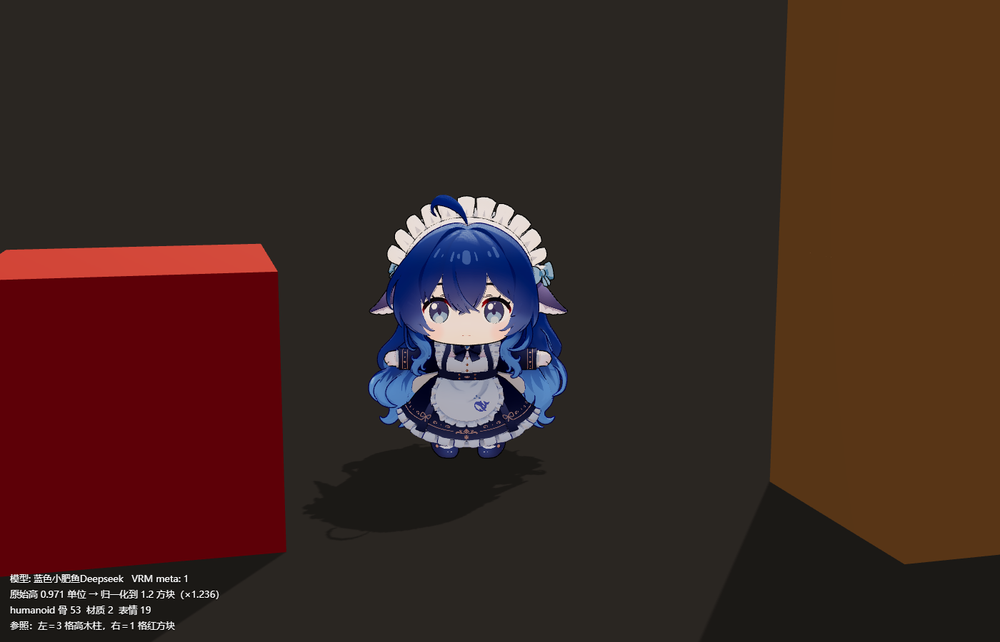

# 方寸 · Fangcun

> **在真实桌面上，出现一个 Minecraft 风格的微缩世界；你用手机摄像头看着它，用手指和 AI 角色一起建造。**

一句话定位：**AR 桌面微缩沙盒**（tabletop AR sandbox）——不是 PC 游戏、不是投屏、不是 VR。

```
        ☁  真实桌面背景（虚焦）
   ┌──────────────────────────────┐
   │   🌳                         │
   │  🏠  敞口木板房              │
   │ 🧰 ▓TNT        ⛏ 钻石镐      │
   │ ████████████████  ~1.2 格的角色站在这
   │ ══════════════   接触阴影     │
   └──────────────────────────────┘
        手机 = AR 取景器 + 输入设备
```

---

## 现在该读哪份文件

| 你想… | 读 |
|---|---|
| **马上开始写代码** | **[docs/DEV.md](docs/DEV.md)** —— 架构、接口契约、角色模型规格、里程碑、ADR（**先读这一份**） |
| 看我们自己渲染出来的第一版 | [docs/m0-final.png](docs/m0-final.png)（可复跑：`cd preview && npm i && node shot.mjs`） |
| 看完整调研结论与选型理由 | [REPORT.md](REPORT.md) |
| 看调查计划原文 | [PLAN.md](PLAN.md) |
| 看某一专项的原始报告 | [reports/](reports/) 下的 `report-a…i` + 审阅报告 |

## 两条产品铁律

1. **世界里只有一个角色**（默认大肥鱼），但角色是**可选、可替换**的（`vrm → glb → billboard8 → 胶囊` 降级链）。
2. **玩家本人不出现在世界里** —— 没有玩家化身/皮肤/身体。玩家是"上帝之手"：手指点哪就在哪放/拆。

## 视觉参考图（**不在仓库内**）

`效果图/1.png`、`2.png`、`3.png` 是**AI 视频生成的帧**，带第三方平台水印，因此**不随仓库分发**，由项目负责人单独提供到本地 `效果图/` 目录（已在 `.gitignore` 中）。

> 它们只作**感觉参考**，不是规格：同一段视频里角色数量/身高/位置都在变（生成模型的一致性缺陷）。
> **采其"感觉"，不采其"数字"** —— 详见 [docs/DEV.md](docs/DEV.md) §1.1。

## 角色模型（当前使用）

### 蓝色小肥鱼 Deepseek 鲸鱼娘 VRM



| | |
|---|---|
| **模型名** | 蓝色小肥鱼 Deepseek 鲸鱼娘 |
| **作者** | **木子恶魔 / MZEM** ｜ B站 <https://space.bilibili.com/95816706> |
| **发布页** | <https://www.aplaybox.com/details/model/ayXkRzVflmnd>（模之屋 Aplaybox） |
| **格式** | VRM 1.0（Blender VRM Add-on 4.5.0 导出）｜17.6 MB |
| **许可** | **个人非商业使用**；**必须署名**；**禁止二次配布**；禁止商用；禁止拆取素材 |

> ⚠️ **本仓库不包含该模型文件**（`.gitignore` 已排除 `*.vrm` / `*.zip`）。
> 原因：作者声明**禁止二次配布**（不得以任何形式上传/转发/分享模型文件）。仓库里的转发也算。
> **开发者自行下载** → 放到 `preview/assets/_user_bluefatfish.vrm`（本地渲染测试用）或
> `%APPDATA%\AR-MC\characters\bluefatfish\`（运行时用）。步骤见 [docs/DEV.md](docs/DEV.md) §8.12。

### 实测规格（我们自己的渲染 + GLB 解析，2026-11-16）

| 项 | 值 | 对产品的含义 |
|---|---|---|
| 三角面 | **45,663**（34,873 顶点 / 6 网格） | 开描边后 ≈ 87k 提交三角 → **超出手机预算（≤72k）**，需降面或只在近景开描边 |
| 材质 | **6 个，全 MToon** | 目标 ≤4；可合并 |
| 贴图 | **8 张**，其中 5 张 2048²；原始 13.76 MB，RGBA 显存 ≈ **90 MB** | **必须运行时降采样到 1024²**（≈22 MB）。注意：降采样只改内存，**不改文件** |
| 骨骼 | humanoid **53** 根 + **尾巴 13 根**（`WeiBa.*`） | 尾巴可做物理摆动 |
| 弹簧链 | **22 条 / 91 关节**（呆毛、刘海、发鬓、耳朵、后发、尾巴） | 约 0.1 ms/帧，可接受 |
| 表情 | **19 个**（含全部 VRM 预设 + 自定义 `TiePen`） | 说话口型/眨眼都有 |
| 动画 | **0** | 只能程序化（idle/走/尾摆） |
| 原始高 | 0.971 单位 → 归一化 ×1.236 到 **1.2 方块** | 与「1 格多一点」的口径一致 |

### 两个已知问题（待处理）

1. **描边没有自动出现** —— `@pixiv/three-vrm` 只读 MToon 的描边参数，**不会生成描边网格**。要接近效果图那种"粗描边赛璐璐"，必须自己做背面法线膨胀（或 outline pass）。见 [docs/DEV.md](docs/DEV.md) §8.10。
2. **一只眼睛偏红** —— 正面渲染时左眼为红/粉色，参考图里是双眼蓝。需确认是模型设计（异色瞳）还是贴图/材质路径问题，**确认前不要当作 bug 改**。


## 目录

```
fangcun/
├─ docs/DEV.md            开发文档（先读这个）
├─ docs/m0-final.png      M0 渲染结果
├─ preview/               M0 可跑原型（three.js，零美术资源）
├─ REPORT.md              调研总报告
├─ PLAN.md                调查计划
└─ reports/               子报告 a–i + 对抗性审阅
```

## 快速开始

```bash
cd preview
npm install
node shot.mjs        # 用 headless Chrome 渲染一帧 → preview/m0.png
```

> 工程骨架（`packages/voxel-core` / `worldd` / `client`）**尚未搭建**，见 DEV.md 附录 B 的 30 分钟脚手架清单。

## 尚未决定的事

- 开源还是闭源、用什么许可（当前仓库为 private，无 LICENSE）
- 正式角色美术：VRoid 自捏 / 外包定制 / 用户自选
- **占位模型 `preview/assets/RobotExpressive.glb` 来自 three.js 官方示例，仅用于开发，不得随产品发布**
