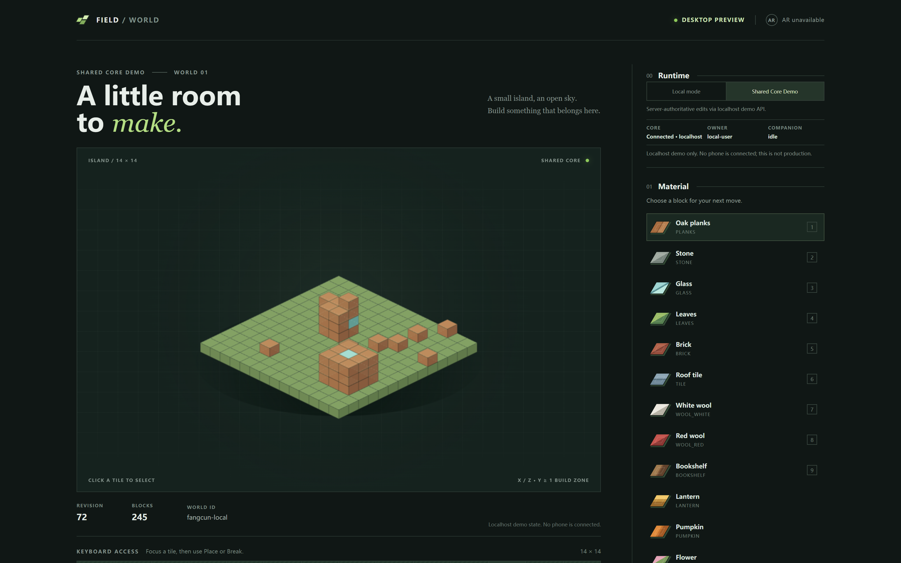
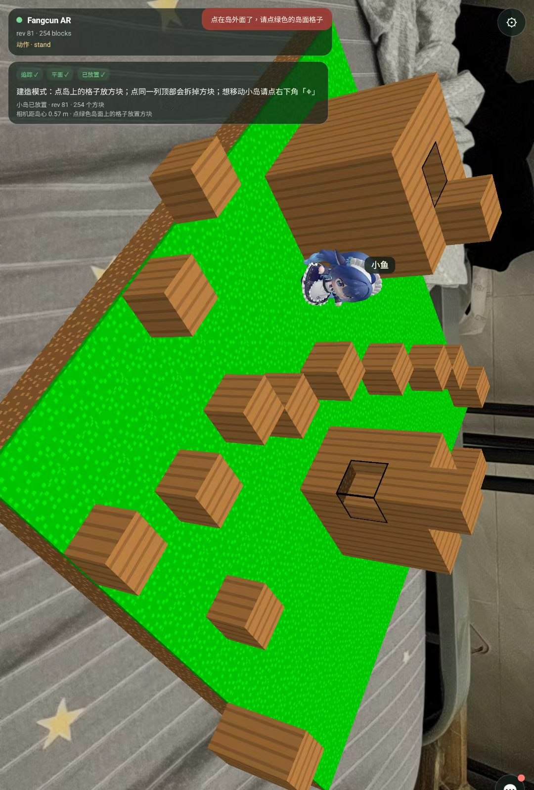

# 方寸 · Fangcun

**在真实桌面上，长出一个 Minecraft 风格的微缩世界。你举着平板看着它，用手指和一只会自己盖房子的 AI 桌宠一起建造。**

> PC 端的方寸世界检视器（`?mode=host`，与平板共享同一份权威世界）：
>
> 
>
> 平板 AR 实机画面（Galaxy Tab S8）：贴图体素岛落在床面上，AI 桌宠「小鱼」站在岛上、头顶带名牌；
> 左上角是随状态变化的中文引导（追踪 ✓ / 平面 ✓ / 已放置 ✓），左下角能看到一次「点空处」的失败提示。
>
> 

不是投屏，不是 VR，不是把 MC 画面贴到摄像头里 —— 是一个**真正存在于桌面上、有 3 cm 体素尺度、由手机/平板做取景与输入**的 AR 沙盒。

---

## 这是什么

| | |
|---|---|
| **形态** | Android 原生 AR 应用 + PC 上的权威世界服务（Host）+ PC 检视/管理界面 + DSH 插件 |
| **世界** | 16×16×16 体素，每格 3 cm，桌面上一块 42 cm 见方、1 格厚的微缩浮岛 |
| **玩家** | 你是"上帝之手"：点格子放方块、再点拆掉。世界里没有你自己的化身 |
| **AI 桌宠** | 有名字、有性格、有物品栏；会提议"我想住这块地"，经你批准后自己在授权地块里盖房子 |
| **AI 的脑子** | 通过 MCP 接入 DSH：模型用工具观察世界、决定建造、开口说话（当前人格层还是占位实现） |

## 现在真的能跑起来的效果

- ✅ 平板对着桌面点一下，**42 cm 微缩岛出现在桌面上**（ARCore 锚定，中文分步引导）
- ✅ **点格子盖房子**，方块带贴图（16 种方块，CC0 材质包）
- ✅ 平板和 PC **同一个世界实时同步**（放一块，另一边立刻出现）
- ✅ 一只 **VRM 大肥鱼**站在岛上：头顶有名牌，说话时冒**动物森友会风格的 3D 气泡**
- ✅ 它会**坐下发呆、躺下睡觉、挥手、跳、张望**（6 个程序化动作，自动轮换）
- ✅ 它会**自己盖房子**：提议地块 → 你批准 → 自动放 12 个方块
- ✅ **你（DSH 里的 AI）能直接建东西**：通过 MCP 工具观察世界、批地块、跑建造 tick、放方块
- ✅ PC 上有**社交软件式的桌宠管理器**：多宠物会话、主人/性格卡片、物品仓库拖放赠送、内嵌岛屿控制台

## 架构

```
                    ┌──────────────────────────────┐
   平板 AR 客户端    │  Android (Java + ARCore)      │
   (真机验证)  ◀────▶│  贴图体素渲染 / VRM 蒙皮角色   │
                    │  名牌 / 动森气泡 / 中文引导     │
                    └──────────────┬───────────────┘
                          WebSocket │ 世界快照 + commit 广播
                    ┌──────────────▼───────────────┐
   PC 权威世界 Host  │  @fangcun/host (Node + TS)    │
   (SQLite WAL)     │  WorldAuthority：唯一写入口    │
                    │  配对码 → token / 事务 / 预算   │
                    │  多宠物档案 / 聊天 / 物品栏     │
                    └──────┬────────────────┬──────┘
                           │ loopback HTTP  │ MCP (stdio)
                    ┌──────▼──────┐  ┌──────▼─────────────┐
   DSH 插件面板      │ 方寸世界面板 │  │ @fangcun/mcp       │
   (侧边栏)         │ 会话/资料/道具│  │ 7 个受限工具        │
                    └─────────────┘  └────────┬───────────┘
                                              │
                                     ┌────────▼─────────┐
                                     │ DSH 里的 AI 模型  │
                                     └──────────────────┘
```

## 快速开始

### 1) 世界核心 + PC 检视器

```bash
git clone https://github.com/60777flowers/fangcun.git
cd fangcun
npm ci
npm run build
npm test          # 93 项测试
```

启动本地 Host（权威世界，持久化到 `~/.fangcun/world.sqlite`）与 PC 检视器：

```bash
npm run host       # → http://127.0.0.1:8765   会打印一次性配对码
npm run simulator  # → http://127.0.0.1:4173
```

打开 <http://127.0.0.1:4173/?mode=host> 就是上面那张截图的世界检视器：选材质、点格子放方块、和 AI 对话、批准它的家园。

### 2) 平板 AR 客户端

需要 Android SDK 与一台支持 ARCore 的设备（本项目在 Galaxy Tab S8 上真机验证）。

```bash
export ANDROID_HOME=/path/to/android-sdk          # Windows: $env:ANDROID_HOME
gradle -p apps/android-ar-poc assembleDebug
adb install -r apps/android-ar-poc/app/build/outputs/apk/debug/app-debug.apk
adb reverse tcp:8765 tcp:8765                      # 开发态：把平板的 127.0.0.1:8765 转发到 PC
adb shell am start -n org.fangcun.ar.poc.debug/org.fangcun.ar.poc.ArPocActivity -e code <配对码>
```

> **当前传输是开发态**：`adb reverse` + 明文 WebSocket 到 loopback。产品形态需要 LAN TLS + 证书指纹固定 + 二维码配对，这部分**还没做**。

### 3) DSH 插件（可选，桌面宠物管理器）

`fangcun-dsh-plugin/` 是一个 DSH 插件包：装进 DSH 后左侧边栏出现「方寸世界」图标，
点开是三栏社交界面（多宠物会话 / 聊天 / 主人·性格·物品栏），中间还能内嵌岛屿控制台。

```bash
# 在 DSH 会话里
plugin_manager { action: "install_bundle", target: "<repo>/fangcun-dsh-plugin" }
```

`fangcun-dsh-bundle/` 则是把方寸的 MCP 工具面接入 DSH 的桥，让模型能直接调用
`world_observe` / `home_claim` / `build_tick` / `place_block` / `break_block` / `companion_say` 等 7 个工具。

### 4) 方块材质（可选）

```bash
npm run atlas      # 由 assets/block-textures 生成 Android 图集
```

## 已完成的模块

| 模块 | 内容 | 证据 |
|---|---|---|
| `packages/world-schema` | 16³ 世界、3 cm 尺度、16 种方块白名单、半开区间 | 单测 |
| `packages/voxel-core` | 确定性浮岛、原子事务、保护地形、快照 | 单测 |
| `packages/protocol` | intent/commit/hello/welcome/ack/resync 校验、帧编解码 | 单测 + JSON Schema |
| `packages/worldd` | 权威世界协调器：单写入口、rev 校验、grant/plan、建造 tick | 单测（含竞态） |
| `packages/host` | SQLite WAL 持久化、配对码/token、WebSocket 副本协议、聊天、多宠物、物品栏、自驱循环 | 单测 + 3 套浏览器/HTTP smoke |
| `packages/mcp` | MCP stdio 服务器，7 个受限工具 | 单测 + 真实 Host 联调 |
| `packages/companion-*` | 人格卡/实例/家园授权数据契约、家园选址、计划预算 | 单测 |
| `apps/simulator` | PC 检视器 + 桌宠配置面板 | Puppeteer smoke |
| `apps/android-ar-poc` | 原生 ARCore 客户端：贴图体素、VRM 角色、动作、名牌、气泡、引导 | 真机截图 |
| `fangcun-dsh-plugin` | DSH 侧边栏面板：社交式桌宠管理 + 岛屿控制台 | 安装验证 + 结构验证 |

**测试现状**：`npm test` 93 项；另有 `test:core-api` / `test:core-ui` / `test:simulator` 三套浏览器与 HTTP smoke。

## 已知限制（诚实清单）

这些**尚未实现**，不要在演示中含糊带过：

- **传输不是产品形态**：`adb reverse` + 明文 WS 回环；没有 LAN TLS、证书指纹固定、二维码配对
- **角色没有骨骼动画片段**：模型本身不含 animation，现在是程序化骨骼姿势（无过渡混合），CPU 蒙皮约 22 Hz
- **没有真实遮挡**：不做 ARCore Depth 合成，手挡住方块时不会消失
- **AI 人格是占位实现**：`packages/host/src/persona.ts` 是关键词规则，不是 LLM；自驱循环用的是固定台词
- **"好友的桌宠"是本地 fixture**：`阿石` 是本地演示数据，没有账号、联网或跨用户访问
- **只有一台设备验证过**（Tab S8 / Android 16 / ARCore），未做机型矩阵与长稳/热测试
- **聊天记录在内存里**（保留最近 30 条），世界和宠物档案才进 SQLite

## 后续计划 / 想一起做的事

按价值排序，欢迎认领：

1. **上真网络**：Host 端 TLS + 自签证书指纹固定 + 二维码配对，平板脱离 `adb reverse` 直连局域网
2. **角色动画**：蒙皮动画播放 + 姿势过渡混合（走/跑/坐下/睡觉的平滑切换）
3. **原子建造 DSL**：`build_plan` / `build_commit` + DSL 编译器（`box`/`wall`/`floor`/`roof_gable`），让"盖个火柴盒"是**一次事务**而不是 25 次
4. **接真模型**：用 DSH 的 LLM 替换占位人格，让它自己决定建什么、说什么
5. **多宠物与串门**：数据契约（`PersonaCard` / `VisitInvitation`）已预留，需要账号体系与受限访问票据
6. **美术**：原创方块材质包、角色 GLB 资产管线、动作库
7. **性能与机型矩阵**：中端机帧时、热、内存预算

## 目录

```
fangcun/
├─ apps/
│  ├─ android-ar-poc/       原生 ARCore 平板客户端
│  └─ simulator/            PC 检视器 + 桌宠配置
├─ packages/
│  ├─ world-schema/  voxel-core/  protocol/  worldd/
│  ├─ host/                权威世界服务（SQLite / WS / 社交模型）
│  ├─ mcp/                 MCP 工具面
│  └─ companion-schema/ companion-runtime/ ar-provider/
├─ fangcun-dsh-plugin/      DSH 桌宠管理面板
├─ fangcun-dsh-bundle/      DSH MCP 桥
├─ assets/block-textures/   方块材质源 + 映射（CC0）
├─ scripts/                构建/演示/冒烟脚本
└─ docs/                   协议、路线、设备验证、素材说明
```

## 文档

| 想了解 | 读 |
|---|---|
| 接口与协议 | [docs/HOST-API.md](docs/HOST-API.md) |
| 结构 DSL | [docs/DSL-SPEC.md](docs/DSL-SPEC.md) |
| 技术路线与里程碑 | [docs/TECH-ROADMAP.md](docs/TECH-ROADMAP.md)、[ADR-0003](docs/ADR-0003-android-client-and-ar-stack.md) |
| MCP 工具面 | [docs/MCP-TOOLS.md](docs/MCP-TOOLS.md) |
| 方块材质与扩展 | [docs/BLOCK-TEXTURES.md](docs/BLOCK-TEXTURES.md) |
| 角色模型与授权 | [docs/COMPANION-ASSET.md](docs/COMPANION-ASSET.md) |
| 本地 demo 怎么跑 | [docs/COMPANION-DEMO.md](docs/COMPANION-DEMO.md) |
| 设备验证 | [docs/DEVICE-TEST-PLAN.md](docs/DEVICE-TEST-PLAN.md) |

## 素材与许可

- **代码**：根目录代码与文档按 [MIT](LICENSE)。
- **方块材质**：仓库内 `assets/block-textures/programmerart/` 是
  [ProgrammerArt](https://github.com/deathcap/ProgrammerArt) 的子集，**CC0 1.0 公共领域**，可自由使用/修改/再分发。
- **角色模型不在仓库里**。当前演示用的 VRM「蓝色小肥鱼 Deepseek鲸鱼娘」版权归 **木子恶魔 / MZEM**
  （[发布页](https://www.aplaybox.com/details/model/ayXkRzVflmnd)），授权为**个人非商业、必须署名、禁止二次配布、禁止商用**。
  因此仓库**不包含任何 `.vrm`**：需要的话请自行下载后放进
  `apps/android-ar-poc/app/src/main/assets/models/companion/default.vrm`（该路径已被 `.gitignore` 忽略）。
  详见 [docs/COMPANION-ASSET.md](docs/COMPANION-ASSET.md)。
- **不使用 Mojang 原版材质**。需要原版观感时，请自备资源包放到本地目录（同样不入库），通过
  [docs/BLOCK-TEXTURES.md](docs/BLOCK-TEXTURES.md) 的映射接口接入。
- `效果图/`、`docs/model-check-*.png` 等第三方素材**不在 MIT 范围内**，公开发布前需清权或移除。

## 参与

- 先读 [CONTRIBUTING.md](CONTRIBUTING.md)。
- 提 issue 时说明设备型号、Android/ARCore 版本、复现步骤。
- 提交前请跑：`npm run build && npm test && npm run test:core-api && npm run test:simulator`。
- 素材类 PR 请附来源与授权说明；**未授权、来源不明的素材一律不进仓库**。
