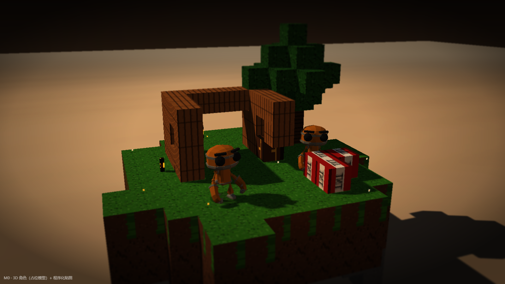

# 桌面 AR 微缩 Minecraft：调查报告档案 v2

> **状态：历史调查材料，不是当前实施真源。** 用户已确认物理桌面 AR 方块世界、玩家参与建造、Android ARCore/WebXR 优先、单个 3D 大肥鱼；真实 PC Minecraft、Windows 独立桌宠窗口、iOS 真 AR 均不在 v0。当前范围/接口/验收见 [docs/IMPLEMENTATION-PLAN.md](docs/IMPLEMENTATION-PLAN.md)，独立审核见 [docs/REVIEW.md](docs/REVIEW.md)。本报告中的 AR SDK 能力/许可、M0 指标、尺寸、估时和“待决”表必须按证据重新验证，不构成已经实现或已获许可的声明。

> 2026-11-16 ｜ v1 见 `reports/REPORT-v1-desktop-pc.md`（保留，不再维护）
> 本版根据效果图形成的**历史调查快照**；主张、工作量和 SDK 结论不得视为当前验证结果。实现真源见 [docs/IMPLEMENTATION-PLAN.md](docs/IMPLEMENTATION-PLAN.md)，审核见 [docs/REVIEW.md](docs/REVIEW.md)。

---

## 0. 先认一个错：我把「桌面」读错了

| | v1 的理解 | 实际（效果图澄清后） |
|---|---|---|
| 「桌面」 | **desktop PC** 的桌面 | **物理桌子**的桌面 |
| 「手机摄像头看到」 | 手机拍**电脑屏幕** | 手机**AR 取景**，虚拟世界叠在真桌上 |
| 产品形态 | PC 上玩 MC，AI 陪你 | **桌面微缩沙盒**：你和 Q 版 AI 在桌上的小世界里一起建造 |
| 渲染 | 串流真 MC 客户端窗口 | **three.js 体素微缩渲染 + AR 锚定** |

**因此 v1 里「淘汰摄像头」的结论作废** —— 摄像头不是"拍屏幕的劣化手段"，而是**这个产品的取景器本身**。

**但 v1 有一半结论仍然有效**（别当废纸）：
- DSH 的能力边界、MCP 客户端、`dsh web --host` 局域网 + token（**实测 401→200**）
- 「手机端不跑 DSH」的判断
- 素材许可风险（MC 纹理 / 社区形象 **CC BY-NC-SA 不可商用**）
- mineflayer 生态、`dsh-game` 的建造器/图纸设计、`dsh-mc-agent` 的工具面
- 手机浏览器需要 HTTPS 才能用摄像头/麦克风

---

## 1. 效果图要什么：10 条可验收要素

| # | 要素 | 实现手段 | 状态 |
|---|---|---|---|
| V1 | 真实桌面 + 背景虚焦 | 摄像头实拍（近距合焦天然虚化）/ 预留位图 | 待 AR |
| V2 | 不规则草方块岛，侧面露泥土层 | 体素 + 噪声侵蚀边缘 | ✅ 已在 M0 做到 |
| V3 | **桌面上的柔和接触阴影** | `ShadowMaterial` 承接面 + 平行光 | ✅ 已在 M0 做到 |
| V4 | 暖色阳光 + 方向投影 | `DirectionalLight` + `HemisphereLight` + ACES | ✅ |
| V5 | MC 风格像素纹理 | 程序化 16×16 生成（**不碰官方素材**） | ✅ |
| V6 | 火把发光 | 自发光材质 + `PointLight` | ✅ |
| V7 | Q 版角色站在岛上 | **3D 模型（VRM/glTF）** | ✅ 已跑通（glTF 占位） |
| V8 | ~~弹幕字幕~~ | 不做（视频产物） | ❌ 已移除 |
| V9 | 低角度略等距、广角 | FOV 38、机位高于桌面 | ✅ |
| V10 | 玩家点按建造 + AI 同时建造 | Raycast + 意图协议 | 待 M2/M3 |

---

## 2. 我们已经做出来的东西（M0 已跑通）



**这不是效果图，是我们自己渲染出来的截图**（`preview/m0.html`，约 500 行，零美术资源、零官方素材）：

- 程序化生成的 16×16 像素贴图（草/泥土/石头/木板/原木/树叶/箱子/TNT/火把/花）
- 体素面剔除 + 按材质合并 → **444 个方块 = 1,300 三角形 / 12 个 draw call**
- 阴影承接面（AR 里就是"焊在桌上"的那一层）+ 暖色定向光 + ACES 色调映射
- **移轴（tilt-shift）后处理** —— 见下方"视觉的秘密"
- **3D 角色（glTF + AnimationMixer + 蒙皮阴影）**：Box3 归一化到 2.2 方块高、SkeletonUtils.clone() 出两份、播放 Idle/Walking —— 证明换 3D **不改渲染架构**
- 程序化"虚焦木纹桌面"背景（真 AR 时换成摄像头画面）


### 视觉的秘密只有两件事

做完这版最大的体会，正好印证 G 的结论：

| 手段 | 效果 | 成本 |
|---|---|---|
| **移轴（tilt-shift）** | 同一套几何，加上就立刻从"3D 场景"变成"桌上的模型" | **~10 行**（`VerticalTiltShiftShader` + `HorizontalTiltShiftShader`，r187 自带） |
| **接触阴影** | 从"浮在空中的贴图"变成"放在桌上的东西" | **~5 行**（`ShadowMaterial` 承接面） |

> **不做这两样，AR 一定"贴纸感"；做了，同一几何立刻变"模型"。这是全项目 ROI 最高的 15 行代码。**
> 另外调参经验：移轴强度 `k≈2/高度`、清晰带 `r≈0.50` 是"岛清晰、远近虚"的甜点；`k=5` 会把岛本身也糊掉。

> **已知证据边界：**本机 headless Chrome/PC 截图只测得静态场景的几何规模，不能推出中端手机 GPU、热态或 AR 合成性能。手机端瓶颈、角色/阴影成本及锚定稳定性均待 M0/M6 真机测量。
> 复现：`cd preview && npm i && node shot.mjs`

---

## 3. 既有实现：有没有现成的「桌面 AR 玩 MC」的库？

**直接答案：没有。而且这不是"没搜到"，是有量化证据的真空。**

| GitHub 搜索 | 命中仓库数 | 最高 star |
|---|---:|---:|
| `minecraft augmented reality` | **12** | **4★** |
| `minecraft hololens` | **2** | — |
| `arcore voxel minecraft` | **0** | — |
| `minecraft threejs`（对照组） | 420 | 2,862★ |

交叉领域（MC × AR × 桌面）**没有任何开源实现**。真正做成这件事的只有两个**闭源**产品，都拿不到代码：

### 3.1 Minecraft Earth（Mojang，2019–2021，2021-06-30 关服）
唯一上过线的同类产品，核心机制 **Buildplate（建造板）** —— 就是效果图里的那个微缩岛。

**三组被严重低估的数字**（直接从 MCE 逆向资料里量出来的，直接用在我们身上）：

| 事实 | 数字 | 对我们的意义 |
|---|---|---|
| **板上比例** | 8×8 板 ≈ 58cm 见方（**1:14**）；32×32 板 ≈ 50cm（**1:64**） | **板越大比例越小，桌上占位恒定 50cm 左右** → 我们的岛应定 **38–48cm**，一格 **3.5–4.5cm**，代码里 `island.scale.setScalar(0.42)` |
| **地下只有 3 格 + 基岩封底** | 3 层 | 侧面天然就是"草/泥土/石头"土层切片；**30–45° 视角下你看到的一半是侧面，侧面比顶面重要** |
| **恒定日光，无昼夜循环** | — | 效果图的"暖色午后"是**设计选择**，不是时间系统 → 锁 35–45° 仰角暖主光，**别做 day/night** |

另外两条可抄的交互：**Build（微缩）↔ Play（1:1）两段式尺度切换**；**放置前先选 scale 再 confirm**。

**社区复刻**（我实测 GitHub API）：`Project-Earth-Team` 组织 15+ 仓库，最大 `Api` **42★**（C#，复刻 MCE API）、`PatcherApp` **23★**（GPL-3.0，给官方 APK 打补丁）——但它们都是**服务端/协议复刻，客户端仍依赖官方 APK**，不能当渲染或 AR 库用。
**意外收获**：MCE 数据格式已被完全逆向 —— **`Earth-Restored/Solace`（94★，MIT，2026-11-12 仍在提交）** 复活了服务器，**`MCeToJava`（MIT）** 能把 buildplate JSON 转成 Java 世界。Mojang 专业关卡设计师做的几十个微缩岛可以当**布局/内容参考**（美术版权归 Mojang，不可直接发行）。

### 3.2 另一个闭源前例
**HoloLens + Minecraft（E3 2015 演示）** —— 在客厅茶几上看 MC。**无 SDK、无源码、硬件已停产**。
> 你在 B 站"记得看到过"的，**大概率就是这个演示的中文解说**（BV1Cf421v7Qj）或 MCE 的宣传片。中文圈实际只有搬运与商业小游戏广告，**无原创开源**。

### 3.3 最接近"复刻"的开源项目
`crips24/Mooncraft` 自述复刻 MCE 的 AR 机制 —— **0★ 空仓库**。

### 3.4 可复用的基础设施（真正能省工的部分）
| 层 | 用什么 | 说明 |
|---|---|---|
| 3D 渲染 | **three.js r187**（MIT） | PC headless 静态 M0 已运行；不代表 WebXR/移动端已验证 |
| **AR** | Android 候选：three.js `ARButton` + WebXR hit-test | 调查候选，须经目标机 spike 验证 |
| 移轴/景深 | `VerticalTiltShiftShader` + `HorizontalTiltShiftShader`（r187 自带）、`postprocessing` 的 `DepthOfFieldEffect`（Zlib） | 静态预览用过；WebXR 相机合成路径另行处理 |
| 体素 | 自写 mesher（静态 M0：444 方块 → 1,300 三角形 / 12 draw call） | 尚未包含动态重建/正式核心包 |
| 标记物 AR | `js-aruco2` 2.0.0、`jsqr` 1.4.0、`mind-ar` 1.2.5 | ⚠️ **见 §4 的坑** |

**历史估计：3–5 人日，未经端到端实测，不作为排期。** M0 静态场景截图不验证 WebXR、LAN 安全部署、真机锚定或 AR 渲染集成；当前排期以 M0 spike 的实际结果重新估算。

---

## 4. 手机 AR 现实约束（历史调查；iOS 不属于当前 v0）

| 平台 | WebXR `immersive-ar` | 证据 |
|---|---|---|
| **Android Chrome** | ✅ 支持（AR 模块/Hit-test 需 **Chrome 81+**；Depth API + 光估计需 **90+**） | three.js `ARButton` 官方示例 |
| **iOS Safari** | ❌ **3.2 → 27.2 全版本不支持** | caniuse 原始 JSON 逐版本 `n`；**WebKit bug 208988 已于 2026-04-01 关闭**，工程师注明只覆盖 visionOS/WPE/WebKitGTK，**iOS 不在其中** |
| 微信/抖音内置浏览器 | ❌ 基本跑不了 WebXR | — |

### 4.1 历史 iOS 方案假设：8th Wall / SLAM（当前未经核实，不作选型结论）

> ⚠️ **历史调查中的结论互相冲突，尚未形成可采信的许可/能力意见。** 本节只保留当时的调查记录；`engine` 与 SLAM `binary` 的实际许可、能力、版本、取得方式和商业/再分发条件都须重新核验。不要据此宣称“SLAM 已 MIT 开源/免费商用”，也不要据此将其作为 iOS 首发依赖。

| 事实 | 值 |
|---|---|
| 许可 | **未核实**；旧记录“MIT 含 SLAM binary”与其他材料冲突 |
| 平台要求 | **历史来源声称 iOS Safari 16.4+**；固定版本当前未核实 |
| 能力 | **历史来源声称** 6DOF SLAM/平面检测/图像追踪；需 POC 复核 |
| 代价 | 体积、许可、构建方式、持续维护状态均待核实 |

→ **旧调查意见已撤回，不能据此选择双平台 SDK。** v0 只按 Android WebXR 做风险验证；iOS 另过许可与真机门禁。

### 4.2 一个会改变选型的细节：**WebXR 里你改不了摄像头画面**

- WebXR immersive AR 通常由浏览器/系统合成相机背景；网页未必能读取摄像头纹理。v0 不把“真实背景可后期”作为 WebXR 能力承诺，先以目标设备的官方 API/POC 验证。
- 独立 `getUserMedia` 合成可能允许对视频画面做后期，但不等价于稳定 6DOF 平面跟踪/桌面锚定；需分别验证跟踪、权限、性能和许可。

> 这意味着：**要效果图那种"照片级微缩感"，纯 WebXR 反而不够**；`getUserMedia` 路线（8th Wall 也属于这路）在**画质**上更自由，代价是锚定精度要自己扛。

### 4.3 被否掉的两条路

1. **MindAR / AR.js 做桌面放置** —— ❌ 它们**没有平面检测**（只有图像/人脸/标记/地理）。而且 MindAR 的 npm 停在 **2024-01**、仓库 2024-06 后无提交。**最容易踩的坑**，因为 demo 最像 WebAR。
2. **只做 Android** —— 旧报告估算可省 1.5–2.5 周，但未实测；v0 已确认 Android 优先，工期按 M0 结果另行估算。

**历史架构建议（未实现）**：旧稿曾建议抽象多种 `AnchorProvider`；当前 v0 只要求 Android WebXR POC，不为尚未批准/核实的 8th Wall 或 photo provider 提前实现抽象层。后续 provider 必须先定义能力、许可和真机验收。

**三条路径的代价**：
| 路径 | 内容 | 工作量 | 复用 |
|---|---|---|---|
| **甲：纯合成** | 旧方案设想的照片背景 + 触摸建造；M0 并未实现摄像头合成或触摸建设 | 历史估计，不作排期 | 未验证 |
| **乙：WebXR 真 AR** | Android WebXR hit-test/anchor POC | 历史估计 3–5 人日，未经实测 | 需 M0 验证后决定复用比例 |
| 丙：Unity AR Foundation | 曾调查的替代方向 | 历史估计 8–12 人日，未经实测 | 是否重写尚未评估 |

> **当前决定：先做 Android WebXR spike；iOS 方案不在 v0，且不据此推荐 8th Wall。** Unity/marker/合成路线若未来需要，须独立评估许可和目标设备。

---

## 5. 历史目标架构草案（实施请勿照抄；以 docs/IMPLEMENTATION-PLAN.md 为准）

```
手机（浏览器）: AR 客户端 = 锚定 + 体素渲染 + **3D 角色** + 点按输入 + 气泡 UI
                        │ WebSocket（局域网 + token）
PC:            世界服务 worldd = 体素权威 + 变更仲裁 + AI 角色状态机 + /mcp
                        │ MCP（stdio 或 streamable-http）
PC:            DSH = 大肥鱼的大脑（persona + voxel_* 工具 + 记忆）
```

**三条关键 ADR**：
1. **世界权威放 PC**（AI 大脑本来就在 PC；手机只做渲染输入，代码量小、断线好恢复）
2. **AI 用 MCP 工具，不写死行为**（换模型/人设/记忆不改世界服务）
3. **建造用高层 `voxel_build`，不逐块**（一个 5×5×3 房子逐块 = 75 次工具调用）

---

## 6. 素材许可（会决定能不能发布）

| 素材 | 风险 | 对策 |
|---|---|---|
| **Minecraft 官方纹理** | 版权属 Mojang/Microsoft，随产品分发有法律风险；`minecraft-assets` 只是"运行时下载"，不等于合规 | **v0 全部程序化生成**（M0 已做到）或自绘/CC0 |
| **大肥鱼形象** | 社区二创，`dsh-game` 的动画素材是 **CC BY-NC-SA 4.0（禁商用）** | 自绘原创角色，或拿授权；`character.json.license` 强制填写 |
| three.js / 其它库 | MIT 等宽松许可 | 保留 LICENSE |

---

## 7. v0 到底要不要"真 Minecraft"

| | 自建体素（推荐 v0） | 真 MC 服务端 + mineflayer |
|---|---|---|
| 像不像 | ✅ 完全可控 | ⚠️ 受 MC 渲染/材质限制 |
| 手机依赖 | ✅ 只渲染 | ❌ 要连 PC + Java 服务端 |
| 建造手感 | ✅ 点一下立刻有 | ⚠️ 经过 bot/RCON，可能"点了没反应" |
| 合成/怪物/红石 | ❌ 没有 | ✅ 全都有 |
| 素材许可 | ✅ 自绘可发布 | ⚠️ 需处理 MC 纹理 |
| 工作量 | 小 | 大（见 `report-f`） |

> **判断**：效果图里没有任何"生存"元素，用户说的是"**一起建造**"。v0 用自建体素。**真 MC 版作为 v2 的"硬核模式"**，复用 mineflayer 那套（`report-f` 会给延迟数字）。

---

## 8. 历史两周验证草案（非排期承诺；待重新估算）

| 天 | 做什么 | 证伪什么 |
|---|---|---|
| **已完成** | M0：静态微缩渲染 + **3D 角色（glTF 占位）** + 移轴 + 接触阴影 | "能不能像" |
| 1–2 | Android Chrome + WebXR hit-test，把 M0 的岛放到真桌上 | **AR 锚定稳不稳**（最大风险） |
| 3–4 | 点按放置/破坏 + 物品栏（本地权威，先不联网） | 触摸建造手感 |
| 5–6 | `worldd` + WS 协议 + 手机连 PC（局域网 token） | 同步与延迟 |
| 7–9 | DSH + `voxel_*` MCP 工具，让大肥鱼会走会盖 | **AI 能不能真的"一起建"** |
| 10–11 | iOS 兜底（photo 模式或 marker） | 跨平台 |
| 12–14 | 打磨：光照/阴影/性能/Bloom/语音 | 能不能拿去给人看 |

**第 1–2 天是 go/no-go**：WebXR 在真机桌上钉不住 → 立刻切 marker 方案，别在 hit-test 上死磕。

---

## 9. 当前决策与仍待验证项

| # | 状态 | 决策/验证项 | 当前口径 |
|---|---|---|---|
| D1 | **已确认** | 产品形态 | 真实物理桌面 AR 微缩方块沙盒；玩家和大肥鱼 AI 同场建设 |
| D2 | **已确认** | v0 平台 | Android ARCore/WebXR 优先；不承诺 iOS 同期 |
| D3 | **已确认** | v0 世界 | 自建有限体素世界，不接真实 MC server |
| D4 | **待验证/发行阻断** | 角色资产 | 单个 3D 大肥鱼是产品目标；运行时/发行模型必须有可审计授权，性能待目标机测量 |
| D5 | **待实现验证** | AI 共建体验 | 先用受限 build plan → 用户确认 → commit；不默认主动关怀或长期记忆 |
| D6 | **待技术验证** | LAN 配对与安全上下文 | M0 实机验证 HTTPS/WSS/配对凭证；不得据旧草案承诺零配置 |
| D7 | **后续产品** | iOS AR、Windows 独立桌宠、真实 PC Minecraft | 不纳入 v0；分别立项和验收 |

---

## 10. 三个子报告的定位（正在跑，回来后并入）

| 报告 | 回答什么 | 状态 |
|---|---|---|
| `report-e-ar-stack.md` | AR 底座、桌面融合与性能调查 | 调查档案；设备支持、8th Wall 许可/能力需重核 |
| `report-f-world-sync.md` | 世界权威、同步与建造 schema | 调查档案；协议伪代码不与新计划契约兼容，不得直接照抄 |
| `report-g-ar-mc-prior-art.md` | AR/Minecraft 历史先例 | 调查档案；不代表当前选型已验证 |

> 本报告及子报告保留了**调查快照与未结论假设**；不得将旧稿中的“进行中/待定稿”或技术推测当作当前开发状态。AR 真机锚定、LAN TLS/WSS、AI 协作与性能需按 [docs/IMPLEMENTATION-PLAN.md](docs/IMPLEMENTATION-PLAN.md) 重新验证。
