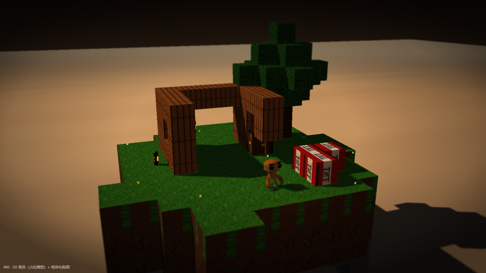

# 桌面 AR 微缩 Minecraft · 开发文档

> 版本：**v0.3**（2026-11-16）｜状态：**已过一轮对抗性审阅，P0 已修**（审阅报告：`reports/report-h-doc-review.md`）
> 读者：接手开发的同学。**目标：读完这份文档 + 跑通 §2，就能在不问原作者的情况下开始写代码。**
> 视觉唯一标准：`效果图/3.png`（全景构图）、`效果图/2.png`（角色正面）、`效果图/1.png`（角色背面/发光/矿洞）。**"像不像"的争论一律以这三张为准。**

---

## 0. 三十秒读懂

> **两条产品铁律（先记住，跟实现有关的都从这两条推出来）：**
> 1. **世界里只有一个角色，默认是大肥鱼。** 角色是**可选、可替换**的（§8.8），但**默认只放一个**；参考图里的三个角色只是视频里的阵容，不是我们的默认值。
> 2. **玩家本人不出现在世界里 —— 没有玩家化身/皮肤/身体。** 玩家是"上帝之手"：手指点哪就在哪放/拆，靠**高亮框**表示位置，不渲染任何人物模型。


在**真实桌面**上出现一个 **Minecraft 风格的微缩世界**；用户用**手机摄像头（AR）**看着它，**用手指建造**，同时一个 Q 版 AI 角色（大肥鱼）**在同一个世界里和玩家一起建造、说话**。

- 不是 PC 端游戏 ❌
- 不是把电脑屏幕投到手机 ❌
- 不是 VR / HoloLens ❌
- 是 **AR 桌面微缩沙盒**：手机 = 取景器 + 输入设备，PC = 世界权威 + AI 大脑

---

## 1. 视觉目标：以效果图为准

### 1.1 效果图位置（**感觉的来源，不是规格**）
> 以下路径均**相对仓库根目录**（本文档位于 docs/）。

> ⚠️ **重要前提：这三张图是 AI 视频生成的帧，不是产品渲染，也不是规格书。**
> 证据就在图里 —— 同一段视频里**角色的数量、身高、位置都在变**（3.png 里 3 个角色、1.png 里 2 个、2.png 里 2 个，身高比例也不一致）。这是生成模型的**一致性缺陷**，不是设计意图。
>
> **所以：采其"感觉"，不采其"数字"。**

| ✅ 采纳 | ❌ 不采纳（生成缺陷） |
|---|---|
| 桌面微缩的**构图与机位**（低角度、略等距、贴近岛边） | 角色的具体身高比例（**按 §8.1 的 1.2 格**，别按图量） |
| **移轴虚化 + 接触阴影 + 暖色午后光** | 角色数量（**默认 1 个**，不是图里的 2–3 个） |
| 木/草/石的**配色与方块质感**；道具组合（房/树/箱/TNT/火把/矿洞） | 角色的"平面感 / 描边恒定"（生成出来的 2D 贴图感；我们要真 3D） |
| "漂浮切片"的**薄岛边**（约 2–3 层泥土） | 透视与遮挡关系（图里有明显错的，如角色与方块的穿插） |

| 文件 | 内容（**已逐张核对：三张图内都没有任何字幕/弹幕/UI，只有右下角 B 站水印**） | 用途 |
|---|---|---|
| **`效果图/3.png`** | ★**全景（唯一一张）**：整块岛 + **三个角色**（左：黑发黄安全帽带兽耳、蓝衬衫、红褐尾巴；中：大肥鱼**站立背影**捧发光青色方块；右：大肥鱼**蹲下**在 TNT 旁）+ 敞口木板房（内含黑色方块、墙上有火把）+ 箱子 + 单块 TNT + MC 树 + 右侧石坡 + 花草 + **虚焦的白瓷杯**（证明确实是桌面实拍）| **整体构图 / 机位 / 角色数量与站位** 基准 |
| **`效果图/1.png`** | 近景·**背面机位**：前景大肥鱼背对镜头、双手捧发光青色方块；背景另一个大肥鱼抱着 TNT；右侧**石山矿洞**（可见煤矿石、钻石矿）；草地上**钻石镐** | 角色比例 / 发光 / 矿洞 |
| **`效果图/2.png`** | 近景·**正面机位**：同一场景的另一帧，前景大肥鱼**跪姿正面**、手持发光钻石块 | **角色正面造型 / 表情** |

> **三张是同一段视频的三帧**：`3.png` 是唯一的全景，1/2 是它的近景推镜。
> **冲突时**：构图看 3.png，角色正面看 2.png，发光/矿洞细节看 1.png。

> 两张图都是视频截图（2.png 右下有 B 站水印），**不是可交互产品**。我们要复现的是"看起来的感觉"，不是它的每一像素。

### 1.2 从两张图读出的 14 条可验收要素

| # | 要素 | 从哪张图看出 | 实现手段 | 优先级 |
|---|---|---|---|---|
| V1 | 真实桌面/纸面为底，背景强虚化 | 1、2 | 摄像头实拍 + **移轴后处理** | P0 |
| V2 | 不规则草方块岛，侧面露出**草/泥土/薄石层**（3.png 里可见约 **2–3 层泥土**，很薄，"漂浮切片"感） | 1、2、**3** | 体素 + 噪声侵蚀边缘；**地下 3 层泥土 + 1 层石底**（别做厚，厚了像"土堆"不像"切片"） | P0 |
| V3 | **岛在桌面上有柔和接触阴影** | 1、2 | `ShadowMaterial` 承接面 + 平行光 | **P0（最关键的"落地感"）** |
| V4 | 暖色阳光、方向明确、投影清晰 | 1、2 | `DirectionalLight` 35–45° 仰角 + `HemisphereLight` + ACES | P0 |
| V5 | 16×16 像素风方块纹理（草/泥/石/木板/原木/树叶/箱子/TNT/火把） | 1、2、3 | 纹理图集，最近邻采样 | P0 |
| V5b | **敞口木板房**：无屋顶、内有黑色方块（熔炉/音符盒一类）、墙上一支火把 | **3** | 5×5 墙 + 留顶；火把用自发光 + 点光 | P1 |
| V6 | **矿石方块嵌在石头里**（煤、钻石，钻石带青色斑点） | 2 | 额外的 `coal_ore` / `diamond_ore` 方块 | P1 |
| V7 | **手持物的发光**（钻石块发出青色光晕） | 2 | 自发光材质 + **Bloom 后处理** + 局部 `PointLight` | P1 |
| V8 | 火把发光 | 1 | 自发光 + 小半径点光 | P1 |
| V9 | **Q 版角色，默认只放 1 个（大肥鱼）**，**约 1.2 格高**（「1 格多一点」，比 MC 玩家矮） | 1、2、**3** | 见 §8 尺度表。参考图里的另两个角色**作为可选预置**，默认不加载 | **P0** |
| V10 | 角色的**多种姿势**：站立 / 行走 / **蹲下**（3.png 右侧）/ 跪地持物（2.png）/ 挖掘 | 1、2、**3** | **3D 骨骼动画**（VRM/glTF）+ 状态机；**"蹲下"是 3.png 明确要的，别漏** | P0 |
| V11 | 角色在草地上投**柔和阴影** | 1、2 | 胶囊影 / 烘焙贴图影 | P0 |
| V12 | ~~弹幕式字幕~~ | 1 | **不做** —— 那是参考视频的观众弹幕，不是产品需求；AI 的台词改用**场景内气泡** | — |
| V13 | 低角度、略等距、广角 | 1、2 | FOV 38–45，机位高于桌面 20–35cm | P1 |
| V14 | 整体像"移轴微缩模型摄影" | 1、2 | **移轴（tilt-shift）= 全项目 ROI 最高的 10 行** | **P0** |

> ⚠️ **验收必须按 AR 方案分档**：V1（真实背景虚化）、V13（视角）、V14（移轴）这三条**在 WebXR 下做不到"对真实画面做后期"**——WebXR 把相机画面交给浏览器合成，页面**拿不到摄像头纹理**。
> → 这三条**只在 `photo` / `8thwall` provider 下验收**；WebXR 下只验收"虚拟内容清晰 + 接触阴影正确 + 锚定稳定"。

### 1.3 明确**不做**的（防止范围膨胀）

- ❌ 生存/饥饿/怪物战斗（v0 不做；矿石只是装饰与可挖）
- ❌ PC 上可玩的完整 MC 体验
- ❌ VR / HoloLens / 桌面投屏
- ❌ 多人联机（v0 = 单人 + 1 个 AI）
- ❌ **不做玩家化身**（不渲染玩家角色、不做捏脸/换装、不做第三人称跟随）
- ❌ **不做多角色同屏**（默认 1 个；架构支持 N 个，但产品默认 1，避免性能与叙事双输）
- ❌ 昼夜循环（**效果图是恒定午后光，这是设计选择，不是缺失**）

---

## 2. Quick Start

### 2.0 ⚠️ 仓库现状（先读这段，别直接敲命令）

**当前仓库只有这些是能跑的**：`preview/`（M0 原型，见 §2.1）。**工程骨架还没搭**——根目录没有 `package.json`，`packages/` 还不存在。

所以启动分两段：

| 阶段 | 现在能不能跑 | 命令 |
|---|---|---|
| **A. 看效果（今天就能跑）** | ✅ 能 | `cd preview && npm install && node shot.mjs` → 输出 `preview/m0.png` |
| **B. 起工程骨架** | ❌ 还没有，需 30 分钟搭 | 见**附录 B 脚手架清单** |

> 附录 B 里给出的文件树是**目标结构**，不是现状。谁先接手，**第一件事就是把附录 B 搭出来并提交**。

### 2.1 先看一眼已有的东西



> **这是我们自己渲染出来的（不是效果图）**：`preview/m0.html`，约 520 行，零官方素材（贴图程序化生成，角色模型为 three 官方示例占位）。
> 实测：**444 个方块 → 1,300 三角形 / 12 个 draw call**，含移轴、接触阴影、**3D 角色（glTF + 动画 + 蒙皮阴影）**。
> 复现：`cd preview && npm i && node shot.mjs`（headless Chrome 截图，输出 `preview/m0.png`）

### 2.2 环境（本机实测，2026-11-16）

| 工具 | 状态 | 备注 |
|---|---|---|
| Node | ✅ v24.19.0 | 要求 ≥22 |
| npm | ✅ 11.17.0 | |
| pnpm | ❌ 未装 | `npm i -g pnpm`，或**直接用 npm workspaces**（推荐，少一层） |
| git | ✅ 2.39 | |
| adb | ❌ 未装 | `adb reverse` 免证书调试需要；装 Android platform-tools |
| Chrome | ✅ 157 | 真机调试走 `chrome://inspect` |
| WLAN IP | `192.168.68.54` | 手机需同一 WiFi |

```bash
npm install
npm run dev:world            # 世界服务，默认 8787
npm run dev:client -- --host # 手机客户端，默认 5173
# 手机打开终端打印的二维码 / 链接
```

> ⚠️ **摄像头与 WebXR 需要安全上下文**：`localhost` 可以，局域网 IP **必须 HTTPS**。
> 开发期捷径：① `adb reverse tcp:5173 tcp:5173` → 手机开 `http://localhost:5173`；② `tailscale serve`；③ `cloudflared tunnel`。

---

## 3. 术语表

| 术语 | 含义 |
|---|---|
| **微缩世界 / diorama / buildplate** | 桌上那个方块岛，本项目的舞台（沿用 Minecraft Earth 的叫法） |
| **体素 voxel** | 一个方块单位；1 体素 = 1 世界单位 |
| **chunk** | 体素分块容器（16×16×16），网络同步与网格重建的最小单位 |
| **权威 authority** | 谁说算；所有变更以权威端仲裁结果为准，客户端只做预测 |
| **AnchorProvider** | AR 锚定适配器（webxr / 8thwall / photo），渲染层不感知底层 |
| **移轴 tilt-shift** | 上下虚化的后处理，制造"微缩模型"观感 |
| **接触阴影 contact shadow** | 物体与桌面交界处的柔和阴影，AR"落地感"的关键 |
| **VRM** | 二次元角色的 3D 标准格式：humanoid 骨骼 + MToon 材质 + 表情 + spring bone |
| **上帝之手 / 光标** | 玩家没有化身，用屏幕点按直接作用于世界；世界里用高亮框/虚影表示"手在哪" |
| **DSH** | DeepSeek Harness，跑在 PC 上的 AI agent 框架 |
| **MCP** | Model Context Protocol，DSH 调用外部工具的标准 |

---

## 4. 总体架构

### 4.1 三层

```
┌──────────────────── 手机（浏览器，零安装）─────────────────────┐
│ AR 客户端 (Vite + three.js)                                    │
│  ├─ ar/         AnchorProvider: webxr | 8thwall | photo        │
│  ├─ render/     体素网格 + 纹理图集 + ShadowMaterial + 移轴/Bloom│
│  ├─ character/  VRM/glTF 加载 + 状态机 + 接触影                 │
│  ├─ input/      点按 raycast → 放置/破坏意图                    │
│  ├─ ui/         物品栏 / AI 气泡 / 连接状态                     │
│  └─ net/        WebSocket：意图上行 / 权威状态下行               │
└────────────────────────────▲───────────────────────────────────┘
                             │ WS（局域网 + token）
┌────────────────────────────┴───────────────────────────────────┐
│ PC                                                             │
│  worldd (Node)  = 体素权威 + 变更仲裁 + AI 角色状态机 + /mcp      │
│        ▲ MCP（stdio 或 streamable-http）                        │
│  DSH            = 大肥鱼的大脑（persona + voxel_* 工具 + 记忆）    │
└────────────────────────────────────────────────────────────────┘
```

### 4.1.1 `AnchorProvider` 接口（**必须照此实现，别只留个名字**）

三种 provider 能力差异很大，所以接口只暴露**最小公约数**，高级能力靠 `capabilities` 查询：

```ts
type ARCapabilities = {
  planeDetection: boolean;   // 能否检测平面（webxr/8thwall: true；photo: false）
  sixDof: boolean;           // 是否 6DOF 追踪（photo: false，只有 3DOF）
  cameraFeed: boolean;       // **页面能否拿到摄像头纹理**（webxr: false！8thwall/photo: true）
  lightEstimation: boolean;
  occlusion: boolean;
};

type Pose = { position: [number,number,number]; quaternion: [number,number,number,number] };

interface AnchorProvider {
  readonly id: 'webxr' | '8thwall' | 'photo';
  readonly capabilities: ARCapabilities;

  /** 启动/授权。失败必须抛出可展示的原因（用户拒绝 / 不支持 / 需要 https） */
  start(opts: { canvas: HTMLCanvasElement }): Promise<void>;
  stop(): Promise<void>;

  /** 命中检测：给屏幕坐标，返回可放置的位姿（photo 模式下返回"相机前方固定距离"） */
  hitTest?(ndc: { x: number; y: number }): Promise<Pose | null>;

  /** 放置/取回世界锚点；photo 模式用 3DOF 近似，anchor 只保证"跟着相机动" */
  createAnchor(pose: Pose): Promise<unknown>;
  /** 每帧调用：返回该锚点当前的位姿 */
  updateAnchor(anchor: unknown): Pose | null;

  /** 只有 capabilities.cameraFeed 为 true 时可用 */
  getCameraTexture?(): THREE.Texture | null;

  /** 用于 UI 提示，如"请用系统浏览器打开""请允许摄像头" */
  lastError?: { code: string; message: string };
}
```

**实现分档**：
| provider | 锚定 | 摄像头纹理 | 后期移轴 | 备注 |
|---|---|---|---|---|
| `webxr` | hit-test + anchor | ❌ | ❌ | Android Chrome 81+ |
| `8thwall` | SLAM | ✅ | ✅ | iOS 主力；**SLAM 在 binary 包，许可要单独核**（见 §12） |
| `photo` | 3DOF 近似 | ✅ | ✅ | 全平台兜底（= M0 形态） |

### 4.2 三条必须遵守的架构纪律

1. **`voxel-core` 零 I/O**：纯函数，浏览器/Node 双端可跑。将来要"手机脱离 PC 单机玩"，靠的就是它。
2. **手机不持有真值**：断线重连 = 重新拉快照。手机端代码量目标 < 3000 行。
3. **AI 与玩家走同一条变更路径**：AI 没有特权，否则会出现"AI 把你刚放的方块变没了"。

### 4.3 为什么不用真 Minecraft 服务端（v0）

| | 自建体素（v0） | 真 MC + mineflayer |
|---|---|---|
| 像不像 | ✅ 完全可控 | ⚠️ 受 MC 渲染/材质限制 |
| 手机依赖 | ✅ 只渲染 | ❌ 要连 PC + Java 服务端 |
| 建造手感 | ✅ 点一下立刻有 | ⚠️ 经 bot/RCON，可能"点了没反应" |
| 合成/怪物 | ❌ 没有 | ✅ 全都有 |
| 素材许可 | ✅ 自绘/CC0 可发布 | ⚠️ **MC 纹理不可分发，见 §12** |
| 工作量 | 小 | 大 |

> 效果图里没有生存元素，用户说的是"一起建造" → **v0 用自建体素**。真 MC 版作为 v2"硬核模式"。

---

## 5. 模块与目录

```
ar-mc/
├─ packages/
│  ├─ voxel-core/          # 纯逻辑，零 I/O ★最重要
│  │   ├─ world.ts         #   体素读写、chunk、快照/差异
│  │   ├─ palette.ts       #   方块 id ↔ 属性（纹理、透明、发光）
│  │   ├─ mesher.ts        #   chunk → BufferGeometry（面剔除 + greedy）
│  │   ├─ schematic.ts     #   建造指令 → 方块集合
│  │   └─ intent.ts        #   协议类型 + 校验（三端唯一来源）
│  ├─ worldd/              # Node 世界服务
│  │   ├─ server.ts        #   WS、token 鉴权、房间
│  │   ├─ arbiter.ts       #   变更仲裁
│  │   ├─ agent.ts         #   AI 角色状态机
│  │   └─ mcp.ts           #   工具暴露成 MCP
│  ├─ client/
│  │   ├─ src/ar/          #   providers/{webxr,8thwall,photo}.ts + index.ts
│  │   ├─ src/render/      #   场景、光照、阴影承接面、tilt-shift、bloom
│  │   ├─ src/input/       #   raycast、放置/破坏手势
│  │   ├─ src/character/   #   VRM/glTF 加载、动画混合、状态机
│  │   ├─ src/ui/          #   物品栏、气泡
│  │   └─ src/net/         #   WS、预测与回滚
│  └─ tools/
│      ├─ world-inspector/ #   在 PC 上用鼠标看/改同一个世界（开发神器）
│      └─ mock-ai/         #   不发 LLM 的假 AI
├─ assets/
│  ├─ blocks/              # 纹理图集（CC0，见 §7.3）
│  └─ characters/          # 角色（见 §8）
├─ 效果图/                  # ★ 视觉基准 1.png / 2.png / 3.png
├─ preview/                # M0 原型（可直接改）
└─ docs/DEV.md
```

**依赖方向**：`voxel-core` 不依赖任何人；`worldd`、`client` 都依赖它；**禁止**反向依赖。

---

## 6. 接口契约（改这里必须同步改三端）

### 6.1 WebSocket（手机 ↔ worldd）

连接：`ws://<host>:8787/ws?token=<token>&name=<玩家名>`

**服务端 → 客户端**
```ts
// origin = 世界坐标 (x0,y0,z0) 对应数组下标 (0,0,0) 的那个方块 → 负坐标必须靠它表达
{ t:"snapshot", rev:1024,
  origin:[-1,-4,-1], size:{x:16,y:12,z:16},
  palette:[...], blocks:"<base64 uint16>" }   // 长度必须 === x*y*z
{ t:"delta", rev:1025, ops:[{op:"place",x:1,y:2,z:3,b:17,by:"player"},
                            {op:"break",x:1,y:2,z:4,by:"ai"}] }
// anim 是**闭集枚举**，三端共用；character.json 的 animations 必须覆盖全部取值
// "idle"|"walk"|"mine"|"place"|"build"|"hold"|"kneel"|"cheer"|"talk"|"sleep"
{ t:"actors", actors:[{ id:"dafeiyu", x:6.2,y:1,z:8.8, yaw:1.57, anim:"build",
                        bubble:"这块放这儿对吧？" }] }        // 10Hz 足够
{ t:"reject", seq:42, reason:"occupied", fix:{x,y,z,b} }
{ t:"chat", from:"player"|"dafeiyu", text:"..." }
{ t:"error", code:"auth"|"version", message:"..." }
```
**客户端 → 服务端**
```ts
{ t:"intent", seq:42, ops:[{op:"place",x,y,z,b}] }   // 乐观更新，等服务端 delta/reject
{ t:"chat", text:"帮我盖个屋顶" }                     // 转给 AI
{ t:"ping", ts:123456 }
```
**规则**：`rev` 单调递增，只接受更大 `rev`；本地先应用、失败回滚；**同一格冲突后到者拒**（AI 也一样）。

### 6.2 MCP 工具（DSH ↔ worldd）

`dsh-mcp-client` 支持 `stdio` 与 `streamable-http`，工具名形如 `mcp__mcworld__voxel_observe`。

```yaml
- id: mcp-voxel
  name: '@deepseek-ai/dsh-mcp-client'
  config:
    serverName: mcworld
    transport: streamable-http
    url: http://127.0.0.1:8787/mcp
    headers:
      Authorization: !!js '`Bearer ${process.env.VOXEL_TOKEN}`'
    toolCallTimeoutMs: 30000
```

**9 个工具（v0 全量，多一个都不要）**

| 工具 | 入参 | 返回 | 说明 |
|---|---|---|---|
| `voxel_observe` | `detail?: brief\|full` | 玩家列表 + **每人最近动作**（已聚合，见 §6.5）+ 世界摘要 + 附近 8³ 方块 | **AI 的眼睛**；`player_activity` **塞进这个返回**，省一次往返 |
| `voxel_place` | `x,y,z,block` | `{ok,rev}` | 单块（微调用，**≤64 格**） |
| `voxel_break` | `x,y,z` | `{ok,rev}` | 单块 |
| `voxel_build_plan` | `spec: Structure` | `{ok, conflicts[], materials{}, **png:"预览图"} ` | **先出图再动手**：模型看三视图 + 冲突 + 材料，自己改 |
| `voxel_build` | `spec: Structure` | `{ok,placed,rev}` | 真正执行（内部仍走仲裁） |
| `voxel_say` | `text` | `{ok}` | 说话（**场景内气泡**，可选 TTS） |
| `voxel_move` | `x,z` 或 `to:"player"` | `{ok,eta}` | 走过去 |
| `voxel_mark` | `name, x,y,z` | `{ok}` | 给地点起名（`site:wall-3`），之后可用名字引用 |
| `voxel_journal` | `query?: string` | 世界日志 | 跨会话记忆（盖过什么、玩家偏好） |

> **为什么 `build_plan` 要返回 PNG**：DSH 的 MCP 栈**支持图片结果**（`dsh-mcp-client` 会把 MCP 图片投影进对话）。让模型"看见"自己设计的房子，比让它读 150 行坐标有效得多——这是 `luckui/dsh-game` 已经验证过的做法（MIT，`blueprint.ts` / `shapes.ts` / `creative.ts` 可直接抄）。

> **纪律**：`voxel_place` 只用于微调（≤64 格）。一个 5×5×3 的房子逐块 = 75 次调用、约 **6,000 token / 120 次往返**；用 `layers` 图纸约 **200 token 换 150 块**。

### 6.3 `voxel_build` 的 `Structure`

```ts
type Structure = {
  id?: string;
  origin: [number, number, number];
  anchor?: "min" | "center" | "player";   // player = 以玩家脚下为基准
  align?: "none" | "grid" | "player";      // 对齐策略
  size: [number, number, number];

  // 三种表达（优先级从高到低）
  voxels?: { x:number; y:number; z:number; b:string }[];
  layers?: string[][];                     // layers[y][z] = 一行字符串；约定：先 y（层），后 z（行），行内 x
  primitives?: Array<
    | { kind:"box"; from:[x,y,z]; to:[x,y,z]; b:string; hollow?:boolean }
    | { kind:"cylinder"; center:[x,z]; radius:number; y0:number; y1:number; b:string; hollow?:boolean }
    | { kind:"sphere"; center:[x,y,z]; radius:number; b:string; hollow?:boolean }
    | { kind:"roof"; style:"gable"|"hip"; from:[x,y,z]; to:[x,y,z]; stairs:string; fill?:string; overhang?:number }
    | { kind:"wall"; from:[x,y,z]; to:[x,y,z]; b:string;
        holes?: { x:number; y:number; w:number; h:number }[] }   // 门窗洞
  >;

  palette: Record<string,string>;          // 字符 → 方块 id
  materials?: { required: Record<string, number> };  // 材料清单（plan 阶段回填估算）

  // 安全阀（默认开）
  avoidPlayers?: boolean;                  // 默认 true：不占玩家所在格
  replaceAirOnly?: boolean;                // 默认 true：不覆盖已有方块
  dryRun?: boolean;                        // 只算不动（build_plan 内部用）
  maxBlocks?: number;                      // 默认 4096，超过直接拒
};
```

**⚠️ 关于坐标轴的歧义（务必照此实现）**：`layers[y][z]` 的含义是 **`layers[层][行]`，行内字符沿 +x 方向递增**。M0 原型就是这么做的，别改成 `[z][y]`。

**为什么这么设计**：
- `layers` 字符图抄 `luckui/dsh-game`（LLM 画字符图比输出几百个坐标可靠，人类可读可 diff）
- `primitives` 抄 `minecraft-numen`（穹顶/圆柱逐块算是地狱）
- `replaceAirOnly` 默认 true + `avoidPlayers` 默认 true 是产品安全底线（AI 不能拆玩家的家）
- `dryRun` 是**产品级关键**：先出预览虚影，玩家点头再落地

### 6.4 仲裁规则（AI 与玩家同权，没有特权）

```
place(x,y,z,b):
  if !insideWorld -> reject "out_of_bounds"
  if replaceAirOnly and 已有方块 -> reject "occupied"
  if 落在玩家当前"手部光标"格 -> reject "taken"        // 玩家没有身体，只有光标
  if 玩家在 1.5s 内刚改过该格 -> reject "contended"     // 防 AI 与玩家抢
  else commit -> rev++ -> broadcast delta
```

**批量建造的特殊处理**：`voxel_build` 内部**逐格过同一个仲裁**，但**只广播一条合并后的 delta**（否则一次建造 150 格会刷 150 条消息）。被拒的格子收集进返回值，不中断整体。

### 6.5 玩家行为聚合（AI 的"共情"来源）

别把原始事件直接喂模型。用 **2 秒窗口 + 空间连通**把事件聚成"意图"：

| 原始事件 | 聚合规则 | 喂给模型 |
|---|---|---|
| 同一批方块被反复破坏 | 2s 内同一区域（半径 3） | 「玩家在挖石头，挖了 12 秒，可能在开矿道」 |
| 方块放置呈平面分布 | 2s 内 5×5 内放置 ≥8 格同种 | 「玩家在搭 5×5 的橡木墙」 |
| 移动 + 血量下降 | 帧间位移 > 3 格 + health 降 | 「玩家血量 6/20，正往东跑，后面 2 只僵尸」 |
| 反复潜行 + 边缘方块 | crouch 事件 + 站在 1 格宽路径 | 「玩家在潜行搭桥，别打扰」 |

**输出形式**：`{ kind:"mining"|"building"|"fleeing"|"bridging"|"idle", region:{x,y,z}, confidence:0..1, site?: "wall-3" }`
> `site` 是给模型**引用**用的短名（`voxel_mark` 生成），避免每次都要重述坐标。

---

## 7. 数据模型

### 7.1 世界尺寸（**有依据，别乱改**）

**坐标域必须先定死，否则所有人写的第一个数据结构都是错的。**

| 项 | 值 | 说明 |
|---|---|---|
| **数组尺寸** | `size = {x:16, y:12, z:16}` = 3,072 体素 = **6 KB**（`Uint16Array`） | 16×16 是 chunk 的平面尺寸，便于网格重建 |
| **世界原点** | `origin = [-1, -4, -1]` | 数组下标 (0,0,0) 对应的世界坐标。**因为没有它，负 y 根本表达不出来** |
| **可建岛** | 平面 **14 × 14**，世界坐标 x,z ∈ [0,14)，y ∈ [-4, 6) | 7 层：y=-4 石底／y=-3..-1 泥土／y=0 草面／y=1..5 地上 |
| 物理尺度 | **1 体素 = 3 cm** → 岛约 **42 cm 见方** | 依据 MCE：8×8 板 ≈ 58cm、32×32 板 ≈ 50cm（板越大比例越小，桌上占位恒定） |
| 世界模式 | **恒定日光** | 效果图是午后暖光；**不做昼夜循环** |

> ⚠️ **AR 里的缩放**：整岛缩放置于 `AnchorProvider` 之外的一层 group 上，值是 `0.03`（1 单位 = 3cm，按"米"为 AR 世界单位）——**不是 0.42**。上一版写的 0.42 是错的（14×0.42 = 5.88 单位，不是 42cm）。
> ⚠️ **M0 原型的已知偏差（别照抄）**：M0 里岛是 14×14 但底面只用噪声随机决定，实测 bbox 12×11×12、且 **106 根柱子中有 55 根底面停在 y=-2（悬空）**。正式实现必须**保证每一列都到底**（y=-4），否则侧壁会出现空洞。

### 7.1.1 带宽与延迟：**已经量过了，不用担心**

F 在本机起真 MC 1.20.1 + mineflayer 4.39 实测（2026-11-16）：

| 项 | 实测值 | 含义 |
|---|---|---|
| `/setblock` → 客户端 `block_change` | **p50 23.3 ms / p95 31.1 ms**（min 12.5） | 真 MC 路线有 tick 地板；**我们自建服务没有**（服务端腿 0.09–1.7 ms） |
| 整区 16384 块 `/fill` | 26 条 `multi_block_change` / **25.9 KB** | 2 字节/记录 |
| **一栋 75 块的小屋** | 75 条 `block_change` / **1,199 B** | 16 字节/事件 → **一次聊天消息的量级** |
| 入场快照 | 109 列 / 56 KB | 我们一个 chunk ≈ 8 KB |

→ **结论：带宽不是问题，永远不是。** 优化重点应放在**网格重建**与**绘制调用**，不是网络。

### 7.2 方块定义

```ts
type BlockDef = {
  id: string;                 // "grass_block" / "oak_planks" / "diamond_ore"
  tex: { top?:number; side:number; bottom?:number };   // 图集索引
  solid: boolean;
  transparent: boolean;
  emissive?: number;          // 0–1：火把、钻石块
  rotatable?: boolean;        // 楼梯/门
};
```

**v0 方块集 = 16 个**（够搭出两张效果图）：
`grass_block`、`dirt`、`stone`、`cobblestone`、`coal_ore`、`diamond_ore`、`oak_planks`、`oak_log`、`oak_leaves`、`chest`、`tnt`、`torch`、`glass`、`diamond_block`（发光手持物）、`flower_white`、`flower_yellow`

### 7.3 纹理与许可（**这一条决定能不能发布**）

| 项 | 结论 |
|---|---|
| **Minecraft 官方纹理** | ❌ **不可分发**。EULA 原文："a single Minecraft block (including its textures and its 'look and feel') — we own that" |
| **真实判例** | **2026-09-14 Mojang 一次性下架了 EaglercraftX + 236 个 fork 共 237 个仓库**（浏览器 MC 克隆，形态与本项目高度相似） |
| **可用替代（已实测下载）** | `programmerart-textures@2.1.0`，**CC0**，349 张 16×16 PNG，1.09 MB（已落在 `_tmp/e_tex/`） |
| 图集 | 单张 256×256 或 512×512，`magFilter=NearestFilter`，慎用 mipmap |

> **v0 决策：用 CC0 包 + 必要时自绘。绝对不要把官方纹理打进包。**
> M0 预览里的是**程序化生成**的贴图（更彻底，零依赖），可作为兜底。

---

## 8. 角色规格：**3D 优先（VRM / glTF）**

> **决策变更记录**：v0.1 曾规划"八向纸片人"，理由是成本低。**用户已明确要求 3D 模型优先**，本版据此改写。
> 纸片人降级为**极早期占位**（已经被 3D 占位取代，见 §8.6）。

### 8.1 尺度：最容易被做错的一项

- **1.png** 里角色约 **2 格高**（旁边 3 格高的墙做参照）。
- **2.png** 里角色是近景 + 广角，视觉上像 **3–4 格高**的大手办。
- → **取 `heightBlocks: 1.2`（约「1 格多一点」）**，可调范围 **1.0–1.5**。这是**产品口径**：大肥鱼是矮个 chibi，比 MC 玩家（1.8 格）明显矮。
  > 注：`效果图/2.png`、`3.png` 因为**近景广角 + 2D 立绘贴图**，看上去会更高（接近 2.5–3 格）。**以 1.2 为准**，不要按图量；需要更接近观感时再往上调，但不要超过 1.5，否则"玩具感"会变成"小人国"。

| 参数 | 值 |
|---|---|
| `heightBlocks` | **1.2**（1.0–1.5） |
| `footprintBlocks` | 0.8（碰撞/避让） |
| `pivot` | **脚底中心**，代码里用 `Box3.min.y` 归零（M0 已这么做） |
| 朝向 | 模型面向 **+Z**；`facingOffsetDeg` 用于修正不同来源模型的朝向差异 |

> ⚠️ 不同来源的模型"原点/朝向/尺寸"全都不一样。**加载时必须做归一化**：量 `Box3` → 按 `heightBlocks` 缩放 → 用 `box.min.y` 把脚底对齐到地面。这段代码 M0 里已经有了，直接复用：
> ```js
> const box0 = new THREE.Box3().setFromObject(src);
> const k = CHAR_H / (box0.max.y - box0.min.y);   // CHAR_H = 1.2 方块
> const box = new THREE.Box3().setFromObject(model.scale.setScalar(k));
> model.position.y = GROUND - box.min.y;
> ```

### 8.2 技术管线

```
模型来源            →  归一化    →  渲染              →  动起来
VRoid Studio (VRM)     身高/脚底      @pixiv/three-vrm      VRMA 片段
BOOTH 购买 (VRM)       朝向修正       MToon 卡通材质        或 Mixamo 重定向
定制建模 (glTF/VRM)    骨骼映射       描边(outline)         或程序化(idle/走/尾摆)
                                      spring bone(尾巴/头发)
```

**核心依赖**（已核实，2026-11-16）：

| 包 | 版本 | 许可 | 用途 |
|---|---|---|---|
| `@pixiv/three-vrm` | **3.5.5** | MIT | VRM 加载 + MToon + 表情 + spring bone |
| `@pixiv/three-vrm-animation` | **3.5.5** | MIT | `.vrma` 动画片段加载 |
| `three` | 0.187 | MIT | 渲染（已用） |
| `GLTFLoader`（three 自带） | — | MIT | glTF/GLB 加载（**M0 已用**） |

**为什么是 VRM 而不是随便找个 glTF**：
- VRM 是**二次元角色的约定格式**：humanoid 骨骼标准命名 + MToon 材质 + 表情 blendShape + spring bone 全都在规范里
- 换模型不改代码（和 `character.json` 的思路一致）
- VRoid Studio 可以**免费捏一个**并导出 VRM

### 8.3 关键实现点（每条都是坑）

| 点 | 做法 | 坑 |
|---|---|---|
| **卡通感** | 用 MToon（three-vrm 内置），**不要** `MeshStandardMaterial` | 标准材质会立刻变"塑料手办"，效果图不是这种 |
| **描边** | 背面法线膨胀（复制 mesh、`BackSide` + 沿法线外扩） | 后处理描边在手机太贵；几何描边要处理蒙皮同步 |
| **头发/尾巴摆动** | VRM 的 spring bone（`VRMSpringBoneManager`） | 刚度/阻尼没调好会"抽搐"；尾巴比头发更需要阻尼 |
| **表情** | VRM expression：`happy/angry/sad/surprised/blink/blinkLeft/blinkRight` + 口型 `aa/ih/ou/ee/oh` | 口型要跟 TTS 对齐（简单做法：按音量驱动 `aa`） |
| **动画** | ① `.vrma` 现成片段（`@pixiv/three-vrm-animation`）② Mixamo 重定向 ③ 程序化 | Mixamo 是写实人形骨骼，重定向到 VRM 会"味道不对"；**Q 版角色程序化动画往往最省且最贴风格** |
| **手持物** | 挂到 `hand_r` 骨骼节点下（`bone.add(object)`） | 别用世界坐标跟随，会抖 |
| **阴影** | `castShadow = true` 的蒙皮网格 + 接触影圆片 | 蒙皮阴影在移动端偏贵；阴影贴图 1024 够 |

### 8.4 `character.json` v2（3D 版，直接替换旧 schema）

```json
{
  "id": "dafeiyu",
  "displayName": "大肥鱼",
  "renderMode": "vrm",
  "model": "models/dafeiyu.vrm",
  "heightBlocks": 1.2,
  "footprintBlocks": 0.8,
  "facingOffsetDeg": 180,
  "shadow": { "type": "contact", "radius": 0.5, "opacity": 0.30 },

  "rig": {
    "type": "vrm-humanoid",
    "handR": "rightHand",
    "handL": "leftHand",
    "head": "head"
  },

  "material": {
    "shader": "mtoon",
    "outline": { "enabled": true, "width": 0.004, "color": "#1a1a22" },
    "toneMapping": "aces"
  },

  "expressions": {
    "normal":    {},
    "happy":     { "happy": 0.8 },
    "surprised": { "surprised": 0.9, "blink": 0 },
    "talk":      { "aa": "audio" }
  },

  "animations": {
    "idle":  { "clip": "idle.vrma",  "loop": true,  "speed": 1.0 },
    "walk":  { "clip": "walk.vrma",  "loop": true,  "speed": 1.2 },
    "mine":  { "clip": "mine.vrma",  "loop": true },
    "place": { "clip": "place.vrma", "loop": false },
    "hold":  { "clip": "hold.vrma",  "loop": true },
    "kneel": { "clip": "kneel.vrma", "loop": true },
    "cheer": { "clip": "cheer.vrma", "loop": false },
    "talk":  { "clip": "talk.vrma",  "loop": true }
  },

  "attachments": [
    { "id":"orb",     "bone":"rightHand", "asset":"blocks/diamond_block", "emissive":true, "glowColor":"#4fd8ff" },
    { "id":"pickaxe", "bone":"leftHand",  "asset":"items/pickaxe" }
  ],

  "perf": { "maxTriangles": 20000, "maxMaterials": 4, "textureMaxSize": 1024 },

  "license": { "spdx": "UNLICENSED", "commercialUse": false, "source": "待定" }
}
```

### 8.5 美术交付硬约束（外包时直接复制这段）

| 项 | 要求 |
|---|---|
| 格式 | **VRM 1.0**（首选）或 glTF 2.0 + humanoid 骨骼 |
| 身高 | 建模按 **1.6–1.8 米**建模即可（代码会缩放到 **1.2 方块** ≈ 1.15 米）；**不要**自己按"格"建模 |
| 原点 | 脚底中心为原点，**面朝 +Z**（若面朝 -Z 就在 `facingOffsetDeg` 里写 180） |
| 三角面 | **≤ 20,000**/角色（含头发），骨骼 ≤ 80 根 |
| 材质 | **≤ 4 个**（MToon）；描边另算但不要引入新材质槽 |
| 贴图 | ≤ 1024×1024/张，总贴图 ≤ 3 张 |
| 表情 | 至少 `happy/surprised/angry/sad/blink` + 口型 `aa/ih/ou` |
| 物理 | 头发 + 尾巴用 spring bone，**尾巴刚度要低于头发** |
| 动画 | 每个状态一个片段（或程序化），**片段名必须与 `character.json` 对上** |
| 风格 | Q 版 2–3 头身、赛璐璐/动漫、粗描边；**不要 PBR 写实** |

### 8.5.1 先做 M0.5：VRM 冒烟测试（**0.5–1 天，go/no-go**）

在写任何正式代码前，先验证"这个 VRM 在我们场景里好不好看"：

1. 从 VRoid Hub 拿一个**免费可商用**的 VRM（或 VRoid Studio 现捏一个，1 小时）
2. 丢进 M0 场景，替换 RobotExpressive
3. 检查 5 件事：**加载成功 / 动画播放 / 描边正确 / 阴影正确 / 手机 fps**
4. 截图与 `效果图/3.png`（全景构图）+ `效果图/2.png`（角色正面）并排比对

> 任何一项不过，**立刻退回 billboard8 兜底**（`renderMode` 字段保留两种取值），别在模型上死磕。

### 8.5.2 表情名必须是 VRM 预设（**别自造**）

VRM 1.0 的预设 expression 是：`happy` / `angry` / `sad` / `relaxed` / `surprised` / `blink` / `blinkLeft` / `blinkRight` / `lookLeft` / `lookRight` / `lookUp` / `lookDown` / `neutral`。
口型是 `aa` / `ih` / `ou` / `ee` / `oh`。

> **上一版 schema 里写的 `normal` 不存在**，应为 `neutral`。

### 8.6 当前占位（M0 已跑通）

`preview/m0.html` 已经用 **three 官方示例 `RobotExpressive.glb`**（464 KB，自带 Idle/Walking/Dance 等 12 个片段）替换了纸片人，验证了整条链路：

- `GLTFLoader` 加载 → `Box3` 归一化到 **1.2 方块高** → （单角色，无需 clone）→ `AnimationMixer` 播放 → `castShadow` 投影 + 接触影圆片
- 截图见 `docs/m0-3d.png`

> **这就是"换 3D 模型"的完整证明**：渲染架构、阴影、AR 层、协议层**一行没改**，只换了一个 loader。
> 正式模型到位后，把 `character.json` 的 `model` 指过去即可。

**兜底**：模型加载失败时自动退回胶囊体占位（`preview/m0.html` 里已实现），保证开发不被美术卡住。

### 8.7 许可红线

| 对象 | 结论 |
|---|---|
| 「大肥鱼 / 鲸鱼娘」 | DeepSeek 鲸鱼娘的**社区二创**，此前查证素材为 **CC BY-NC-SA 4.0（禁止商用）**；DeepSeek 官方规范禁止商标性使用与修改 |
| BOOTH / VRoid Hub 上的模型 | **逐个看许可**：允许商用 / 仅个人 / 禁止改编，三者差别巨大；**必须把许可写进 `character.json.license`** |
| VRoid Studio 产出 | 模型归创作者，可商用（具体条款以官方为准） |
| three 示例模型 | 仅用于开发占位，**不得随产品发布** |

→ **正式发布必须用原创或已购商用授权的角色。`character.json.license` 不填不允许合入主分支。**

### 8.8 模型插槽：**用户可自行替换**（产品硬需求）

模型不能写死。设计成"注册表 + 目录约定 + 运行时切换"三层。

#### 8.8.1 目录与注册表

```
user-data/characters/            # 用户自定义（不随升级覆盖）
└─ my-waifu/
   ├─ character.json
   └─ model.vrm

assets/characters/               # 内置（随包发布）
├─ index.json                    # 注册表
└─ dafeiyu/
   ├─ character.json
   └─ model.vrm
```

```json
// assets/characters/index.json
{
  "version": 1,
  "default": "dafeiyu",
  "active": "dafeiyu",            // 同一时刻只渲染这一个
  "characters": [
    { "id": "dafeiyu", "path": "assets/characters/dafeiyu/character.json", "builtin": true },
    { "id": "my-waifu", "path": "user-data/characters/my-waifu/character.json", "builtin": false }
  ]
}
```

**规则**：
- **产品默认只激活 1 个角色**（`active: "dafeiyu"`），注册表可以有很多个，但**同一时刻只渲染一个**。
- 注册表**合并**两个来源（内置 + 用户），同 `id` 时**用户覆盖内置**（用户永远能改）。
- 用户目录在 `worldd` 侧：`<DSH_HOME>/ar-mc/characters/`（Windows: `C:\Users\<user>\.dsh\ar-mc\characters\`），**升级不覆盖**。
- 客户端通过 `GET /characters/index.json` 拿合并后的注册表；模型走 `GET /characters/<id>/model.vrm`（支持 Range，便于大文件）。

#### 8.8.2 三种加载模式与降级

| `renderMode` | 触发条件 | 降级链 |
|---|---|---|
| `vrm` | 是 `.vrm` 且 humanoid 骨骼齐全 | → `glb` → `billboard8` → 胶囊 |
| `glb` | 是 `.glb/.gltf`（有无骨骼都可） | → `billboard8` → 胶囊 |
| `billboard8` | 只有立绘 / 为保证体验兜底 | → 胶囊 |

**自动判定**：按扩展名 + 加载后探测（`gltf.parser.json.extensions?.VRMC_vrm` 是否存在、有没有 `SkinnedMesh`）。
**动画退化**：没有动画片段的模型 → 用**程序化动画**（上下浮动 + 朝向插值），状态机里的 `anim` 字段忽略但不报错。

#### 8.8.3 运行时切换（不刷新页面）

```ts
async function switchCharacter(id: string) {
  const next = await loader.load(registry.get(id));   // 先加载新的
  scene.add(next.root);
  next.play(stateMachine.current);                    // 继承当前状态
  transferAttachments(prev, next);                    // 手持物挂点迁移
  prev.dispose();                                     // 释放
  character = next;
}
```
**必须释放**（否则换 3 次就爆显存）：`geometry/material/texture.dispose()`、`mixer.stopAllAction()`、从 `scene` 移除。

#### 8.8.4 校验与用户提示（给非程序员看的话术）

| 检查 | 失败提示 |
|---|---|
| 文件 < 40 MB | "模型太大了（>40MB），手机上加载会很慢，请压缩后再试" |
| 有 humanoid 骨骼（VRM） | "这个模型没有标准骨骼，只能摆静态姿势" |
| 三角面 ≤ 20k | "模型面数偏高（{n}），可能掉帧，仍要继续吗？" |
| `character.json` 可解析 | "配置文件格式不对，请照模板改" |
| `license` 非空 | "请填写模型许可；自己用没关系，随产品发布必须填" |

#### 8.8.5 用户自助换模型（3 步）

1. 把模型文件夹（`character.json` + `model.vrm`）丢进 `%USERPROFILE%\.dsh\ar-mc\characters\`
2. 手机端 → 右上角「角色」→ 列表里出现它
3. 点一下切换（不用重启）——**切换是"换人"，不是"加人"**：同一时刻仍然只有一个角色。

> 进阶：手机端支持**拖拽上传**单个 `.vrm`（自动生成默认 `character.json`，`heightBlocks` 取 1.2）。

#### 8.8.6 许可责任划分

- **内置角色**：必须随包附许可证明（`character.json.license` + `LICENSES/` 原文），发布前人工核。
- **用户导入**：用户自负；UI 明示"你导入的模型版权由你负责"，**禁止**随产品分发用户目录内容。
- 只有 `builtin: true` 的条目参与打包检查。

### 8.9 ⚠️ 必须写进 PRD：**效果图里的大肥鱼本身就是 2D 立绘**（子代理 I 实测判定）

参考图里的角色呈现出明显的**平面感**，三条迹象：

1. **没有透视收缩** —— 同一角色在不同帧里不论远近，头身比几乎不变
2. **描边宽度恒定** —— 3D 描边应随距离变细
3. **阴影像"画"的** —— 更像椭圆色块，而非方向光投影

> **归因（重要）**：这些很可能是 **AI 视频生成的副产物**（见 §1.1 的提示），而不一定是原作者的刻意选择。
> 但**结论不变**：**"参考图那种观感" ≠ "3D 模型默认就能给出"**，3D 还是要靠 MToon + 描边 + 美术调参去逼近。

**这意味着**：

| | 像效果图 | 可交互性 |
|---|---|---|
| 2D 立绘（billboard） | ✅ 几乎 1:1 | ❌ 只能切方向帧，不能自由转向/真阴影 |
| 3D VRM（你要的） | ⚠️ **只能逼近**，靠 MToon 调参 | ✅ 自由转向、真阴影、尾巴物理、表情 |

> **决策记录**：用户明确要 3D。那么 PRD 里必须写明"**3D 版观感会与效果图有差异**"，验收标准改为"**同风格、不塑料**"，而不是"像效果图"。
> 兜底：`renderMode` 保留 `billboard8`，如果最终觉得 3D 味不对，可以**一键切回 2D**（§8.8 插槽已支持）。

### 8.10 实测得来的硬约束（I 的验证结果，别重踩）

| 项 | 结论 |
|---|---|
| 版本兼容 | three **0.187.0** + `@pixiv/three-vrm` **3.5.5** 实测跑通（peerDeps 是 `three >=0.137` 开放区间，**不存在不兼容**） |
| **描边** | **必须用 `screenCoordinates`**；`worldCoordinates` 在缩放后失效（I 从 shader 源码读出了算法并做了对照实验） |
| 描边开销 | **+54% draw call、+92% 三角形** → 同屏只给 1 个角色开描边 |
| spring bone | 便宜（57 关节 **0.063 ms/帧**）且**不抖**；但**缩小模型会让头发炸开**（0.1× 时相对垂坠 24 倍）。我们是放大 ×1.486，安全；**但别做"远景缩小"** |
| 贴图 | 实测 10.28 MB 里 5.94 MB 是贴图（2048² 缩略图 + 法线贴图全是浪费）→ **重编码到 ≤1.5 MB** |
| **许可** | **VRM 文件默认不是开源资产**：VRM Public License 1.0 默认**只授权"展示渲染画面"**，商用/再分发/改変必须作者在**文件 meta** 里显式开启。**必须读文件 meta，不能看站点标签**；且两代字段名不同（0.x 是 `commercialUssageName`（官方拼写有误），1.0 是 `commercialUsage`） |
| VRoid Studio 产出 | ✅ **可商用**（个人+法人），官方 guidelines 明文列举"卖模型数据/做游戏/做手办销售"；但**不是 CC0**，pixiv 保留预设网格权利 |
| **Mixamo** | ❌ **对中国大陆用户不可用**（Adobe FAQ 明文"not available for users who have a country code from China"）→ **动画只能走程序化或自建** |
| Unity-chan | ⚠️ 可营利但有"**可随时中止**"条款（6.2）+ 许可传染 → **不进产品** |

### 8.11 原创角色的最短路径（I 给的，¥0 / 约 4 天到能进引擎）

| 步 | 做什么 | 工时 |
|---|---|---|
| 1 | 拿 BOOTH 的 **CC0 ちび素体**（`booth.pm/ja/items/5156817`，¥0） | 0.5 h |
| 2 | **VRoid Studio** 改配色 + 女仆装（头饰/围裙） | 1.5 天 |
| 3 | **Blender** 加鲸鱼尾巴 + spring bone（**尾巴做成独立 mesh，不要与身体缝合**，否则权重会撕） | 2 天 |
| 4 | 导出 **VRM 1.0** | 0.5 h |
| 5 | 重编码贴图，压到 **≤1.5 MB** | 0.5 天 |
| **合计** | | **≈4 天出 v0；8–13 天到可发布** |

> 外包（日本）报价量级：**10 万–数十万日元 / 1–3 个月**。作为对比，先自己走一遍这条 ¥0 路径，能把"到底要什么"搞清楚再外包，能省一半钱。

## 9. 里程碑

| 里程碑 | 内容 | 验收标准 | 估时 |
|---|---|---|---|
| **M0 静态微缩** ✅ | 效果图的岛 + 阴影 + 移轴 | 截图与 `效果图/3.png` 并排，同事认得出是同一个东西 | 1–2 天（**已完成，见 §2.1**） |
| **M1 真 AR 放置** | WebXR hit-test 把岛钉在真桌上 | 换 3 个角度/距离，位姿稳定不漂；**iOS 用 photo provider 保底** | 2–4 天 |
| **M2 玩家建造** | 点按放置/破坏、物品栏、乐观更新与回滚 | 连续放 50 块无漂移/无重复；断线重连不丢 | 3–5 天 |
| **M2.5 接真模型** | 用真 VRM 替换占位：描边/表情/尾巴 spring bone/贴图重编码 | 与 `效果图/2.png` 并排不"塑料"；包体 ≤1.5MB；单角色含描边 ≤72k | 3–5 天（含美术 4 天） |
| **M3 AI 入世** | 肥鱼出现、会走会说、`voxel_build` 帮玩家盖 | 说"帮我盖个 3×3 小屋"，30 秒内出现 | 5–7 天 |
| **M4 打磨** | Bloom、性能、iOS、矿洞玩法、语音 | 中端安卓 30fps+；iPhone 可看可建 | 1–2 周 |

> **M0 最重要**：它决定"像不像"。不要先去啃 AR —— M0 用假背景，一天就能看到效果，能最早证伪视觉方案。（已验证：这条判断是对的）

---

## 10. 技术决策记录（ADR）

| # | 决策 | 理由 | 否决的备选 |
|---|---|---|---|
| ADR-1 | **不用真 MC 服务端做 v0** | 要的是"微缩建造玩具"；真 MC 会引入 Java/版本/mod/反作弊/延迟四重负担 | 详见 §4.3 |
| ADR-2 | **世界权威放 PC（`WorldAuthority` 接口）** | AI 大脑本就在 PC；手机只做渲染输入，代码量小、断线好恢复。实测：自建服务端一次变更 0.09–1.7 ms，**没有 MC 的 tick 地板**（23.3 ms） | 手机本地权威：切后台/刷新就丢世界；真 MC 镜像：技术可行但"点了没反应"与"人不在世界里"是结构性问题 |
| ADR-3 | **角色直接做 3D（VRM/glTF），不做八向纸片人** | 用户明确要求；VRM 生态成熟（`@pixiv/three-vrm` 3.5.5 MIT，MToon/表情/spring bone 齐备）；换模型不改代码。**M0 已用 glTF 跑通** | 纸片人：只剩"极早期占位"价值，且已被 3D 占位取代 |
| ADR-4 | **AI 用 MCP 工具而非硬编码** | 换模型/人设/记忆都不改世界服务 | 行为树：快但没法"聪明" |
| ADR-5 | **建造用高层 `voxel_build`** | 逐块 tool call 会让一个房子消耗 75 次调用 | 逐块只用于微调 |
| ADR-6 | **不做好友弹幕；AI 台词用 3D 场景内的气泡** | 弹幕是参考视频的产物，不是需求；场景内气泡更贴合"手办在说话"的观感，也省一层 UI | DOM 弹幕：能抄，但会把产品变成"看直播"而不是"一起玩" |
| ADR-7 | **14×14×10 固定世界** | "桌面玩具"需要边界；固定尺寸让渲染/同步/存档都简单一个量级 | 无限世界：复杂度失控 |
| ADR-8 | **AR 锚定做成 `AnchorProvider`** | Android 用 WebXR、iPhone 用 8th Wall、兜底用 photo；渲染层不感知 | 硬编码 WebXR：iOS 直接 0 覆盖 |
| ADR-9 | **恒定日光，不做昼夜** | 效果图是午后暖光；昼夜循环对"桌面玩具"是纯负担 | — |
| ADR-10 | **纹理用 CC0，不用 MC 官方** | 官方纹理不可分发，且已有 237 仓库被下架的判例 | 见 §7.3 |
| ADR-11 | **角色模型做成可替换插槽，不写死** | 用户硬需求；角色形象本身有版权风险，可换 = 可降风险；也让玩家能用自己的角色 | 写死模型：换一次要改代码、发一版 |
| ADR-12 | **描边用 `screenCoordinates`** | 实测 `worldCoordinates` 在缩放后失效 | — |
| ADR-13 | **同屏只给 1 个角色开描边** | 实测描边 +54% DC / +92% 三角，两个就超手机上限 | 全开：140k 提交三角，必掉帧 |

---

## 11. 调试与测试

| 需求 | 工具 | 说明 |
|---|---|---|
| PC 上看/改同一个世界 | `tools/world-inspector` | 鼠标转视角、点方块改（**手机调试必备**） |
| 不发 LLM 也能测 AI | `tools/mock-ai` | 固定剧本：走过来→盖 3 块→说一句话 |
| 视觉回归 | `pnpm test:visual` | 固定机位渲染 3 张，与基线对比 |
| 性能基准 | `pnpm bench` | 输出 draw call / triangles / 帧时间；**提交前必跑** |
| 手机真机调试 | Chrome `chrome://inspect` + `adb` | iOS 用 Safari 开发菜单 |
| AR 调试 | Android: `chrome://webar` | 检查 ARCore/Play Services 是否就绪 |

**测试优先级**：`voxel-core` 纯函数（mesher / schematic / arbiter）必须单测，其余靠视觉回归 + 手测。

### 性能预算（有实测支撑）

| 项 | 预算 | 依据 |
|---|---|---|
| 体素三角形 | **< 10k** | 32×32×16 世界面剔除后 7,684；我们只有 16×16×16 且岛 14×14 |
| 角色三角形 | **单角色含描边 ≤ 72k 提交**、**同屏最多 1 个描边角色** | I 实测：单角色 36,470 面 / 13 材质 → **描边后 20 DC / 70,116 提交三角形**（描边 = **+54% DC、+92% 三角**）。两个都开描边 = 140k，**超手机 AR 上限**。→ 远景/次要角色关描边或换 billboard |
| 角色材质数 | **≤ 4** | 实测模型 13 材质是浪费；VRoid 导出后要合并 |
| 角色包体 | **≤ 1.5 MB**（重编码后） | 实测 10.28 MB 里 **5.94 MB 是贴图**（2048² 缩略图 1.22 MB + 法线贴图 3.07 MB 全是浪费）；brotli 只能压到 6.64 MB → **必须重编码贴图，不能靠压缩** |
| draw call | **< 100** | 手机 AR 社区口径 80k–150k tris / <100 DC |
| 阴影贴图 | 1024²（移动端） | 2048 仅 PC 截图用 |
| DPR | `min(devicePixelRatio, 2)`，低端机 1.5 | — |
| **网络** | 一次建造（150 块）**< 4 KB** | 实测 16 B/事件（75 块小屋 = 1,199 B） |
| **点按→看见变化** | **< 50 ms**（局域网） | 服务端 0.09–1.7 ms + WS RTT；客户端还会先做乐观更新，体感≈0 |

### 复用参考实现时已知的坑（别重踩）

| 来源 | 坑 | 对策 |
|---|---|---|
| `prismarine-viewer` 1.33 | `WorldRenderer` 把 three 钉在 **0.128**、section 重建按 **50 ms 节流** | **只复用它的 `models/atlas` 数据管线**（方块模型 + 纹理图集），渲染自己写 |
| `prismarine-viewer` 资源 | `blocksStates/1.21.4.json` **11.6 MB**（gzip 254 KB） | 剪到本项目 16 种方块 → **399 KB / gzip 11.5 KB** |
| `mineflayer` 的 `placeBlock` | 收到该格 update 就 resolve，`acked` 后**方块没变也算成功**（`place_block.js:31`） | 只在"真 MC 路线"才相关；自建服务不受影响，但**永远别把乐观信号当权威** |
| 带连接状态的方块（栅栏/玻璃板/红石线） | 一次放置会产生 **1–N 条** `block_change` | 容量规划 ×2 |
| `luckui/dsh-game` 的建造器 | 是 **32 位 MC 版本相关**的方块名 | 抄它的**算法与 schema**（`blueprint.ts`/`shapes.ts`），别抄方块表 |

---

## 12. 风险清单（按"会不会让项目死"排序）

| 风险 | 影响 | 缓解 |
|---|---|---|
| **iOS 没有 WebXR** | 一半用户看不到 AR | `AnchorProvider` + 8th Wall；最差退 photo 模式（M0 形态，仍可玩） |
| **8th Wall 的许可/能力前提未核实** | iOS 唯一"真 AR"路径可能不成立 | **已核实到的部分**：`@8thwall/engine@0.1.0` 是 **MIT**；但 **SLAM 在 `@8thwall/engine-binary@1.0.0`，其 license 只写 "See LICENSE"** → **不等于"MIT 含 SLAM 可免费商用"**。另有早期报告称"别碰 8th Wall"，三份材料互相矛盾。**→ 决策前必须读 binary 包的 LICENSE 原文并记录结论**（负责人：技术选型） |
| **"像不像"做不出来** | 产品核心价值归零 | **M0 阶段就用真截图对比**（已完成）；不行换离线烘焙阴影/AO 贴图 |
| **MC 纹理/形象侵权** | 无法发布 | CC0 纹理（已备）；原创角色；`license` 字段强制 |
| 手机发热/掉帧 | 玩不了 5 分钟 | 固定世界、限 DPR、阴影 1024、动态降级 |
| AI 把玩家东西拆了 | 用户暴怒 | `replaceAirOnly` 默认 true + 变更前虚影预览 + 撤销 |
| 逐块同步带宽爆炸 | 卡顿 | 增量批量 + 只同步可见区域 + AI 用 `voxel_build` |
| 8th Wall 体积/构建复杂 | iOS 包变大 | 只在 iOS 分支动态加载，Android 不引 |

---

## 13. 编码规范（少而硬）

1. **类型单一来源**：协议类型只在 `voxel-core/intent.ts`，三端 import，禁止复制。
2. **纯函数优先**：`voxel-core` 禁止 `import fs / ws / three`。
3. **单位统一**：世界坐标 = 体素整数；角色坐标 = 浮点，y 是脚底。
4. **每个 PR 必须**：`typecheck && test && bench`（bench 报告贴 PR）。
5. **提交信息**：`feat(mesher): greedy meshing` / `fix(sync): 回滚时未清 pending`。
6. **渲染循环里不许分配对象**（`new Vector3()` 提到循环外）—— 手机上直接掉帧。
7. **不许引入未在 §7.3 登记许可的素材**。

---

## 14. 待决问题

| # | 问题 | 影响 | 谁来定 |
|---|---|---|---|
| Q1 | **Android 先行 + iOS 用 8th Wall，还是先只做 Android？** | 差 1.5–2.5 周 | 产品 |
| Q2 | 方块纹理：CC0 包 / 自绘 / 程序化生成？ | 观感与法务 | 美术 + 技术 |
| Q3 | 大肥鱼正式美术（自绘 / 买断 / 授权 / 用户自选） | 观感与法务 | 产品。**插槽已做成可替换（§8.8），所以这一项不阻塞开发** |
| Q4 | 是否要"矿洞/挖掘"玩法（2.png 暗示） | 范围 | 产品 |
| Q5 | AI 台词怎么呈现：**场景内气泡** / 语音 TTS / 两者都要？ | 交互 + 音频链路 | 产品 |
