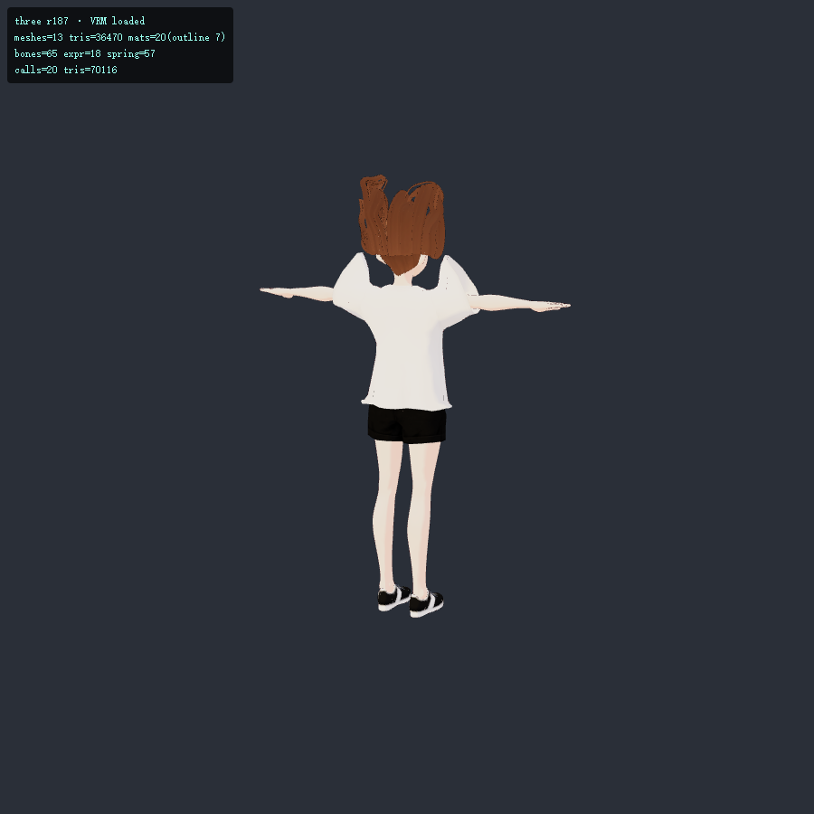
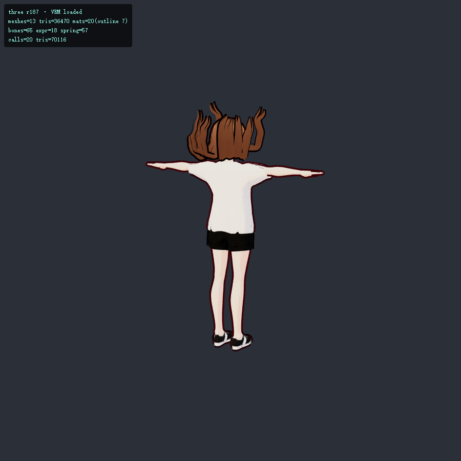
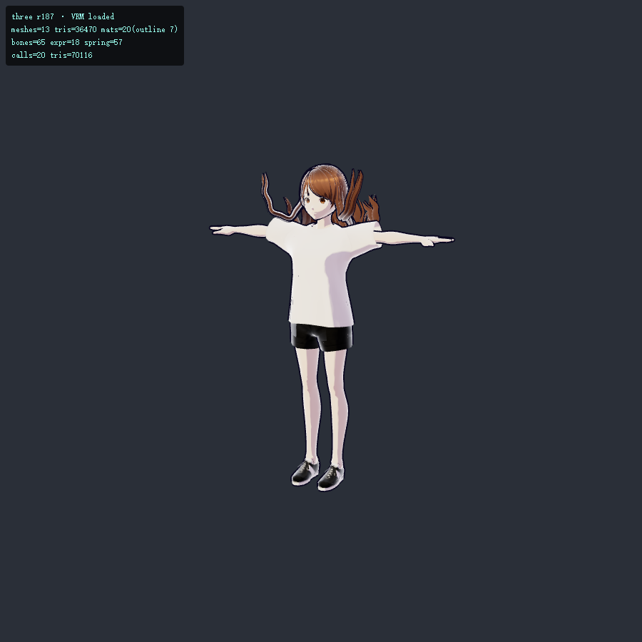
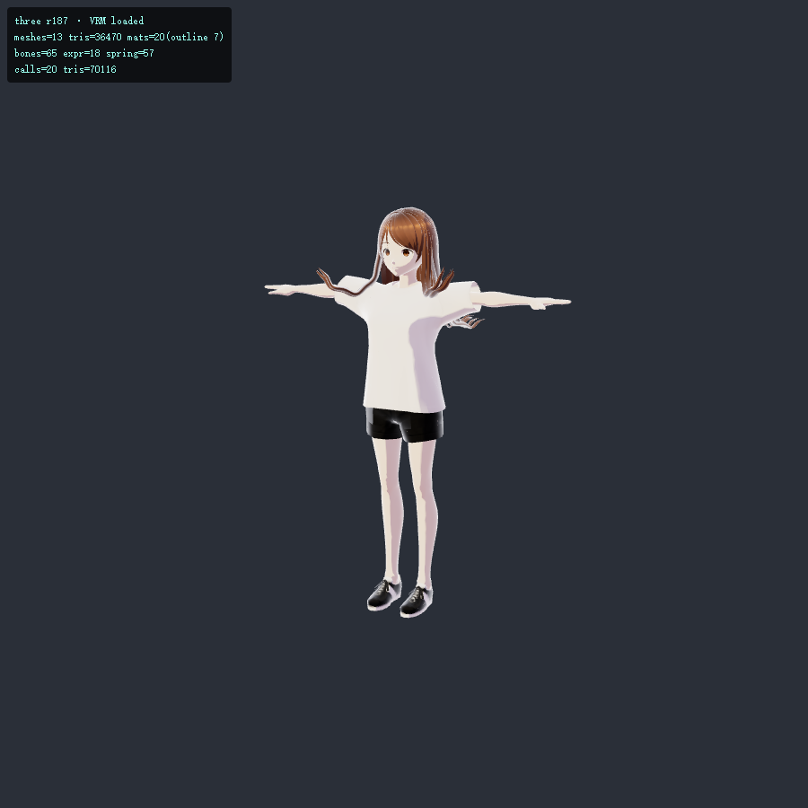
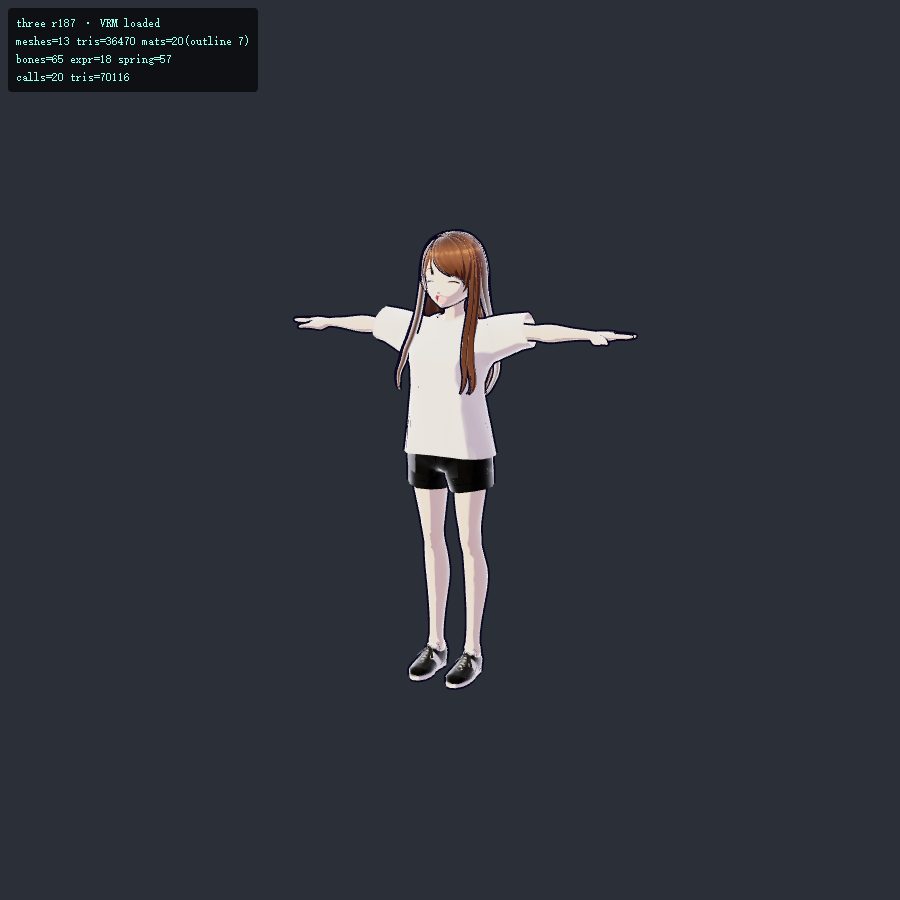
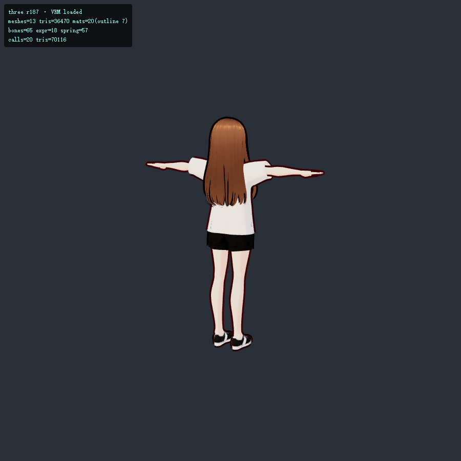
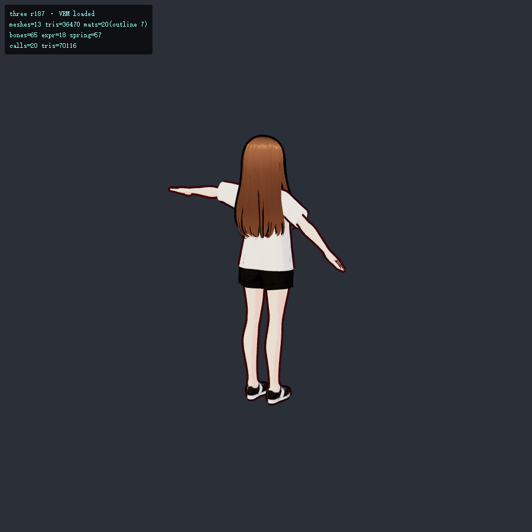
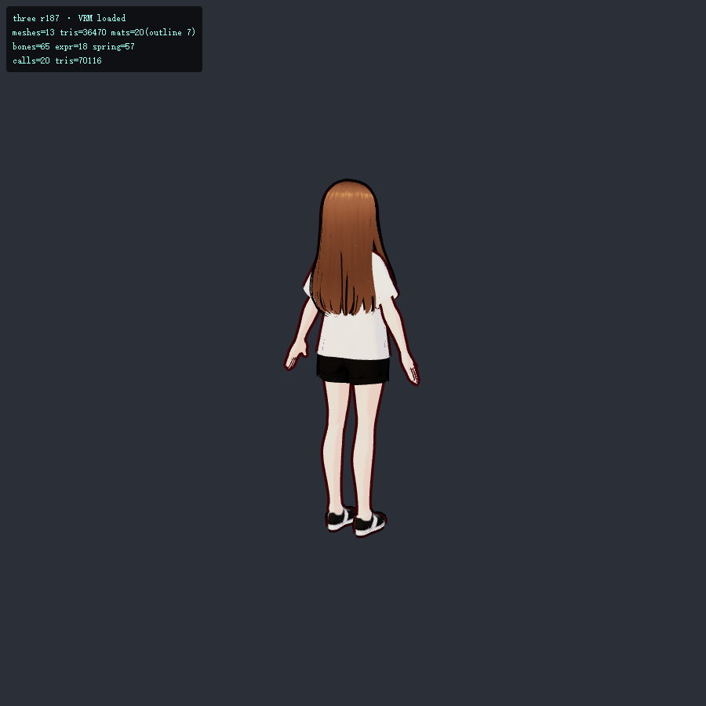

# 报告 I · 3D 二次元 Q 版角色路线（WebGL2 / three.js r187）

> 作者：子代理 I ｜ 日期：**2026-11-16** ｜ 状态：**结论已钉死，可据此排期**
> 本文所有数字分三类，逐条标注：**【实测】**= 本机跑出来的；**【文档】**= 官方文档/许可原文；**【估算】**= 由实测量推导、未逐项验证。
> 证据资产：`reports/assets/i-vrm/`（9 张真实渲染截图）｜ 复现工程：`_tmp/i_vrm/`（`test/index.html` + `test/run.mjs`）

---

## 1. 执行摘要

**可行，而且是唯一可行；但"最短路径"不是买模型，是"VRoid 捏 + Blender 改 + 自己写渲染"。**

**第一段直接回答：**

1. **3D 这条路技术上完全成立，且没有悬念。** 我本机用 three **0.187.0** + `@pixiv/three-vrm` **3.5.5** 跑通了完整链路：加载 VRM 1.0、MToon 材质、`screenCoordinates` 描边、spring bone、18 个表情预设、`.vrma` 动画播放，全部无报错（【实测】见 §4.1）。**不存在"r187 不兼容"的问题**——`peerDependencies` 是开放区间 `three >= 0.137`，我实测在 r187 上正常工作。

2. **但必须提前承认一个残酷事实：你给的效果图里，角色根本不是 3D。** `效果图/2.png` 的近景大肥鱼是**一张 2D 手绘立绘直接贴在 3D 体素场景上**——没有透视收缩、描边宽度恒定、跪姿是一个画好的剪影、阴影是画的。所以「用户不想用 billboard8」和「效果图就是 billboard」这两件事是冲突的。**换成 3D VRM 后，观感不会自动等于效果图**，必须靠 MToon 调参 + `screenCoordinates` 描边 + 低角度机位去"逼近"。我做了调参对照实验，能明显拉近（§4.4 两张图），但**做不到 100% 一致**。这一点必须在立项时就讲清楚，否则 M4 会返工。

3. **最短路径（推荐，钉子方案）：VRoid Studio 捏 + Blender 加尾巴/头饰 + 导出 VRM 1.0 + 程序化动画。**
   - **钱：0 元**（工具全免费，模型自己捏）。
   - **人天：8–13 人天**（含 2 轮返工）；如果只做"能跑通、能替换"的 v0 占位，**3–4 人天**。
   - **许可：可以商用，已核实到官方原文**（§2.1）。
   - 决定性的省钱点：**动画不要买、不要重定向，用程序化**（§5）。`.vrma` 生态现成免费资源极少，Mixamo 对中国大陆用户**根本不开放**（§2.6，这条是硬阻断）。

4. **「大肥鱼」必须换掉，这不是建议是红线。** 用原创角色。但好消息是：**换角色 = 换一个 .vrm 文件 + 改 `character.json`，零改代码**——这正是 §7 的 `character.json` v2 要达成的目标。

**三条最关键的许可结论（详见 §2）：**

| 结论 | 依据 |
|---|---|
| ✅ **VRoid Studio 生成的模型可以商用**（个人与法人皆可），pixiv 官方 guidelines 明文列举了"卖模型数据""做游戏/应用""做手办并销售" | [vroid.com/en/studio/guidelines](https://vroid.com/en/studio/guidelines) 【文档】 |
| ⚠️ **VRM 文件默认不是开源资产。** VRM Public License 1.0 默认只授权"模型利用"（展示渲染画面），**再分发 / 商用 / 改変必须由作者在文件 meta 里显式开启** | [vrm.dev/licenses/1.0/](https://vrm.dev/licenses/1.0/) 【文档】 |
| ❌ **Unity-chan 不可用于正式产品。** 允许商用营利，但第 6.2 条写明"弊社可随时中止你的使用"，且衍生作品**必须传染本许可**给下游 | [unity3d.jp license](https://unity3d.jp/unity-chan_contents/license.php?lang=en) 【文档】 |

---

## 2. 模型来源对比表

> 判断口径：**能否商用**给明确的是/否/有条件；**质量**指"能不能做出 2–3 头身赛璐璐 Q 版"；**工作量**指从零到能进 `character.json` 的人天。

### 2.1 VRoid Studio（pixiv，免费桌面工具）

| 项 | 结论 |
|---|---|
| **能否商用** | ✅ **能。** 官方 guidelines 原文："Any individual or corporation may sell or use for commercial purposes any mesh, texture, or preset item provided by VRoid Studio… provided that no special clauses are indicated in the license." 明文允许的用法包含「卖导出的模型数据」「做游戏、应用、软件」「做手办并销售」「接/发外包」 |
| **许可类型** | **不是 CC0，也不是标准 SPDX 许可。** 原文明确："All content provided by pixiv, including the base models when creating a new avatar, is not CC0." → 是 pixiv 自有的**授权式许可**：你拥有自己做的贴图/头发网格的著作权，但**预设网格/服装网格的权利仍归 pixiv**，pixiv 授予你宽范围使用许可 |
| **是否要署名** | 官方 guidelines **未要求**署名（对比 VRM meta 里的 `creditNotation` 另说）。建议仍在致谢里写一句，成本为零 |
| **两条硬禁止** | ① 不能拿 VRoid 的输出做一个"能生成/导出 3D 模型"的应用（本节第 3 条）；② 预设项若带**特殊条款**（部分发型/服装有），以该条款为准，需逐项看 |
| **导出格式** | **VRM**（0.x 与 1.0 都支持，VRoid Studio 较新版本默认导出 VRM 1.0）；另有 VRM + glTF |
| **做 Q 版合适吗** | ✅ 合适，但**不是一键**。VRoid Studio 通过"体型参数"里的**身高/头身比**滑块做 SD/ちび 化，官方 help 有专门条目讲这件事（`パラメータを調整すれば、SDキャラも簡単に作成できます`，该页本机被 Cloudflare 拦，403，见 §8 未取到清单）。**副作用【文档/社区】**：头身比压得太狠会让网格破形（穿模、脸部拉伸），BOOTH 上一个 CC0 ちび素体的作者就明说自己"破綻しやすい，所以把描边关掉了" |
| **低多边形** | ⚠️ **VRoid 不做减面。** 导出的是标准 VRoid 密度：我实测的那只 pixiv 官方 VRM 样本是 **36,470 三角面 / 24,951 顶点 / 13 个材质（全 MToon）**（【实测】）。要减面必须进 Blender 用 Decimate，或者干脆接受（§6 会论证 36k 其实可以接受） |
| **做"蓝发+女仆装+尾巴"要多久** | 见 §2.12 的工时表。**核心矛盾：VRoid 里能 20 分钟捏出"蓝发+女仆装"，但「鲸鱼尾巴」捏不出来**——VRoid 没有尾巴类部件，必须在 Blender 里建模 + 绑骨 + 加 spring bone。这是唯一必须出 Blender 的地方 |
| **链接** | [vroid.com/en/studio/guidelines](https://vroid.com/en/studio/guidelines) ｜ [vroid.com/studio](https://vroid.com/studio) |

### 2.2 VRoid Hub（模型分享站）

| 项 | 结论 |
|---|---|
| **能否商用** | ⚠️ **逐个模型不同，必须以该模型的许可标记为准**，不能按站点一刀切。站点明确声明 "The license on VRoid Hub is different from the one on UniVRM and other connected applications"（该 help 页本机 403，未能取出原文，但标题本身即为官方立场，且与站点 URL 参数结构一致） |
| **怎么读许可标记** | **这是本节最有用的一条。** VRoid Hub 的筛选 URL 参数**直接对应 VRM 1.0 的 meta 字段**，所以"会读 URL 参数 = 会读文件里的许可"：<br>`allowed_to_use_user`（谁能扮演：everyone / onlyAuthor / explicitlyLicensedPerson）<br>`characterization_allowed_user`（人格付与）<br>`corporate_commercial_use`（**法人商用**：allow / disallow）<br>`personal_commercial_use`（**个人商用**：profit / nonprofit / disallow）<br>`credit`（是否必须署名：necessary / unnecessary）<br>`modification`（改変：allow / disallow）<br>`redistribution`（再分发：allow / disallow）<br>`sexual_expression` / `violent_expression`<br>—— 对照 §4.2 的 `Meta` 接口，一一对得上 |
| **有多少可商用的 Q 版模型** | ❓ **未取到确切数量。** 站点是 JS 单页应用，`hub.vroid.com/en/license?...` 直连返回 404（只有外壳 HTML），本机无法枚举。§8 记入未验证清单 |
| **能不能直接下载** | ⚠️ **取决于作者开关**。很多模型只允许"在线看"，`redistribution=disallow` + 无下载按钮。要找可下载的必须同时满足 **可下载 + `corporate_commercial_use=allow`（或你是个人主体则看 `personal_commercial_use=profit`）** |
| **质量** | 【文档/观察】VRoid Hub 上主体是 VRoid 捏的常规头身角色，**真·2–3 头身 Q 版是少数派**（ちび 需要刻意压头身比，多数人不做）。找到"蓝发+女仆+尾巴"的概率≈0 |
| **链接** | [hub.vroid.com](https://hub.vroid.com/en) |

### 2.3 BOOTH.pm（日本同人市场，pixiv 运营）

| 项 | 结论 |
|---|---|
| **能否商用** | ⚠️ **必须逐商品看，且这里的坑最多。** 常见三类：① **个人利用限定**（"個人利用のみ"，商用要另买商业 license，通常 ×2–×10）；② **商用可但有件数上限**（如"售卖 500 份以内"）；③ **VN3 许可**（VRM 生态的事实标准许可模板，勾选式，商用/改変/再配布逐项打勾）。**没有统一标准，只有逐项确认** |
| **许可类型** | 多数商品页会写「VN3ライセンス」并给出勾选表；少数用 CC 系；少数写「規約は同梱の README 参照」——**这类直接放弃**，不可核查 |
| **价格区间** | 【文档，BOOTH 实页】观测到的样本：**¥0**（CC0 ちび素体）、**¥100**（简易 VRM 模型）、**¥5,000**（VRoid 対応 3D 模型本体，含 2 体套装、标注「即使用可」）。**主流 VRM 角色落在 ¥0–¥10,000 区间**（另有来源给"無料〜1万円台"的区间，见 §2.12） |
| **有没有现成的"Q 版可商用"** | ✅ **有一个非常值得用的东西**：[【無料】【CC0】Vroid ちび素体（男女）](https://booth.pm/ja/items/5156817) —— 免费、9.29 MB、作者声明 CC0、只用 VRoid 预设捏的、身高约 110cm、**已去掉描边**（因为容易破形）、男女双素体。<br>⚠️ **但这个 "CC0" 标签法律上不严谨**：作者无法把 pixiv 的预设网格 CC0 掉（见 §2.1"不是 CC0"）。**实际结论：拿它当底模是安全的（VRoid 许可本就允许商用），但 `character.json.license` 里不能只写 `CC0`，必须写 `VRoid Studio License + author CC0 intent`**，并把 pixiv 的许可原文链接记进 `provenance` |
| **另一个有用工具** | [【VRM】V-Chibi Studio](https://booth.pm/en/items/8698259) —— 把已有 VRoid 一键 ちび 化。**未实测**，但如果是真的能省 1–2 人天，值得 30 分钟试一次 |
| **链接** | [booth.pm](https://booth.pm/) |

### 2.4 Sketchfab

| 项 | 结论 |
|---|---|
| **能否商用** | ✅ **CC0 可以（无条件）**；✅ **CC BY 可以（需署名）**；❌ **CC BY-NC 不可以**；❌ **CC BY-ND 不可以**（我们不能不改：要加尾巴、要改材质、要减面）；⚠️ **Store 的 Standard License 可以商用**，Editorial License **不可以**（仅新闻/纪录用途） |
| **许可类型** | CC0 / CC BY / CC BY-NC / CC BY-ND / CC BY-SA / Store Standard / Store Editorial（原文见 [Sketchfab 许可筛选公告](https://sketchfab.com/blogs/community/refine-downloadable-model-searches-with-new-license-filters/)） |
| **有现成 Q 版/二次元角色吗** | ⚠️ **有，但基本不可用。** 原因不是没有模型，而是：① 动漫风 Q 版在 Sketchfab 上的**可下载且 CC0/CC-BY** 的比例极低，绝大多数是 **CC BY-NC**（同人二创，作者无权商用授权）或**不可下载**（仅展示）；② 即便找到，**大概率不是 VRM**，是 FBX/glTF，没有 humanoid 骨骼约定、没有 MToon、没有 spring bone、没有表情 blendShape → 要自己重做 rig + 表情 + 物理，**工作量比 VRoid 捏一个更大**。**【判断】这条路对"Q 版可商用 VRM"是死路，不建议投入时间搜索** |
| **质量** | 【判断】展示向模型质量高，**但"能直接进引擎的 rigged anime VRM"极少**。Sketchfab 的强项是硬表面/场景/道具，不是可驱动的动漫 avatar |
| **链接** | [sketchfab.com/search](https://sketchfab.com/search) |

> **注**：Sketchfab 另有「Restricting Generative AI Use of Free Models」政策（2023-11），与本案无关但值得知道。

### 2.5 Ready Player Me

| 项 | 结论 |
|---|---|
| **能否商用** | ⚠️ **未取到许可原文，不下结论。** 官方文档站与条款页本轮抓取未拿到可直接引用的商用条款。**已知事实**：RPM 的定位是"照片 → 半写实/卡通 avatar"，输出 glTF（.glb），带 humanoid rig，可商用是他们宣传的卖点，但**具体条款必须由法务读 terms 后确认**（§8 未验证） |
| **适合二次元吗** | ❌ **不适合。** RPM 的生成管线是**写实/半写实捏脸**（照片驱动、真实人脸比例、PBR 材质），产出的是"3D 卡通人"而不是"2–3 头身赛璐璐 Q 版"。**风格差得太远，改都改不过来**（头身比、眼睛、描边、材质模型全不对） |
| **额外问题** | RPM 的 avatar 是**云端生成 + CDN 托管**，长期可用性依赖对方服务；我们要求"可离线打包发布"，不匹配 |
| **结论** | ❌ **排除。** 不是许可问题，是风格问题 |

### 2.6 Mixamo（Adobe）

| 项 | 结论 |
|---|---|
| **能否商用** | ✅ **能，且免版税、无需署名。** 官方 FAQ 原文："You can use both characters and animations royalty free for personal, commercial, and non-profit projects including: … Create video games." |
| **许可类型** | Adobe 自有条款（非 CC），免费、需 Adobe ID |
| **🚨 硬阻断** | **官方 FAQ 明文："Mixamo is not available for users who have a country code from China. The current release of Creative Cloud in China does not include web services."** —— **中国大陆用户用不了。** 这不是"慢"或"要梯子"的问题，是**账号层面不可用**。对国内团队 = **直接出局**，不要把它写进方案 |
| **适合二次元吗** | ❌ 动画本身是**写实人形动作捕捉**，幅度大、节奏写实。套到 2–3 头身 Q 版上会因为**肢体比例差异巨大**（chibi 的腿只有真人的 1/3 长）导致动作变形/穿插。**能重定向，但效果差**，还要额外做 retarget（§5.2） |
| **另一个坑** | 官方明确说 auto-rigger **不支持"有大型附加物（翅膀、尾巴、大头发、大衣服）"的角色** —— 我们的鲸鱼尾巴正好踩这条 |
| **结论** | ❌ **排除（中国大陆不可用 + 风格不匹配）** |
| **链接** | [helpx.adobe.com/creative-cloud/faq/mixamo-faq.html](https://helpx.adobe.com/creative-cloud/faq/mixamo-faq.html) |

### 2.7 Unity-chan（UCL 3.0）

| 项 | 结论 |
|---|---|
| **能否商用** | ⚠️ **"能营利"，但不能用于正式产品。** 第 3.1 条许可"创作二次创作物"并"自己上映/公衆送信/展示/頒布"，含营利；但**第 6.2 条："利用者による…利用は、弊社の自由な意思に基づいていつでも中止させることができます"——Unity 可随时叫停** |
| **致命条款三条** | ① **第 2.2 条**："弊社は、弊社キャラクターの改変物について、著作権を専有しています"（改変物的著作权归 Unity）；② **第 3.1(3) + 3.2(1)**：分发衍生作品时**必须让下游继承本许可**（传染），与闭源商业产品不兼容；③ **第 3.2(7)**：禁止用作 **AI 图像生成的训练/输入数据** |
| **还有** | 第 3.3 条要求显著展示 license logo 或表记；第 1(3) 条：把素材数据挪用去**非该角色**的用途 → 转为 Unity Companion License |
| **能不能当占位/演示** | ✅ **可以当"内部演示/技术验证"的临时模型**（不对外发行、不商业化、用完就删）。**但不能进产品链路**，因为随时可能被叫停 |
| **结论** | ❌ 正式产品排除；✅ 仅限一次性技术 demo |
| **链接** | [unity3d.jp/unity-chan_contents/license.php](https://unity3d.jp/unity-chan_contents/license.php?lang=en) ｜ [unity-chan.com/contents/license_jp](https://unity-chan.com/contents/license_jp/) |

### 2.8 Alicia Solid（ニコニ立体ちゃん）

| 项 | 结论 |
|---|---|
| **能否商用** | ⚠️ **未取到许可原文，不下结论**（§8）。社区普遍认知是 CC-BY 系（ニコニ立体官方角色，允许二次创作），**但"CC-BY 具体版本 + 是否允许商用"本轮没抓到可引用的官方页**，不能凭印象写。**必须用之前去 [3d.nicovideo.jp](https://3d.nicovideo.jp/) 官方作品页读一遍** |
| **适合二次元吗** | ⚠️ 她是**常规头身比**的动漫少女（不是 Q 版），而且**没有尾巴/女仆装**，改造成本高 |
| **能不能当占位** | ⚠️ 许可未确认前不建议 |
| **结论** | ❓ 待法务确认；风格上也不合适。**不推荐** |

### 2.9 VRM 官方 sample avatar（AvatarSample_A/B/C、Sendagaya Shino 等）

| 项 | 结论 |
|---|---|
| **能否商用** | ⚠️ **每个 sample 不同，必须读文件里的 meta。** 好消息：**VRM 的 meta 就在文件里，能直接读出来**——这是 VRM 相对 FBX/glTF 的最大优势 |
| **我实测到的一个正面案例** | pixiv 官方的 `VRM1_Constraint_Twist_Sample.vrm`，从文件里解出的 meta 是：`commercialUsage: "corporation"`、`allowRedistribution: true`、`modification: "allowModificationRedistribution"`、`creditNotation: "unnecessary"`、`licenseUrl: "https://vrm.dev/licenses/1.0/"`、`authors: ["pixiv Inc."]`、`copyrightInformation: "(c) 2022 pixiv Inc."`（【实测】直接用 GLB 解析器读 JSON chunk）。**这份样本明确允许法人商用、允许再分发、允许改変、无需署名** |
| **VRoid Studio 的 sample model（AvatarSample_A/B）** | ⚠️ 有**独立的**使用条件（官方 help 有专页 `VRoidPreset-A-B-C` / `Do VRoid Studio's sample models come with conditions of use?`，本机 403 无法取原文）。**不能默认等同 VRoid Studio 本体许可** |
| **Sendagaya Shino（千駄ヶ谷篠）** | ⚠️ 同上，官方 help 页 403 未能取原文。**不臆测** |
| **能不能当占位/演示** | ✅ **能，而且强烈推荐**——但只用**内部技术验证**级的样本（如上面的 Twist Sample），**不要拿它当对外发布素材**：它是 pixiv 的技术测试模型（白 T 恤黑短裤），不是角色设计，且**没有尾巴、没有女仆装**，无法验证我们真正的视觉需求 |
| **结论** | ✅ **当"管线验证 + 性能基准"的标尺最合适**（我就是这么用的）；❌ 不能当产品角色 |

### 2.10 Kenney

| 项 | 结论 |
|---|---|
| **能否商用** | ✅ **能，CC0，公共领域，无需署名。** 官方 FAQ："all game assets on the asset pages are public domain licensed (CC0). You're free to use them, even in commercial projects." / "Attribution is not required." |
| **许可类型** | **CC0**（唯一一个真正干净的 CC0） |
| **适合二次元吗** | ❌ **完全不适合。** Kenney 是**几何低多边形/扁平卡通**（方块人、圆头人），是无纹理或极简贴图的"开发者美术"风格。跟"2–3 头身、粗描边、赛璐璐、女仆装、鲸鱼尾巴"**没有任何交集** |
| **能不能当临时占位** | ✅ **能，而且是"占位"的最佳答案**——但**不建议用 Kenney 的角色**，建议**用自己的 20 行代码生成的胶囊 + 名字**（`DEV.md` §8.5 已经这么做了，M0 原型里也有 `chibiSprite()` 出的占位立绘）。理由：Kenney 的角色模型**没有 humanoid 骨骼约定**（不是 VRM），接上去反而要写一套"非 VRM 的降级加载器"，**增加代码而不是减少代码**。**要占位就直接用 pixiv 的 VRM 样本**，走同一条代码路径 |
| **链接** | [kenney.nl/support](https://kenney.nl/support) |

### 2.11 Quaternius

| 项 | 结论 |
|---|---|
| **能否商用** | ✅ **能。** QAL v1.0 明文："You can use these assets, free of charge, in personal, educational, and commercial games and other projects, with no credit required." |
| **⚠️ 重要更新** | **不再是 CC0 了。** Quaternius 已从 CC0 切换为自有的 **Quaternius Asset License (QAL) v1.0**，页面标注 **Last updated: 8/28/2026**（就是三个月前）。QAL 允许商用、免署名，但**禁止把素材本身当素材转售/再分发**。且明确"变更不追溯"——**老包里拿到的仍是 CC0，新包是 QAL**，所以**必须记录每个包的取得日期** |
| **适合二次元吗** | ❌ **不适合。** 同样是低多边形欧美卡通（fantasy/Sci-Fi 道具与角色），风格差得远 |
| **能不能当临时占位** | ⚠️ 同 Kenney：技术上能，但**引入第二条加载路径不值得**。**不推荐** |
| **链接** | [quaternius.com/license.html](https://quaternius.com/license.html) |

### 2.12 国内的二次元 3D 模型库 / 捏脸工具 / ToB 方案

| 项 | 结论 |
|---|---|
| **有没有"国内可商用的二次元 3D 模型库"** | ❌ **没找到对口的。** 国内没有 VRoid Hub / BOOTH 这种"VRM 角色市场"。淘宝/爱发电上有卖 MMD/PMX 模型和"虚拟主播模型定制"的，但**许可基本是"个人使用"**，商用要另谈，且**不可核查、不可追溯**——不符合本项目"许可必须可核查"的硬约束。**不建议走这条路** |
| **ToB 数字人方案（百度曦灵 / 魔珐 / 相芯等）** | ❌ **不对口，别浪费时间。** 我查了[百度智能云数字员工价格指南](https://xiling.cloud.baidu.com/doc/AI_DH/s/Vlysgbz88)：这些是**"AI 数字人客服/直播"SaaS**——卖的是"照片/视频 → 会说会动的数字人 + 播报 + 直播推流"，**产出不是可进游戏引擎的 rigged VRM/glTF**，是托管在他们平台上的视频流。我们要的是"能塞进 three.js、能自己驱动骨骼和表情的资产"，**形态完全不匹配**。（具体报价页只有导航壳、没取到数字，§8；但形态不对口这一点已经足够否掉） |
| **捏脸工具** | ⚠️ 国内有若干 Web 捏脸 SDK（人脸 → 参数化 avatar），但输出的都是**写实/半写实头部**，不是全身 Q 版，也没有尾巴/女仆装的表达能力。**排除** |
| **结论** | **国内路线没有捷径。** 回到 VRoid 自制 |

### 2.13 自制路径：VRoid 捏 + Blender 改尾巴/头饰

| 项 | 结论 |
|---|---|
| **可行性** | ✅ **高。** VRoid 负责"人"（头/脸/发/身体/女仆装——VRoid 有女仆装预设），Blender 只负责 VRoid 做不了的三件事：**① 鲸鱼尾巴 ② 女仆头饰的额外细节 ③ 减面/合并材质** |
| **风险** | ⚠️ 三条真实风险：<br>① **VRoid 的 mesh 是自动生成的四边面为主、拓扑不干净**，在 Blender 里直接拉伸接尾巴会破面 → 正确做法是**尾巴做成独立 mesh，不缝合，靠父子关系/骨骼挂在髋部**（省掉拓扑噩梦，视觉上也够用）；<br>② **尾巴必须加 spring bone**，且**不能挂到 humanoid 骨骼上**（VRM humanoid 只允许那 54 根标准骨），要走 `VRMC_springBone` 的独立 joint 链；<br>③ **缩放会破坏弹簧**（§4.5 实测），必须做 `gravityPower` 补偿 |
| **工时** | 见 §3 |

### 2.14 对比总表

| 来源 | 能商用 | 许可类型 | 要署名 | 有 Q 版/二次元 | 能直接下载 | 价格 | 到"能进引擎"的工作量 | 结论 |
|---|---|---|---|---|---|---|---|---|
| **VRoid Studio 自制** | ✅ | pixiv 自有授权（**非 CC0**） | 不要求 | ✅ 可参数化到 SD | ✅ 本地生成 | **¥0** | **3–13 人天**（看完成度） | ⭐ **推荐** |
| **BOOTH CC0 ちび素体** | ✅ | 作者声明 CC0 + **VRoid 许可仍在** | 不要求 | ✅ 就是 Q 版 | ✅ ZIP 9.29MB | **¥0** | **2–5 人天**（改色/加尾巴） | ⭐ **最佳底模** |
| BOOTH 付费 VRM | ⚠️ 逐个看 | VN3 / 自有 | 多半要 | ⚠️ 少数 | ✅ | ¥100–¥10,000 | 3–8 人天（改造成 Q 版+加尾巴） | 备选 |
| VRoid Hub | ⚠️ 逐个看 | VRM meta 开关 | 看 `credit` | ⚠️ 少数 | ⚠️ 看作者 | ¥0 | 同上 | 备选 |
| Sketchfab CC0/CC-BY | ✅ | CC0 / CC BY | CC BY 要 | ❌ 极少且非 VRM | ✅ | ¥0 | **10–20 人天**（重建 rig/表情/物理） | ❌ 死路 |
| Sketchfab Store | ✅ | Standard License | 不要求 | ❌ | ✅ | $10–$200 | 同上 | ❌ |
| Ready Player Me | ❓ 未取到 | 自有条款 | 未知 | ❌ 写实向 | ✅ | 免费/订阅 | — | ❌ 风格不对 |
| **Mixamo** | ✅ | Adobe 免费条款 | 不要求 | ❌ 写实动作 | 🚫 **中国大陆不可用** | ¥0 | 需 retarget | ❌ **硬阻断** |
| **Unity-chan** | ⚠️ 可营利但**可随时叫停** | UCL 3.0（传染） | **必须** | ⚠️ 常规头身 | ✅ | ¥0 | 5–10 人天 | ❌ 不可进产品 |
| Alicia Solid | ❓ 未取到 | 疑 CC-BY | 疑要 | ⚠️ 常规头身 | ✅ | ¥0 | 5–10 人天 | ❌ |
| VRM 官方样本 | ✅（逐个读 meta） | VRM Public License 1.0 | 看 `creditNotation` | ❌ 测试模型 | ✅ | ¥0 | 0（当基准） | ✅ **仅当测试标尺** |
| Kenney | ✅ | **CC0** | 不要求 | ❌ 欧美低模 | ✅ | ¥0 | 需新写加载器 | ❌ 占位也不划算 |
| Quaternius | ✅ | **QAL v1.0**（已非 CC0） | 不要求 | ❌ | ✅ | ¥0 | 同上 | ❌ |
| 国内模型库 / ToB 数字人 | ❌ 不可核查 / 形态不对 | — | — | — | — | — | — | ❌ 排除 |
| **自制（VRoid+Blender）** | ✅ | 你的 | 你定 | ✅ 完全可控 | ✅ | **¥0 + 工时** | **见 §3** | ⭐ **正式路线** |

---

## 3. 原创角色的最短路径（含每步工时）

### 3.1 路线图

```
┌─ 阶段 0：定设计稿（1 人天，不可省）
│    2–3 头身比例草图、配色（蓝发 #2f63c8 / 深蓝女仆装 #28345c / 尾巴 #3f86d8）
│    产出：三视图 PNG（正面/侧面/背面）— 这是后续所有工作的唯一裁判
│
├─ 阶段 1：VRoid Studio 捏人（1.5–2.5 人天）
│    ├ 用 BOOTH 的 CC0 ちび素体当底模（跳过调头身比，省 0.5 天）   [0.5 天]
│    ├ 换发色/瞳色/肤色，调脸型（VRoid 参数化）                   [0.5 天]
│    ├ 选女仆装预设 + 上色（白围裙 + 深蓝连衣裙）                  [0.5 天]
│    ├ 头发造型（双马尾/长发，注意要留 spring bone 的骨骼链）      [0.5 天]
│    └ 导出 VRM 1.0                                            [0.2 天]
│    产出：dafeiyu_base.vrm
│
├─ 阶段 2：Blender 加工（2–4 人天）
│    ├ 导入 VRM（VRM Add-on for Blender）                        [0.2 天]
│    ├ 【唯一必须做】建鲸鱼尾巴 mesh（低模，200–600 面）          [1–2 天]
│    │   └ 尾巴做成独立 mesh，父子挂到 hips，不缝合
│    ├ 给尾巴加骨链（4–6 节）+ 在 Blender 里设 spring bone        [0.5 天]
│    │   └ 或用 three.js 运行时补（见 §4.5 的代码）
│    ├ 女仆头饰（白色荷叶边发箍）                                [0.3–0.5 天]
│    ├ 减面 / 合并材质（13 个材质 → 目标 6–8 个）                 [0.5–1 天]
│    └ 导出 VRM 1.0 + 校验（用 VRM Viewer 或本报告的测法）        [0.2 天]
│    产出：dafeiyu.vrm
│
├─ 阶段 3：贴图/材质压缩（0.5–1 人天）  ← §6.3 有实测依据
│    ├ 删 thumbnail（−1.2 MB，白送）
│    ├ 干掉/降采样 normal map（−3.0 MB）
│    └ 彩色贴图统一 ≤512（−2.4 MB）
│    产出：dafeiyu.web.vrm（目标 ≤3 MB）
│
├─ 阶段 4：接入引擎（1–2 人天）
│    ├ 按 §4.3 写 VRMCharacter.ts（加载/描边/机位/挂点）
│    ├ 程序化动画（idle/走路/说话/跪姿）                          [见 §5.3]
│    └ 表情映射 + 口型
│    产出：能替换掉 m0.html 里的纸片人
│
└─ 阶段 5：返工与打磨（2–3 人天）
     └ 描边粗细/明暗交界/机位/裙摆穿模 — 这一步别省
```

### 3.2 工时与成本汇总

| 路线 | 人天 | 现金成本 | 产出质量 | 适用 |
|---|---|---|---|---|
| **A. 最快能跑的占位**（拿 pixiv 样本 + 改配色） | **1–2 天** | ¥0 | 能验证管线/性能，**不能对外** | 本周就想要动起来 |
| **B. 内部演示级**（VRoid 捏 + 不改 Blender） | **3–4 天** | ¥0 | 蓝发女仆装有了，**没尾巴**，观感中等 | M3 AI 入世前 |
| **C. 正式 v0**（本报告推荐） | **8–13 天** | **¥0** | 有尾巴、有头饰、材质已压缩、能 30fps | **对外公开发布** |
| **D. 外包（日本 3D 建模）** | 1–3 个月 | **10 万–数十万日元**（≈人民币 0.47–1.4 万元以上，按 1 日元≈0.047 元粗算，汇率以付款日为准） | 最高，且 IP 归你 | 有预算、要品牌级质量 |
| **E. 外包（VOID 中）** | — | — | — | **不建议**：国内模型市场许可不可核查 |

> **D 档的价格依据**【文档】：`VTuberモデルの費用 — 依頼相場と自作・購入の価格比較（2026年版）` 给出的一张市场表：3D 模型委托 **10 万円〜数十万円、納期 1〜3 か月**；BOOTH 既製模型 **無料〜1万円台**；VRoid 自作 **0 円、数時間〜数日**（[vtubeme.com/jp/vtuber-model-cost](https://vtubeme.com/jp/vtuber-model-cost)）。
> ⚠️ **该页是厂商内容（卖 $7.99 的 AI 生成服务），价格数字有营销倾向**，仅作量级参考，不作报价依据。另有 [3d-modely.com 2026 年版 VRM 制作依赖费用相场](https://3d-modely.com/blog/product-service/avatar-vrm-production/) 一篇，但其费用表格在本机抓取时被截断，**未能取到具体数字**（§8）。

### 3.3 最短路径的一句话答案

> **"拿 BOOTH 的 CC0 ちび素体（0 元）→ VRoid Studio 改配色和女仆装（1.5 天）→ Blender 加鲸鱼尾巴和 spring bone（2 天）→ 导出 VRM 1.0 → 重新编码贴图压到 3 MB（0.5 天）"。合计 ¥0、约 4 天出一个能进引擎的 v0；再加 4–9 天打磨到能对外发布。**

**为什么不是"买一个"**：市面上没有"蓝发+女仆装+鲸鱼尾巴+2.5 头身"的现成 VRM，**这个组合本身就是原创设计**。买来的模型一样要改，改动量不小于从底模开始，还要额外承担许可不可核查的风险。

---

## 4. 渲染管线（代码级）

### 4.1 环境与依赖（全部已 `npm view` 核实）

| 包 | 版本 | 许可 | 说明 |
|---|---|---|---|
| `three` | **0.187.0** | **MIT** | 项目已锁定 |
| `@pixiv/three-vrm` | **3.5.5** | **MIT** | VRM 加载 + MToon + spring bone + lookAt + expression + node constraint（一体化 bundle） |
| `@pixiv/three-vrm-animation` | **3.5.5** | **MIT** | `.vrma` 加载 |
| `@pixiv/three-vrm-core` | 3.5.5 | MIT | 被 `three-vrm` 依赖 |
| `@pixiv/three-vrm-materials-mtoon` | 3.5.5 | MIT | idem |
| `@pixiv/three-vrm-springbone` | 3.5.5 | MIT | idem |
| `@pixiv/three-vrm-node-constraint` | 3.5.5 | MIT | idem |
| `vrm-mixamo-retarget` | 1.0.3 | **MIT** | §5.2 用；`github.com/saori-eth/vrm-mixamo-retargeter` |
| `@three-ws/retarget` | 0.1.2 | **Apache-2.0** | 备选 retarget；`github.com/nirholas/three.ws` |
| `meshoptimizer` | 1.3.0 | MIT | 可选，几何压缩 |
| `@gltf-transform/core` | 4.5.1 | MIT | 可选，资产离线处理 |

**兼容性结论（【实测】）：**
- `peerDependencies: { "three": ">=0.137" }` —— **开放区间，不锁版本**（【实测】`npm view`）。
- 我在 **three 0.187.0 + three-vrm 3.5.5** 上跑通了：`GLTFLoader` + `VRMLoaderPlugin` + `VRMAnimationLoaderPlugin` → 加载 VRM 1.0 → 13 个 MToon 材质 → 18 个表情预设 → 57 个 spring bone 关节 → 播放 `.vrma`。**零报错**。
- ⚠️ **three r187 的三个 API 变更**（实测时被 warning 打到，会咬人）：
  - `THREE.PCFSoftShadowMap` **已从 r187 移除**，设了会自动降级为 `PCFShadowMap` —— `m0.html:173` 现在用的就是 `PCFShadowMap`，**没问题**，但别再想换 Soft。
  - `THREE.Clock` **已废弃** → 用 `THREE.Timer`。
  - `VRMUtils.removeUnnecessaryJoints` **已废弃** → 改用 `VRMUtils.combineSkeletons`（官方注释：对性能贡献更大）。
- ⚠️ three-vrm 的 shader 里有 `THREE_VRM_THREE_REVISION` 编译期常量做版本兼容分支。它在 r187 上**实测正常**，但这是"构建时快照"式兼容，**升级 three 时必须跑一次回归**（§6.1 给了回归脚本思路）。

### 4.2 加载器：最小可用代码

```ts
// src/character/VRMCharacter.ts
import * as THREE from 'three';
import { GLTFLoader } from 'three/addons/loaders/GLTFLoader.js';
import { VRMLoaderPlugin, VRMUtils, type VRM } from '@pixiv/three-vrm';
import { VRMAnimationLoaderPlugin, createVRMAnimationClip }
  from '@pixiv/three-vrm-animation';

export type CharacterSpec = { /* = character.json v2，见 §7 */ };

export async function loadVRM(url: string, spec: CharacterSpec): Promise<VRM> {
  const loader = new GLTFLoader();
  loader.register((parser) => new VRMLoaderPlugin(parser));
  loader.register((parser) => new VRMAnimationLoaderPlugin(parser));

  const gltf = await loader.loadAsync(url);
  const vrm = gltf.userData.vrm as VRM;
  if (!vrm) throw new Error('not a VRM: ' + url);

  // 1) 骨架合并（r187 推荐；替代已废弃的 removeUnnecessaryJoints）
  VRMUtils.removeUnnecessaryVertices(gltf.scene);
  VRMUtils.combineSkeletons(gltf.scene);

  // 2) VRM 0.x 才需要转向（0.x 朝 -Z，1.0 朝 +Z）
  //    rotateVRM0 内部会判断 metaVersion，1.0 上是 no-op
  VRMUtils.rotateVRM0(vrm);

  // 3) 按方块高度归一（关键！见下方说明）
  const box = new THREE.Box3().setFromObject(vrm.scene);
  const rawH = box.max.y - box.min.y;              // 实测：常规 VRoid 角色 ≈ 1.615
  const scale = spec.scale.heightBlocks / rawH;    // 2.4 / 1.615 ≈ 1.486
  vrm.scene.scale.setScalar(scale);
  vrm.scene.position.y = -box.min.y * scale;       // 脚底贴 y=0

  // 4) 遮蔽/阴影
  vrm.scene.traverse((o) => {
    if ((o as THREE.Mesh).isMesh) {
      o.castShadow = true; o.receiveShadow = true;
      o.frustumCulled = false;   // 蒙皮包围盒会跟丢，AR 近景必关
    }
  });

  return vrm;
}
```

> **`scale` 这一行是最容易做错的地方。** VRM 的作者尺度是**米**（实测样本 `rawHeight = 1.6154`）。我们的世界里 1 方块 = 1 单位、角色 2.4 方块高 → **要放大 ×1.486，不是缩小**。
> 物理直觉核对：14 方块 = 42cm → 1 方块 = 3cm → 角色 2.4 方块 = **7.2cm**。这个尺寸在真桌上就是"7 厘米高的手办"，`DEV.md` §8.1 想要的"手办感"**正好来自这个数**。

### 4.3 每帧更新顺序（顺序错了会抖/会穿模）

```ts
// 必须严格按这个顺序，漏一步就出问题
function updateCharacter(vrm: VRM, dt: number) {
  // ① 先驱动动画（改 normalized bone 的旋转）
  mixer?.update(dt);

  // ② 再跑 spring bone（用刚更新完的骨骼世界矩阵算物理）
  vrm.springBoneManager?.update(dt);

  // ③ node constraint（VRM 1.0 的旋转/滚动约束，如扭转发条）
  vrm.nodeConstraintManager?.update();

  // ④ lookAt（让角色看玩家/相机）—— 依赖 ③ 之后的头部朝向
  vrm.lookAt?.update(dt);

  // ⑤ 表情（blendShape 权重）
  vrm.expressionManager?.update();

  // ⑥ 最后统一把 normalized → raw 骨骼、更新矩阵
  vrm.update(dt);
}
```

### 4.4 描边：**必须用 `screenCoordinates`，不能用 VRoid 出厂的 `worldCoordinates`**

**这是本报告最有价值的一条工程结论。** 我从 three-vrm 的 shader 源码里读出了描边的确切算法（`three-vrm-materials-mtoon.module.js` 的 `mtoon.vert`）：

```glsl
#ifdef OUTLINE
  float worldNormalLength = length( transformedNormal );
  vec3 outlineOffset = outlineWidthFactor * worldNormalLength * objectNormal;

  #ifdef OUTLINE_WIDTH_SCREEN           // ← screenCoordinates 模式
    outlineOffset *= vViewPosition.z / projectionMatrix[ 1 ].y;
  #endif

  gl_Position = projectionMatrix * modelViewMatrix * vec4( outlineOffset + transformed, 1.0 );
  gl_Position.z += 1E-6 * gl_Position.w;   // 反 z-fighting 的魔法数
#endif
```

**结论链：**
1. 描边 = **背面法线膨胀（inverted hull）**，在**顶点着色器**里做，**不是后处理**。所以它**不占额外 render target、不需要 depth/normal pass**——这对手机是好事。
2. 但它是**给同一个 mesh 追加第二个材质**实现的（源码：`outlineMaterial = surfaceMaterial.clone(); outlineMaterial.isOutline = true; outlineMaterial.side = THREE.BackSide; mesh.material.push(outlineMaterial)`）→ **每个带描边的材质 = 多一次 draw call + 多画一遍三角形**。
3. `worldCoordinates` 模式下 `outlineOffset` 是**物体空间**的量，会被 `modelViewMatrix` 缩放。**把角色放大 1.486 倍后，描边宽度也被放大 1.486 倍**；反过来，任何 `<1` 的缩放都会让描边变细乃至消失。VRoid 出厂值 `outlineWidthFactor = 0.0008` 本来就是按"1.6m 角色、全身入镜"调的，**换尺度就必须重调**。
4. `screenCoordinates` 模式额外乘 `vViewPosition.z / projection[1][1]`，**做了深度归一化 → 描边宽度与模型缩放、与相机距离解耦，屏幕上恒定像素宽**。这正是"粗描边赛璐璐"要的效果，也是唯一稳的做法。

**实测对比**（`reports/assets/i-vrm/`）：

| worldCoordinates（出厂 0.0008） | screenCoordinates（0.0075） |
|---|---|
|  |  |
| 描边细到几乎看不见，手臂上有脏的橙红边 | 均匀、干净、明显的冷色描边，接近效果图的"粗描边" |

**实测 draw call 代价**（真正把 outline 材质从 `material` 数组里摘掉再量）：

| 配置 | draw call | 提交三角形 |
|---|---|---|
| 带描边（13 面材质 + 7 描边材质） | **20** | **70,116** |
| 摘掉描边材质 | **13** | **36,470** |
| **差价** | **+7（+54%）** | **+33,646（+92%）** |

> 注意：该样本 13 个材质里只有 **7 个**带描边（6 个脸/眼材质没有描边——这是 VRoid 的正确做法，五官描边靠贴图而不是几何膨胀）。**如果一个角色 13 个材质全都开描边，draw call 会从 13 涨到 26，直接翻倍。**

**所以材质数是硬约束，不是三角形数。** §6 会给预算。

**卡通调参（把默认 MToon 推到效果图的赛璐璐感）**：

```ts
function tuneCelLook(vrm: VRM) {
  vrm.scene.traverse((o) => {
    const mesh = o as THREE.Mesh;
    if (!mesh.isMesh) return;
    const mats = Array.isArray(mesh.material) ? mesh.material : [mesh.material];
    for (const m of mats as any[]) {
      if (!m.isMToonMaterial) continue;

      if (m.isOutline) {
        m.outlineWidthMode      = 'screenCoordinates';  // ★ 缩放无关
        m.outlineWidthFactor    = 0.0042;               // ★ 0.003–0.006 是"粗描边"区间
        m.outlineColorFactor.setHex(0x1b1630);          // ★ 深蓝紫，别用纯黑（纯黑显脏）
        m.outlineLightingMixFactor = 0.0;               // ★ 描边不吃光，保持恒定色
      } else {
        m.shadingShiftFactor   = -0.12;                 // 明暗交界推向暗侧
        m.shadingToonyFactor   = 0.95;                  // 交界更硬（0=柔, 1=纯二值）
        m.shadeColorFactor.setHex(0x8f7fb8);            // 冷紫阴影（二次元标准做法）
        m.parametricRimColorFactor.setHex(0xdfe9ff);    // 边缘光，把角色从背景里"抠"出来
        m.parametricRimFresnelPowerFactor = 4.0;
        m.parametricRimLiftFactor = 0.08;
        m.rimLightingMixFactor = 0.45;
      }
      m.needsUpdate = true;   // MToon 的属性改了必须置位，否则不重编译
    }
  });
}
```

**调参前 / 调参后**（同一机位、同一光照、同一个 `screenCoordinates` 描边）：

| 出厂 MToon 默认值 | 上面的 `tuneCelLook()` |
|---|---|
|  |  |
| 平、发白、没有明暗交界 | 明确的二段明暗 + 冷色阴影 + 边缘光 + 蓝紫描边，**这才是"赛璐璐"** |

**关掉描边后**（说明描边到底贡献了多少观感）：


> **坦白说**：即便调到这个程度，**仍然不等于效果图**。效果图是手绘立绘，它的眼睛是画的、头发的层次是画的、表情是画的。3D 模型的眼睛是贴图 + 少量 blendShape，头发是面片，**鼻子的阴影、脸型的收窄都做不到 2D 那么极端**。要更接近，只能靠：① 更极端的头身比（2 头身）；② 眼睛贴图重绘成"大眼高光"；③ **相机永远略仰视 + 头永远微转向相机**（VRM 的 `lookAt` 天然支持，见 §4.6），制造"她一直在看你"的手办感。**这三条是 M4 的工作，不是 M0 的。**

### 4.5 spring bone（头发/尾巴/裙摆）：能跑，便宜，但**缩放会坏**

**实测数据**（用最长的那条 spring 链末端关节，`J_Sec_Hair6_05`，链长 14；每个 scale 跑 240 步后统计）：

| 模型 scale | 末端最大相对位移<br>（÷scale，归一化到模型自身尺寸） | 稳态抖动<br>（帧间位移差） | `springBoneManager.update()` 耗时 |
|---|---|---|---|
| 1.0 | 0.0289 | **0** | 0.088 ms |
| **1.4857（我们的 2.4 方块）** | **0.0322** | **0** | 0.063 ms |
| 0.5 | **0.375**（13 倍） | 0 | 0.060 ms |
| 0.1 | **0.700**（24 倍） | 0 | 0.073 ms |
| 0.01 | 0.586 | 0 | 0.074 ms |

**三条结论：**

1. ✅ **不会抖。** 所有 scale 下稳态抖动都是 **0**，2 步内收敛。（"手机上手会抖"这个担心是多余的——抖的根源通常是**帧率不稳导致 dt 抖动**，而不是 spring 本身。**所以必须用固定 dt 或 clamp dt**，见下面代码。）
2. ✅ **便宜。** 57 个关节 **0.063–0.088 ms/帧**。本机是桌面 CPU，中端安卓单核大约慢 3–5 倍 → **估算 0.2–0.45 ms/帧**，占 60fps 预算（16.6ms）的 **1.2%–2.7%**。**spring bone 不是瓶颈，放心用。**
3. 🚨 **缩小模型会让弹簧"炸开"。** scale 0.5 时头发末端相对位移是原来的 **13 倍**，0.1 时 **24 倍**——因为**重力是世界空间的常量，而骨骼长度随 scale 缩小**，相对垂坠量 ∝ 1/scale。
   - 我们这条路线是**放大 ×1.486**，所以**安全**（0.0289 → 0.0322，只差 11%）。
   - 但如果将来要"把角色缩到很远的背景里"当远景，**必须补偿**。

**补偿代码（如果哪天真要缩小）：**

```ts
// VRM 1.0 的 spring 参数：{ hitRadius, stiffness, gravityPower, gravityDir, dragForce }
// 缩放 S 时，重力导致的相对垂坠 ∝ 1/S → 把 gravityPower 乘 S 即可抵消
function compensateSpringForScale(vrm: VRM, S: number) {
  if (S >= 0.9) return;                       // 放大或轻微缩小，不用管
  vrm.springBoneManager?.joints.forEach((joint) => {
    const s = (joint as any).settings;
    if (s) s.gravityPower *= S;
  });
}
```

**固定 dt（防抖的真正关键）：**

```ts
const FIXED = 1 / 60;
let acc = 0;
function tick(now: number) {
  const raw = Math.min((now - last) / 1000, 0.1);  // ★ clamp：切后台回来别给 3 秒的 dt
  last = now;
  acc += raw;
  while (acc >= FIXED) { updateCharacter(vrm, FIXED); acc -= FIXED; }
  renderer.render(scene, camera);
}
```

> **API 注意**：`VRMSpringBoneJointSettings` 的字段是 `{ hitRadius, stiffness, gravityPower, gravityDir, dragForce }`（从 `types/VRMSpringBoneJointSettings.d.ts` 读出）。**没有 `gravityPower` 的 setter 保护，是可变对象**，所以上面的写法成立。

### 4.6 表情与口型：**能驱动"说话时嘴动"**

- **VRM 1.0 的预设表情全集**（从 `types-vrmc-vrm-1.0/types/ExpressionPresetName.d.ts` 读出，权威）：
  `happy` `angry` `sad` `relaxed` `surprised` / `aa` `ih` `ou` `ee` `oh` / `blink` `blinkLeft` `blinkRight` / `lookUp` `lookDown` `lookLeft` `lookRight` / `neutral`
  → **18 个**。我实测的样本模型 18 个**全都有**（【实测】`Object.keys(expressionManager.expressionMap)`）。
- **口型（viseme）就是 `aa/ih/ou/ee/oh` 五个**，这是 VRM 标准定义的日语音素口型，**可以直接用来做中文口型近似**（中文不需要精确 viseme，5 个口型轮播看起来就"在说话"）。
- **实测**：`expressionManager.setValue('happy', 1)` 生效（截图 `assets/i-vrm/expression-happy.png` 里眼睛变成笑眼）；`setValue('aa', 0.9)` 生效（`expression-aa-viseme.png` 里嘴张开）。

| happy | aa（口型） |
|---|---|
|  |  |

**说话驱动（配合 TTS 或纯文本节奏）：**

```ts
// 方案 A：无音素的"假口型"——最省，观感足够（推荐 v0）
class LipFlap {
  private t = 0;
  private seq = ['aa', 'ih', 'ou', 'ee', 'oh'] as const;
  update(dt: number, speaking: boolean, vrm: VRM) {
    const em = vrm.expressionManager!;
    if (!speaking) { for (const p of this.seq) em.setValue(p, 0); return; }
    this.t += dt;
    const idx = Math.floor(this.t * 8) % this.seq.length;   // 8 Hz 换口型
    for (let i = 0; i < this.seq.length; i++) {
      const target = i === idx ? 0.75 : 0;
      const cur = em.getValue(this.seq[i]) ?? 0;
      em.setValue(this.seq[i], cur + (target - cur) * Math.min(1, dt * 18)); // 平滑
    }
  }
}

// 方案 B：真的有音素时间轴时
// [{ t: 0.00, v:'aa', w:0.8 }, { t: 0.12, v:'ou', w:0.6 }, ...] → 按时间插值
```

**眨眼（必须做，否则像死物）：**

```ts
let blinkTimer = 0, blinkPhase = -1;
function tickBlink(dt: number, vrm: VRM) {
  const em = vrm.expressionManager!;
  if (blinkPhase < 0) {
    blinkTimer -= dt;
    if (blinkTimer <= 0) { blinkPhase = 0; blinkTimer = 2.2 + Math.random() * 3.5; }
    return;
  }
  blinkPhase += dt / 0.09;                    // 90ms 一次眨眼
  if (blinkPhase >= 1) { blinkPhase = -1; em.setValue('blink', 0); return; }
  em.setValue('blink', Math.sin(blinkPhase * Math.PI));  // 0→1→0
}
```

### 4.7 机位（对齐效果图的"低角度略俯视"）

```ts
// 效果图 2.png：相机比角色低一点，微微仰视，广角
// DEV.md §1.2 V13 说 "FOV 38–45，机位高于桌面 20–35cm"
// 换算到我们的世界单位（1 方块 = 3cm）：
//   20–35cm = 6.7–11.7 方块 → 相机 y ≈ 6.7–11.7
//   角色 2.4 方块高，所以相机高度 ≈ 角色的 2.8–4.9 倍
const cam = new THREE.PerspectiveCamera(42, aspect, 0.05, 200);
cam.position.set(target.x + 3.2, target.y + 2.6, target.z + 5.4);  // 低角度、略俯视
cam.lookAt(target.x, target.y + 1.3, target.z);                     // 看胸口而不是脚
```

### 4.8 让"手办"活起来：`lookAt` 一直盯着玩家

```ts
// VRM 的 lookAt 是标准能力，用它做"她在看你"的手办感——这是 3D 相对 2D 立绘的唯一优势
if (vrm.lookAt) {
  vrm.lookAt.target = camera;        // 直接指向相机
  // 或指向一个空 Object3D（玩家手指点的地方）
  // vrm.lookAt.target = playerGazeTarget;
}
```
> 注意要 `vrm.lookAt.update(dt)`（见 §4.3 顺序）。默认 `VRMLookAtQuaternionProxy` 会在 `createVRMAnimationClip` 时自动补（我实测时打出了这个 warning：`VRMLookAtQuaternionProxy is not found. Creating a new one automatically.`）。

---

## 5. 动画方案

### 5.1 `.vrma`（VRM 专用动画格式）：能用，但**现成免费资源极少**

| 项 | 结论 |
|---|---|
| **支持状态** | ✅ 官方支持。`@pixiv/three-vrm-animation` **3.5.5**（MIT），提供 `VRMAnimationLoaderPlugin` + `createVRMAnimationClip(vrmAnim, vrm)` |
| **格式本质** | 一个**只有骨骼/表情/视线轨道、没有 mesh** 的 glTF，扩展名 `VRMC_vrm_animation`。我在测试用的 `test.vrma` 上验证：**11.3 KB / 53 个 node / 1 个 animation / 3 秒 / 3 条轨道**，轨道名长这样：`Normalized_J_Bip_R_UpperArm.quaternion`、`VRMExpression_happy.weight`、`VRMLookAtQuaternionProxy.quaternion`（【实测】） |
| **体积** | **极小**：11.3 KB → brotli **2.1 KB**（【实测】）。**动画根本不是体积问题，可以一次预载十几条** |
| **生态** | ⚠️ **弱。** 免费资源主要在 BOOTH（如「【無料】VRMA回転アニメーション3種」，[booth.pm/ja/items/7485491](https://booth.pm/ja/items/7485491)），但：① 数量少；② **每个都要单独看许可**（多半是"个人利用可、商用需另议"）；③ 质量参差；④ 都是**常规头身**的动作，套到 2.5 头身 Q 版上会因肢体长度差异而变形 |
| **结论** | ✅ **技术准备好，可以留作后期加"挥手/鞠躬/思考"等成品的通道**；❌ **不要指望靠现成 .vrma 起步** |

**实测播放代码（已跑通）：**

```ts
const loader = new GLTFLoader();
loader.register((p) => new VRMAnimationLoaderPlugin(p));

async function playVRMA(url: string, vrm: VRM, mixer: THREE.AnimationMixer) {
  const g = await loader.loadAsync(url);
  const vrmAnim = g.userData.vrmAnimations?.[0];
  if (!vrmAnim) return null;
  const clip = createVRMAnimationClip(vrmAnim, vrm);   // ★ 关键：把动画重定向到当前 VRM
  mixer.stopAllAction();
  mixer.clipAction(clip).reset().play();
  return clip;
}
```
播放中的截图：

### 5.2 Mixamo 动画重定向到 VRM：**技术上可行，但我们已经否掉 Mixamo**

- 工具是有的、而且是 MIT：
  - `vrm-mixamo-retarget` **1.0.3**（**MIT**，`github.com/saori-eth/vrm-mixamo-retargeter`）
  - `@three-ws/retarget` **0.1.2**（**Apache-2.0**，`github.com/nirholas/three.ws`）
- **重定向本身不难**：VRM 的 humanoid 54 根骨是标准命名，Mixamo 的 `mixamorig:*` 也是标准的，映射表是固定的。
- **但三个理由否掉：**
  1. 🚫 **Mixamo 对中国大陆用户不可用**（§2.6，Adobe 官方明文）——**这是决定性理由**。
  2. **比例错配**：Mixamo 动作是按 7–8 头身真人调的。Q 版的腿长只有真人的 1/3，同样的髋关节旋转会产生完全不同的足部轨迹 → **脚会穿地/打滑**，要逐条手调 IK，比程序化还慢。
  3. **许可叠加**：即便拿到 Mixamo 动画，也要单独确认"动画的商用许可"与"角色模型的许可"是两条独立的链，容易漏。

**结论：`vrm-mixamo-retarget` 记在案，作为"将来真要买成套写实动作"时的备选；v0 不用。**

### 5.3 程序化动画：**推荐方案**（省钱、可控、无许可风险）

**为什么推荐：**
- 我们只需要 **5 个状态**：`idle`（呼吸+尾巴摆）、`walk`、`talk`、`kneel`（跪姿持物，对应效果图）、`build`（放方块的手部动作）。
- 每个都是**几个正弦波的叠加**，代码 20–40 行/个，**总共不到 200 行**。
- **零许可风险、零体积、零加载时间、参数可实时调**（改一下 `heightBlocks` 或走路速度，动画自动跟着变）。
- 骨骼是标准 VRM humanoid，**换角色不用改动画代码**——这比 .vrma 还稳（.vrma 至少还要匹配动画风格）。

```ts
// src/character/procedural.ts
import type { VRM } from '@pixiv/three-vrm';

export type AnimState = 'idle' | 'walk' | 'talk' | 'kneel' | 'build';
const _v = { x: 0, y: 0, z: 0 };   // ★ 循环外分配（DEV.md §13 第 6 条）

export function tickProcedural(vrm: VRM, t: number, state: AnimState, speed = 1) {
  const h = vrm.humanoid;
  const n = (bone: any) => h.getNormalizedBoneNode(bone);

  // ── 呼吸（所有状态都有，这是"活着"的底线）
  const breath = Math.sin(t * 1.6);
  const spine = n('spine'); if (spine) spine.rotation.x = 0.02 + breath * 0.012;
  const chest = n('chest'); if (chest) chest.rotation.x = Math.sin(t * 1.6 + 0.3) * 0.010;

  // ── 头：轻微环视 + 点头
  const head = n('head');
  if (head) {
    head.rotation.y = Math.sin(t * 0.55) * 0.14;
    head.rotation.x = Math.sin(t * 1.6 + 0.6) * 0.02;
  }

  // ── 手臂：默认自然下垂（VRM 的 T-pose 手臂是平的，必须压下来！）
  const la = n('leftUpperArm'), ra = n('rightUpperArm');
  const armBase = -1.15;                     // ★ 这个值不做，角色永远是 T-pose
  if (la) la.rotation.z = armBase + Math.sin(t * 1.6) * 0.03;
  if (ra) ra.rotation.z = -armBase - Math.sin(t * 1.6 + 0.2) * 0.03;

  switch (state) {
    case 'walk': {
      const phase = t * 6.5 * speed;
      const sw = Math.sin(phase);
      const ul = n('leftUpperLeg'), ur = n('rightUpperLeg');
      const ll = n('leftLowerLeg'), lr = n('rightLowerLeg');
      if (ul) ul.rotation.x =  sw * 0.55;
      if (ur) ur.rotation.x = -sw * 0.55;
      if (ll) ll.rotation.x = Math.max(0, -Math.sin(phase - 0.6)) * 0.85;  // 膝盖只往后弯
      if (lr) lr.rotation.x = Math.max(0,  Math.sin(phase - 0.6)) * 0.85;
      if (la) la.rotation.x = -sw * 0.38;    // 手臂反相摆
      if (ra) ra.rotation.x =  sw * 0.38;
      if (spine) spine.rotation.y = sw * 0.05;
      break;
    }
    case 'talk': {
      const g = Math.sin(t * 2.2);           // 说话时手势
      if (ra) { ra.rotation.z = -armBase - 0.35 - g * 0.12; ra.rotation.x = -0.25; }
      if (head) head.rotation.x += Math.sin(t * 3.1) * 0.03;
      break;
    }
    case 'kneel': {
      // 对应效果图 2.png：跪地 + 双手捧发光钻石块
      const ul = n('leftUpperLeg'), ur = n('rightUpperLeg');
      const ll = n('leftLowerLeg'), lr = n('rightLowerLeg');
      if (ul) ul.rotation.x = -1.45; if (ur) ur.rotation.x = -1.45;
      if (ll) ll.rotation.x =  2.05; if (lr) lr.rotation.x =  2.05;
      const hips = n('hips'); if (hips) hips.position.y = -0.55;
      const sl = n('leftShoulder'), sr = n('rightShoulder');
      if (sl) sl.rotation.z =  0.22; if (sr) sr.rotation.z = -0.22;
      if (la) { la.rotation.x = -0.95; la.rotation.z = -0.32; }
      if (ra) { ra.rotation.x = -0.95; ra.rotation.z =  0.32; }
      if (spine) spine.rotation.x = 0.18;    // 前倾
      if (head) head.rotation.x = 0.14;
      break;
    }
    case 'build': {
      const g = Math.sin(t * 4.0);
      if (ra) { ra.rotation.x = -1.1 + g * 0.28; ra.rotation.z = -0.35; }
      if (head) head.rotation.x = 0.10 + g * 0.03;
      break;
    }
    default: break;  // idle
  }
}
```

**跪姿实测截图**（`procedural-idle.png` 是 idle；跪姿需在真机上按上面的 `kneel` 分支调参）：



> ⚠️ **跪姿的真实难点不是骨骼，是「裙子/尾巴穿模」**。跪下去之后裙摆会和腿重叠、尾巴会插进地板。**必须做**：① 裙子挂 spring bone（VRoid 导出时勾选）；② 尾巴的 spring bone collider 要包含大腿和地面；③ 或者接受"稍微穿一点"，因为我们的镜头是低角度近景，穿模点大多被身体挡住。**这一项要在 M4 留 0.5–1 人天。**

### 5.4 三方案对比与推荐

| | `.vrma` | Mixamo 重定向 | **程序化（推荐）** |
|---|---|---|---|
| 现成资源 | 少（需逐个查许可） | **中国大陆不可用** | N/A（自己写） |
| 实施成本 | 加载 2 行 + 内容采购 | 映射表 + IK 手调 | **~200 行代码** |
| 许可风险 | 逐条确认 | 中（双链） | **零** |
| 体积 | 2 KB/条（极小） | 大 | **0** |
| 与 Q 版比例匹配 | 差（沿用真人比例） | 很差 | **完美（参数化）** |
| 换角色要改吗 | 要（风格） | 要 | **不要** |
| 可控性 | 低 | 低 | **高**（实时调） |
| **结论** | ✅ 留作后期精品动作通道 | ❌ | ⭐ **v0 用它** |

---

## 6. 移动端性能与体积预算

### 6.1 实测基线（pixiv 官方 VRM 样本，一个标准 VRoid 密度角色）

**几何与材质【实测】：**

| 指标 | 数值 | 备注 |
|---|---|---|
| 三角面 | **36,470** | 24,951 顶点 |
| mesh / primitive | **3 / 13** | 13 个 primitive = 13 次基础 draw call |
| 材质 | **13，全部 MToon** | 其中 7 个带描边 → +7 draw call |
| **实际 draw call** | **20**（13 + 7） | 关描边 = 13 |
| **实际提交三角形** | **70,116** | 关描边 = 36,470 |
| humanoid 骨骼 | **54**（声明） | skin joints 实际 **83 / 137 / 137**（多的在头发/配件） |
| morph target（blendShape） | **399**（跨 primitive 累计） | 这是 CPU/带宽的隐藏成本 |
| spring bone | **22 spring / 79 joint / 13 collider / 12 collider group** | 经 `combineSkeletons` 后剩 **57 joint** |
| 贴图 | **19 张 / 22.35 MP / 5.94 MB** | 见 §6.3 |

**为什么 399 个 morph target 是个问题**：three.js 的蒙皮 + morph 是**在顶点着色器里**算的，每个 morph target 都会让顶点着色器多读一组 attribute 并做一次累加。399 个 target 意味着 shader 里的 morph 循环极长，**在 Adreno/Mali 上是实打实的 ALU 开销**，而且 attribute 带宽会顶上去。

**解法（推荐）：只保留要用的表情。** 我们只需要 5 个情绪 + 5 个口型 + 3 个 blink/look = 13 个，其余**在 Blender 里删掉**。这能把 399 降到 ~40–60，**shader 开销降一个量级**。

### 6.2 性能预算（建议写进 `DEV.md` §11）

| 项 | 旧预算（`DEV.md` §11） | **新预算（3D 版）** | 依据 |
|---|---|---|---|
| 体素三角形 | < 10k | < 10k（不变） | M0 实测 1,300 |
| **角色三角形（带上描边）** | **< 30k（两个角色）** ← **必然超** | **< 80k 提交量 / 单角色** | 单角色 36k 几何 → 描边后 70k 提交。【实测】 |
| **角色几何面数** | — | **< 20,000**（减面后） | 36k 是"标准 VRoid"，Q 版减面到 15–20k 完全够 |
| **角色 draw call（单角色）** | 未单独列 | **≤ 26**（13 材质全描边）→ **目标 ≤ 16**（8 材质 + 8 描边） | 【实测】20 |
| 角色材质数 | — | **≤ 8** | 直接决定 draw call |
| morph target | — | **≤ 60** | 399 太浪费，我们只要 13 个表情 |
| spring bone joint | — | **≤ 80** | 57 个实测 0.063ms |
| **总 draw call** | < 100 | **< 100（不变）**，其中角色占 ≤ 26 | 手机 AR 社区口径 |
| 阴影贴图 | 1024² | **1024²（不变）** | — |
| DPR | min(dpr,2)，低端 1.5 | **min(dpr, 1.75)** | MToon 不透支，但保留余量 |
| 角色更新 CPU | — | **< 1.5 ms/帧**（spring 0.45 + 表情 0.2 + 蒙皮 GPU 侧） | 【实测】+ 3–5× 移动端惩罚 |

**⚠️ 必须改的一条**：`DEV.md` §11 现在写「角色三角形 **< 30k（两个角色）**，Q 版 VRM 典型 15k/个」。**这个数字是猜的，实测是 36k/个（描边后 70k 提交）**。两个角色描边后就是 **140k 提交量**，**已经超过"手机 AR 80k–150k tris"的上限**。要么只放一个高模角色 + 一个低模，要么把两个都减面到 15k。

### 6.3 体积预算：**纹理是唯一的敌人**

**VRM 的实测体积构成【实测】：**

| 内容 | 体积 | 占比 |
|---|---|---|
| 文件总计 | **10.28 MB** | 100% |
| 贴图（19 张） | **5.94 MB** | 58% |
| 几何 + 骨骼 + 动画数据 | **4.11 MB** | 40% |
| JSON / 其他 | ~0.2 MB | 2% |

**逐张贴图（按体积排序）【实测】：**

| 贴图 | 分辨率 | 体积 | 说明 |
|---|---|---|---|
| `Body_00_nml` | **2048×2048** | **2,890 KB** | **单个文件占了全部贴图的 48%** —— 一张法线贴图 |
| `Thumbnail` | **2048×2048** | **1,215 KB** | **VRM 的缩略图**！纯浪费 |
| `Body_00` | 2048×2048 | 638 KB | 身体颜色 |
| `Tops_01` | 1024×2048 | 186 KB | 上衣 |
| `Face_00` | 1024×1024 | 139 KB | 脸 |
| `HairBack_00` | 1024×1024 | 139 KB | 后发 |
| `Hair_00` | 512×1024 | 129 KB | 前发 |
| `Bottoms_01` | 1024×1024 | 122 KB | 下装 |
| `EyeWhite_00` | 1024×512 | 116 KB | 眼白 |
| `Shoes_01` | 512×512 | 103 KB | 鞋 |
| （其余 9 张） | — | ~400 KB | — |
| **合计** | **22.35 MP** | **5.94 MB** | |

**关键发现：**
- **`Thumbnail` 是 2048×2048 的 PNG，1.22 MB。** 它只是 VRoid Hub 上的封面图。**删掉它直接省 1.2 MB，零损失。**
- **法线贴图合计 3.07 MB**（Body 2.89 + Hair 0.095 + HairBack 0.084）。**MToon 的赛璐璐渲染基本不吃法线贴图**——明暗是由 `shadingShiftFactor`/`shadingToonyFactor` 二值化出来的，不是靠 normal perturbation。**删掉或降到 256² 省 3 MB，对观感几乎无损。**

**优化路径（逐级，全部有实测量支撑）：**

| 步骤 | 动作 | 效果 | 累计体积 | 依据 |
|---|---|---|---|---|
| 0 | 原始 | — | **10.28 MB** | 【实测】 |
| 1 | **删 thumbnail** | **−1.22 MB** | **9.06 MB** | 【实测】该图 1215 KB |
| 2 | **删/降 normal map 到 256²** | **−2.9 MB** | **6.2 MB** | 【实测】3.07 MB → 估 ~0.17 MB |
| 3 | **彩色贴图统一 ≤512²** | **−2.4 MB** | **3.8 MB** | 【实测】22.35 MP 降到 ≤512 估算 0.91 MB |
| 4 | 几何 meshopt/Draco | **−1.2～−1.8 MB**（【估算】4.11 MB 几何压缩 30–45%） | **2.0–2.6 MB** | 【估算】 |
| 5 | brotli（传输层） | **×0.65** | **1.3–1.7 MB on wire** | 【实测】10.28→6.64 MB = 64.6% |

**⚠️ 只做 HTTP 压缩是不够的（这条要写进文档防坑）：**

| | 原始 | gzip -9 | brotli -11 |
|---|---|---|---|
| `twist.vrm` | **10.28 MB** | 6.94 MB（67.6%） | **6.64 MB（64.6%）** |
| `test.vrma` | 11.3 KB | — | **2.1 KB（18%）** |

【实测】原因：**PNG 本身已经压缩过，HTTP 压缩救不了它**。所以**必须重新编码贴图（步骤 1–3），压缩算法只能锦上添花**。
（但 `.vrma` 是纯浮点数据，**brotli 能压到 18%** —— 所以动画文件随便传。）

**首屏加载策略（建议）：**

```ts
// 三级渐进：先占位，再低模，最后高清
// 1) 立即显示 §4 里的 capsule placeholder（0 字节，0 等待）
// 2) 并行加载 dafeiyu.lod.vrm（≤1.5 MB，目标 1.5s 内可见）
// 3) 空闲时（requestIdleCallback）加载 dafeiyu.hi.vrm（3 MB），替换
// 注意：VRM 不能直接 Draco（Draco 不支持 skinning/morph 的一些组合）
//       → 几何用 meshopt（EXT_meshopt_compression）更稳，或用 gltf-transform 的 optimize
```
**Draco vs meshopt 的选择【判断，未逐项实测】：**
- **Draco** 对蒙皮网格支持有限（需要 `KHR_draco_mesh_compression` 且 skinning attribute 要一起编），three.js 的 `DRACOLoader` 能读，但**VRM 的扩展（spring bone / MToon / expression）需要 loader 插件链兼容**，风险高。
- **meshopt**（`EXT_meshopt_compression`）是**逐 attribute 的通用压缩**，对 skinning/morph 友好，three.js 的 `MeshoptDecoder` 成熟。**推荐 meshopt。**
- **最省事的做法**：不做几何压缩，只做贴图重编码（步骤 1–3 就能从 10.28 → 3.8 MB），**收益/风险比最高**。

### 6.4 到 30fps 要降到什么程度（结论）

**给中端安卓（骁龙 7 系 / 天玑 8000 系，Adreno 642L / Mali-G77 级）的目标配置：**

| 参数 | 目标值 | 怎么做到 |
|---|---|---|
| 角色几何面数 | **≤ 20,000** | Blender Decimate 到 0.55 比例（36k → 20k） |
| 角色材质数 | **≤ 8** | Blender 里合并（13 → 8）：脸五官合并、鞋并入身体 |
| 描边 | **开，但只给身体/头发/衣服** | 8 材质里 5 个开 → +5 DC |
| 角色 draw call | **≤ 13**（8 + 5） | 上面两条的必然结果 |
| 提交三角形 | **≤ 45,000** | 20k × 2（描边）+ 余量 |
| morph target | **≤ 60**（删到 13 个表情） | Blender 里删掉没用的 blendShape |
| spring bone joint | **≤ 80** | VRoid 默认就够；不需要减 |
| VRM 文件 | **≤ 1.5 MB** | §6.3 步骤 1–3 |
| 总 draw call（含体素+阴影） | **< 100** | 角色 13 + 体素 12 + 阴影 pass |

**这样一个配置，在中端安卓上 30fps 是有把握的**（角色部分 draw call 13、提交 45k、spring 0.45ms）。**没有 60fps 的余量，30fps 是现实目标**，这也符合 `DEV.md` §9 M4 的「中端安卓 30fps+」。

> ⚠️ **我没有真机数据。** 本机是 SwiftShader（CPU 软栅格），`29.81 ms/帧` 这个数字**不能用来代表手机**（它慢 1–2 个数量级），我只用它验证了**管线通、draw call 数对**。**真机 30fps 必须在 M1 之后用 `chrome://inspect` 实测**（§8 未验证清单第 1 条）。

---

## 7. `character.json` v2（3D 版完整 schema）

### 7.1 完整 schema（可直接替换 `DEV.md` §8.3）

```json
{
  "$schemaVersion": 2,
  "id": "dafeiyu",
  "displayName": "大肥鱼",

  "renderMode": "vrm",

  "asset": {
    "format": "vrm1",
    "url": "/assets/characters/dafeiyu/model/dafeiyu.vrm",
    "lod": [
      { "level": 0, "url": "/assets/characters/dafeiyu/model/dafeiyu.lod0.vrm", "triangles": 8000,  "bytes": 900000 },
      { "level": 1, "url": "/assets/characters/dafeiyu/model/dafeiyu.vrm",      "triangles": 20000, "bytes": 3800000 }
    ],
    "preload": "lod0",
    "bytes": 3800000,
    "sha256": "0000000000000000000000000000000000000000000000000000000000000000",
    "thumbnailUrl": null,
    "stripThumbnail": true
  },

  "scale": {
    "heightBlocks": 2.4,
    "heightBlocksRange": [1.8, 3.5],
    "autoFit": true,
    "authoredHeightMeters": 1.6154,
    "footprintBlocks": 0.8,
    "collisionRadiusBlocks": 0.42
  },

  "transform": {
    "pivot": "bottom-center",
    "up": "+Y",
    "facing": "+Z",
    "facingOffsetDeg": 0,
    "applyRotateVRM0": true
  },

  "skeleton": {
    "standard": "vrm-humanoid",
    "humanoidBones": 54,
    "maxSkinJoints": 137,
    "maxBoneInfluences": 4,
    "requiredBones": ["hips", "spine", "chest", "neck", "head",
                      "leftUpperArm", "leftLowerArm", "leftHand",
                      "rightUpperArm", "rightLowerArm", "rightHand",
                      "leftUpperLeg", "leftLowerLeg", "leftFoot",
                      "rightUpperLeg", "rightLowerLeg", "rightFoot"],
    "optionalBones": ["upperChest", "jaw", "leftEye", "rightEye", "leftToes", "rightToes"],
    "idleArmDownRotationZ": -1.15
  },

  "materials": {
    "style": "mtoon",
    "outline": {
      "enabled": true,
      "mode": "screenCoordinates",
      "width": 0.0042,
      "color": "#1b1630",
      "lightingMix": 0.0,
      "skipOnMaterials": ["Face", "Eye", "Brow", "Eyeline", "Highlight"]
    },
    "shading": {
      "shadingShift": -0.12,
      "shadingToony": 0.95,
      "shadeColor": "#8f7fb8"
    },
    "rim": {
      "enabled": true,
      "color": "#dfe9ff",
      "fresnelPower": 4.0,
      "lift": 0.08,
      "lightingMix": 0.45
    },
    "textureMaxSize": 512,
    "dropNormalMaps": true,
    "morphTargetsKeep": ["happy","angry","sad","relaxed","surprised",
                          "aa","ih","ou","ee","oh","blink","lookUp","lookDown"],
    "maxMorphTargets": 60
  },

  "springBone": {
    "enabled": true,
    "maxJoints": 80,
    "fixedTimestep": 0.016666,
    "scaleCompensateGravity": true,
    "colliders": ["head", "hips", "leftUpperLeg", "rightUpperLeg", "floor"]
  },

  "animations": {
    "default": "idle",
    "clipFormat": "procedural",
    "fps": 60,
    "clips": {
      "idle":  { "source": "procedural", "loop": true,  "params": { "breathHz": 1.6, "swayHz": 0.55 } },
      "walk":  { "source": "procedural", "loop": true,  "params": { "strideHz": 6.5, "speedScale": true } },
      "talk":  { "source": "procedural", "loop": true,  "params": { "gestureHz": 2.2 } },
      "kneel": { "source": "procedural", "loop": true,  "params": { "hipsDrop": -0.55 } },
      "build": { "source": "procedural", "loop": true,  "params": { "swingHz": 4.0 } },
      "cheer": { "source": "vrma", "loop": false, "url": "/assets/characters/dafeiyu/anim/cheer.vrma" }
    },
    "transitions": {
      "defaultSec": 0.18,
      "pairs": { "walk->idle": 0.24, "idle->kneel": 0.35, "kneel->idle": 0.35 }
    }
  },

  "expressions": {
    "preset": "vrm1",
    "map": {
      "neutral":   "neutral",
      "normal":    "neutral",
      "happy":     "happy",
      "angry":     "angry",
      "sad":       "sad",
      "surprised": "surprised",
      "relaxed":   "relaxed",
      "think":     "relaxed",
      "shy":       "happy"
    },
    "viseme": {
      "aa": "aa", "ih": "ih", "ou": "ou", "ee": "ee", "oh": "oh",
      "silence": null,
      "strategy": "lipflap",
      "lipflapHz": 8.0,
      "weight": 0.75
    },
    "blink": { "enabled": true, "expression": "blink", "durationSec": 0.09, "intervalSec": [2.2, 5.7] },
    "lookAt": { "enabled": true, "target": "camera", "yawLimitDeg": 70, "pitchLimitDeg": 30 }
  },

  "attachments": [
    { "id": "orb",     "bone": "rightHand", "asset": "diamond_block",
      "emissive": true, "glowColor": "#4fd8ff", "bloom": true,
      "offset": [0, 0.06, 0.10], "scale": 0.34 },
    { "id": "pickaxe", "bone": "leftHand",  "asset": "pickaxe",
      "emissive": false, "offset": [0, 0, 0.04], "scale": 0.45,
      "visibleIn": ["idle", "walk", "mine"] },
    { "id": "tail",    "bone": "hips",      "asset": "self:tail",
      "springBone": true, "emissive": false }
  ],

  "shadow": {
    "type": "capsule",
    "radius": 0.45,
    "height": 2.0,
    "opacity": 0.34,
    "receiveCastShadow": true,
    "castShadow": true
  },

  "performance": {
    "lodSwitchDistanceBlocks": [0, 12],
    "maxDrawCalls": 16,
    "maxSubmittedTriangles": 45000,
    "frustumCulled": false,
    "skeletonUpdateRateHz": 60,
    "degrade": {
      "onFpsBelow": 26,
      "steps": ["disableRim", "outlineWidth*0.6", "textureMaxSize=256", "lod=0", "disableCastShadow"]
    }
  },

  "license": {
    "spdx": "LicenseRef-VRoidStudio-1.0",
    "commercialUse": true,
    "attributionRequired": false,
    "modificationAllowed": true,
    "redistributionAllowed": true,
    "licenseUrl": "https://vroid.com/en/studio/guidelines",
    "vrmMetaLicenseUrl": "https://vrm.dev/licenses/1.0/",
    "vrmMetaCommercialUsage": "corporation",
    "vrmMetaAllowRedistribution": true,
    "vrmMetaModification": "allowModificationRedistribution",
    "vrmMetaCreditNotation": "unnecessary",
    "source": "自建：VRoid Studio 3.x 捏制 + Blender 4.x 加工（尾巴/头饰/减面）",
    "thirdParty": [
      { "what": "VRoid Studio 预设网格/服装网格", "holder": "pixiv Inc.",
        "license": "VRoid Studio License（非 CC0）",
        "url": "https://vroid.com/en/studio/guidelines" }
    ],
    "notes": "「大肥鱼」为 DeepSeek 鲸鱼娘社区二创，官方规范禁止商标性使用；本模型为原创角色，不得复用该名称与形象。"
  },

  "provenance": {
    "createdAt": "2026-11-16",
    "author": "（美术）",
    "toolchain": ["VRoid Studio", "Blender 4.x + VRM Add-on for Blender"],
    "sourceBaseModel": null,
    "changelog": []
  }
}
```

### 7.2 字段改动理由（相对旧版）

| 旧字段 | 处置 | 理由 |
|---|---|---|
| `renderMode: "billboard8"` | → `"vrm"`（保留 `"billboard8"` 作为可选值） | 保留降级能力：低端机/加载失败时退回纸片人，**这是很有价值的保险** |
| `sprites/` 目录 | → `model/` + `anim/` | 见 §7.4 目录结构 |
| `animationFps: 10` | → `animations.fps: 60` | 纸片人是 10fps 切帧；3D 是逐帧插值 |
| `states: {idle:{frames:4}}` | → `animations.clips` | 从"帧数"变成"片段 + 来源（procedural/vrma）+ 参数" |
| `expressions: ["normal","happy","surprised"]` | → `expressions.map` + `viseme` + `blink` + `lookAt` | 3D 的表情是**预设名映射**而非自由字符串；口型/眨眼/视线是独立子系统 |
| `attachments[].bone: "hand_r"` | → `"rightHand"` | **必须用 VRM humanoid 标准骨名**（`HumanoidHumanBoneName`），否则运行时找不到节点 |
| `attachments[].bone: "root"`（尾巴） | → `"hips"` + `"asset": "self:tail"` | VRM 没有 `root` 骨；尾巴是模型自带部件，不是外部资产 |
| `license: {spdx, commercialUse, source}` | → **扩充** | 必须同时记录 **VRM 文件内 meta**（`vrmMeta*`）和**外部许可**，两者可能不一致，要能追溯 |
| — | **新增 `skeleton`** | 明确"骨骼约定"：标准、必需骨、影响数上限、以及**T-pose 手臂下垂角度**（不做这条角色永远摊手） |
| — | **新增 `materials`** | 描边模式/宽度/颜色、明暗参数、贴图上限、保留哪些 morph target |
| — | **新增 `springBone`** | 开关、关节上限、固定步长、**缩放重力补偿**、collider 列表 |
| — | **新增 `performance`** | 包含 `degrade` 降级链——手机上必须能自动降级 |
| — | **新增 `provenance`** | 工具链 + 底模来源，回答"这东西哪来的" |

### 7.3 相对 `DEV.md` 旧版的兼容性

- **保留**：`id`、`displayName`、`heightBlocks`（挪进 `scale`）、`footprintBlocks`（挪进 `scale`）、`pivot`（挪进 `transform`）、`facingOffsetDeg`（挪进 `transform`）、`shadow`、`license.commercialUse`。
- **破坏性变更**（会改代码）：`renderMode` 值、`states` → `animations`、`attachments[].bone` 命名、`animations.fps`。
- **迁移策略**：加载器先读 `$schemaVersion`；`< 2` 走旧分支（billboard），`>= 2` 走 VRM 分支。**两套并存一个里程碑，M4 结束时删旧分支。**

### 7.4 目录结构（3D 版）

```
assets/characters/dafeiyu/
├─ character.json                  # 上面那份
├─ icon.png                        # 512×512，UI 用（不是 VRM 内嵌 thumbnail）
├─ model/
│   ├─ dafeiyu.vrm                 # 主模型（VRM 1.0，≤3.8 MB）
│   ├─ dafeiyu.lod0.vrm            # 低模（≤900 KB，远景/低端机）
│   └─ dafeiyu.web.vrm             # 贴图重编码后的网络版（≤1.5 MB）
├─ anim/                           # 仅当用到 .vrma 时
│   └─ cheer.vrma                  # ~2 KB/条
└─ LICENSE.md                      # 人读版：pixiv 许可原文链接 + 第三方清单
```

### 7.5 ⚠️ 必须同步改的**其他文档位置**（补全你已知的 5 处之外的）

你已知：ADR-3、§8 全节、§11 性能预算角色行、§1.2 的 V9/V10、§5 目录 `character/`。
**以下是补全清单（按 `docs/DEV.md` 行号）：**

| 位置 | 现在写的是 | 改成 |
|---|---|---|
| **§0 三十秒读懂**（L11） | "一个 Q 版 AI 角色（大肥鱼）**在同一个世界里和玩家一起建造**" | 加一句"角色是 **VRM 3D 模型**（约 2.4 方块高的手办比例），不是 2D 立绘" |
| **§1.2 V9**（L43） | 实现手段列 "见 §8 的尺度表与可调范围" | → "**VRM 1.0 + MToon，`autoFit` 到 2.4 方块**；原始 1.615m 需 **×1.486**" |
| **§1.2 V10**（L44） | "**状态机 + 八向纸片人或多帧立绘**" | → "**VRM humanoid 骨骼 + 程序化动画**（idle/walk/talk/kneel/build）；`.vrma` 仅后期补充" |
| **§1.2 V11**（L45） | "胶囊影 / 烘焙贴图影" | → "**胶囊接触影 + 角色真实 castShadow（1024² 阴影图）**；胶囊影作为降级保底" |
| **§1.2 新增 V15** | — | "角色**始终 `lookAt` 相机**，制造手办'在看你'的感觉（3D 相对 2D 的核心增值点）" |
| **§2.1**（L66-68） | "约 500 行，零美术资源、零官方素材…**占位纸片人**…444 方块 → 1,300 三角形 / 12 draw call" | 更新为 M0.5：加"**+1 个 VRM 角色 → 20 draw call / 70k 提交三角形**"，并说明**这是新的性能基线** |
| **§3 术语表**（L105） | 有"纸片人 billboard"条目 | **改**：保留但标"（已废弃，仅降级用）"；**新增**：`VRM`、`MToon`、`spring bone`、`VRMA`、`morph target`、`screenCoordinates 描边`、`humanoid 骨骼` |
| **§4.1 架构图**（L121） | `character/  纸片人 + 状态机 + 胶囊影` | → `character/  VRM 加载 + MToon 调参 + 状态机 + spring bone` |
| **§5 目录**（L176） | `src/character/   #   纸片人、状态机` | → `src/character/  # VRMCharacter.ts / procedural.ts / lipflap.ts` |
| **§5 目录**（L183） | `assets/characters/  # 角色（见 §8）` | → 展开成 §7.4 的 3D 结构（`model/` `anim/` `LICENSE.md`） |
| **§6.1 actors 消息**（L204） | `anim:"build"` | **契约变更**：`anim` 必须是 `character.json.animations.clips` 的 key（`idle/walk/talk/kneel/build/cheer`），**新增枚举校验**，避免 AI 传一个不存在的动画名 |
| **§7.1 世界尺寸**（L329） | "14 格 ≈ 42cm 见方，一格 ≈ 3cm" | **加一行**："角色 2.4 格 = **7.2cm 高**（这正是'手办感'的来源）；改 `heightBlocks` 会改变真实尺寸，超过 3.5 格 = 10.5cm 就不像摆件了" |
| **§8.1**（L382-393） | 尺度表 `heightBlocks 2.4` | **保留 2.4，但加实测**："VRM 原始高 1.615m → **scale ×1.486**"；并**注明效果图实测约 3.2–3.6 格**，2.4 偏小，建议 M4 复测后调到 2.8–3.0 |
| **§8.2**（L395-405） | `sprites/` + "v0 默认 billboard8" | **整节替换**为 §7.4 的 3D 目录；删掉"3D 骨骼模型留到后期"这句（已被 ADR-11 推翻） |
| **§8.3**（L407-438） | 旧 character.json | **整节替换**为 §7.1 |
| **§8.4**（L440-452） | 美术外包硬约束（八向、256×256、立绘） | **整节替换**为 3D 版硬约束（见 §7.6） |
| **§8.5**（L454-456） | "2.4 高的胶囊 + 蓝色矩形" | **保留**，但加一句"**VRM 加载失败/低端机时自动降级到它**"——这是有价值的保底 |
| **§8.6**（L458-461） | 许可红线（CC BY-NC-SA，禁止商标性使用） | **保留原意，补充三条**：① VRM 文件**默认不是开源资产**，商用/再分发必须看 meta；② `character.json.license.vrmMeta*` 必须与实际文件 meta 一致，**CI 校验**；③ VRoid 预设网格**非 CC0**，不能把整个模型标成 CC0 |
| **§9 里程碑**（L469-473） | M0–M4 | **插入 M2.5「角色接真模型」**（3–5 天，验收：VRM 替换纸片人、描边对、30fps 不掉）；**M4 加"跪姿穿模修复"** 占 0.5–1 天 |
| **§10 ADR-3**（L485） | "**角色先做八向纸片人**…纸片人便宜、可控、贴效果图" | **推翻**，改为 **ADR-3（v2）「角色直接上 3D VRM」**，理由写：用户明确要求；VRM 生态成熟（three-vrm 3.5.5 MIT，r187 实测可用）；**换角色 = 换文件**；否决的备选写"八向纸片人：效果图其实也是纸片人，但换姿势/换角度要重画整套，美术成本反而更高" |
| **§10 新增 ADR-11** | — | "**描边必须用 `screenCoordinates`，禁用 `worldCoordinates`**"（理由见 §4.4，缩放后 world 模式描边会失效） |
| **§10 新增 ADR-12** | — | "**动画用程序化，不买 `.vrma`、不用 Mixamo**"（理由：Mixamo 中国大陆不可用；Q 版比例不匹配；程序化零许可零体积） |
| **§11 性能预算**（L514） | "角色三角形 **< 30k（两个角色）**，Q 版 VRM 典型 15k/个" | **必改，这行是错的** → 换成 §6.2 的表：**单角色几何 ≤20k / 提交 ≤45k / draw call ≤16 / morph ≤60** |
| **§11 新增「已知的坑」**（L521-529 表） | 现有 5 条 | **加 3 条**：① three-vrm 描边 = 材质数组追加 → **draw call 翻倍**；② **缩小 VRM 会让 spring bone 塌**（相对垂坠 ∝1/S）；③ three r187 **移除 `PCFSoftShadowMap`**、废弃 `THREE.Clock` 和 `removeUnnecessaryJoints` |
| **§12 风险清单**（L535-544） | 有「"像不像"做不出来」 | **新增风险**：「**3D 角色观感 ≠ 效果图（效果图是 2D 手绘）**」→ 缓解：M0.5 就出对照图、`tuneCelLook` 参数化、接受"接近而非相同"；**新增风险**：「VRM 文件体积 10MB 首屏卡」→ 缓解：§6.3 重编码到 ≤1.5MB |
| **§13 编码规范**（L547-555） | 6 条 | **加 2 条**：⑦ **描边必须 `screenCoordinates`**（见 ADR-11）；⑧ **`vrm.update()` 的调用顺序固定**（§4.3），顺序错会导致穿模/抖动 |
| **§14 待决问题 Q3**（L565） | "大肥鱼正式美术（自绘 / 买断 / 授权）" | → "**原创 3D 角色的美术来源：自建 VRoid（推荐）/ 外包 / 买断**"，并给出 §3 的工时与价格 |

### 7.6 §8.4 硬约束（3D 版，美术外包直接复制这段）

| 项 | 要求 |
|---|---|
| **格式** | **VRM 1.0**（`.vrm`），不是 glTF、不是 FBX。导出用 VRM Add-on for Blender |
| **单位/朝向** | 米、Y-up、T-pose、**朝 +Z**（VRM 1.0 标准；0.x 是 -Z，我们不要 0.x） |
| **高度** | 脚底 = 原点，**原始高度 1.5–1.7m**（引擎会按 `heightBlocks` 自动缩放到 2.4 方块 = 7.2cm） |
| **头身比** | **2–3 头身**（头高占全身 1/2.5 左右），眼睛占比大、下巴尖 |
| **骨骼** | 必须含 17 根**必需骨**（见 `character.json.skeleton.requiredBones`）；humanoid 骨总数 ≤ 54；**蒙皮影响 ≤ 4 骨/顶点** |
| **面数** | **≤ 20,000 三角面**（不是 36k；要减面） |
| **材质数** | **≤ 8 个**（每个材质 = 1 draw call，描边再 +1）。脸的五官（眼白/虹膜/眼线/眉/嘴/高光）**必须合并成 1–2 个材质** |
| **描边** | MToon 的 `outlineWidthMode = screenCoordinates`，`outlineWidthFactor` 0.003–0.006；**脸/眼材质不开描边**（靠贴图画）；描边色 **不要纯黑**，用深蓝紫 |
| **贴图** | 总量 ≤ 3 MB；**单张 ≤ 512²**（脸可以 1024²）；**不要法线贴图**（MToon 赛璐璐不吃）；**删掉 VRM 缩略图** |
| **morph target** | **≤ 60 个**，且必须包含 VRM 1.0 预设名：`happy/angry/sad/relaxed/surprised`、`aa/ih/ou/ee/oh`、`blink`。**不要自定义名字** |
| **spring bone** | 头发、裙摆、**尾巴**都要挂；joint 总数 ≤ 80；collider 至少包含 head / hips / 两条大腿 |
| **尾巴** | **独立 mesh，父子挂 `hips`，不要和身体缝合**（缝合会破坏拓扑）；尾巴自带 4–6 节骨链 + spring bone |
| **姿势** | 交付时是 **T-pose**；引擎会在运行时把手臂压到 `idleArmDownRotationZ`（默认 -1.15 rad），**不要预摆姿势** |
| **禁做** | ❌ 不要写实皮肤/次表面散射/高光塑料感；❌ 不要做"能捏脸"的参数化（VRoid 许可禁止）；❌ 不要用 DeepSeek 鲸鱼娘的任何元素（名称、鲸鱼 logo、官方配色） |
| **必须随文件交付** | `LICENSE.md`（含 VRoid 许可原文链接 + 第三方素材清单）+ 填好的 `character.json`。**`license` 字段不全不许合入主分支** |

---

## 8. 风险与未验证清单

### 8.1 未验证 / 未取到（**不要当成结论使用**）

| # | 项 | 状态 | 影响 | 怎么补 |
|---|---|---|---|---|
| 1 | **真机 30fps** | ❌ **未验证**。只有 SwiftShader 的 29.81ms/帧（不代表手机）| **高**：性能预算可能整体偏乐观 | M1 后用 `chrome://inspect` + Adreno/Mali 真机测，`preview/shot.mjs` 的思路可直接复用 |
| 2 | **VRoid Hub 有多少可商用 Q 版模型** | ❌ **未取到**。站点是 SPA，`hub.vroid.com/en/license?...` 返 404 | 中：影响"捡现成"的可行性 | 手工在站上按 `corporate_commercial_use=allow` 筛，人工数 |
| 3 | **VRoid Hub 许可 help 原文**（`vroid.pixiv.help` 两篇） | ❌ **403（Cloudflare）** | 中：许可解读依赖 URL 参数结构 + VRM meta 类型定义，**结论可靠但缺一手原文引用** | 换网络/人工开浏览器取原文存档 |
| 4 | **VRoid Studio sample model（AvatarSample_A/B/C）的使用条件** | ❌ **403** | 中：影响"能不能拿官方样本当占位" | 同上；在此之前**只用 Twist Sample（meta 已实测可商用）** |
| 5 | **Sendagaya Shino / Alicia Solid 的许可** | ❌ **403 / 未取到原文** | 低（两者风格都不合适） | 若要用则必须补 |
| 6 | **Ready Player Me 商用条款** | ❌ **未取到** | 低（风格已排除） | 不需要补 |
| 7 | **几何压缩（meshopt/Draco）的实际压缩率与 VRM 兼容性** | ⚠️ **仅估算**（4.11MB × 30–45%） | 中：影响最终体积 1–1.8 MB | 用 `gltf-transform optimize` 跑一遍 + three-vrm 加载回归 |
| 8 | **VRM 委托制作的具体报价** | ⚠️ **部分**：拿到"10 万–数十万日元 / 1–3 个月"的区间，但 `3d-modely.com` 的费用表在抓取时被截断 | 低（我们推荐自建） | 若走外包再要 3 家报价 |
| 9 | **`V-Chibi Studio`（BOOTH 上的 VRoid→ちび 工具）是否真能用** | ❌ **未实测** | 低：能省 1–2 人天 | 30 分钟试一次 |
| 10 | **跪姿的裙摆/尾巴穿模程度** | ❌ **未验证**（我只跑了 idle，没跑跪姿） | **中高**：效果图 2.png 的核心姿势就是跪姿 | M2.5 必须专门调，预算 0.5–1 天 |
| 11 | **399 个 morph target 减到 60 后的实际收益** | ⚠️ **未量化**（只从原理推断 shader 开销） | 中 | 在 Blender 里删完再跑一次本报告的 bench |

### 8.2 已识别的主要风险（按"会不会让项目死"排序）

| # | 风险 | 可能性 | 影响 | 缓解 |
|---|---|---|---|---|
| **R1** | **3D 角色观感 ≠ 效果图**（因为效果图是 2D 手绘立绘） | **高** | **产品核心价值打折** | ① **M0.5 立刻出对照图**（本报告 §4.4 已经有第一版），别等到 M4；② 用 §4.4 的 `tuneCelLook` 参数化，允许美术调；③ 接受"接近而非相同"，并在 PRD 里改口径；④ 极致手段：**相机永远略仰视 + `lookAt` 锁相机 + 更极端的 2 头身 + 重绘大眼贴图** |
| **R2** | 手机跑不到 30fps | 中 | 玩不了 5 分钟 | draw call 硬上限（≤16/角色）；`character.json.performance.degrade` 降级链；lod0 900KB 版本；DPR 1.5 |
| **R3** | **首屏加载 10MB 卡死** | **高（如果按原样用 VRM）** | 用户直接退出 | §6.3 的重编码（10.28 → ≤1.5MB）+ brotli + lod 渐进加载 + capsule 占位先出 |
| **R4** | 原创角色设计做不出来 / 不好看 | 中 | 观感归零 | 阶段 0 先定三视图；用 CC0 ちび素体当底模降低难度；预算里留 2–3 天返工 |
| **R5** | **尾巴/头饰在 Blender 里做崩**（VRoid 网格拓扑不干净） | 中 | 返工 | 尾巴**独立 mesh 不缝合**，父子挂 hips；§3.1 阶段 2 已按此设计 |
| **R6** | 许可踩雷（误用 CC0 标签、误用二创素材） | **中** | 无法发布 | `character.json.license` 强制 + **CI 校验 VRM meta 与 json 一致**；§2 的逐条结论 |
| **R7** | three 升级破坏 three-vrm 的兼容分支 | 低 | 隐性 shader 错误 | 锁 `three@0.187.0`；升级时跑 `_tmp/i_vrm/test/run.mjs` 回归 |
| **R8** | 「大肥鱼」名称/形象的商标风险 | **高（若沿用）** | 法务 | **必须原创**；`displayName` 也要改，不能叫"大肥鱼" |

### 8.3 复现方式（任何人可核对本报告的数字）

```powershell
# 1) 装依赖（已验证版本）
cd D:\研一上\AR_MC\_tmp\i_vrm
npm i three@0.187.0 @pixiv/three-vrm@3.5.5 @pixiv/three-vrm-animation@3.5.5 puppeteer-core@23.11.1

# 2) 拿 pixiv 官方 VRM 样本（MIT 仓库里的测试资产）
#    https://raw.githubusercontent.com/pixiv/three-vrm/dev/packages/three-vrm/examples/models/VRM1_Constraint_Twist_Sample.vrm
#    -> models/twist.vrm   (10.28 MB)
#    https://raw.githubusercontent.com/pixiv/three-vrm/dev/packages/three-vrm-animation/examples/models/test.vrma
#    -> models/test.vrma   (11.3 KB)

# 3) 读 VRM 内部结构与 meta（不需要浏览器）
node parse-vrm.mjs models\twist.vrm models\test.vrma
node tex-stats.mjs models\twist.vrm

# 4) 真渲染 + 描边成本 + 表情 + VRMA + 弹簧（需要本机 Chrome）
node test\run.mjs
node test\probe.mjs
node test\spring.mjs
# -> shots/*.png，控制台打印所有实测数字
```

**关键实测输出（存档）：**
```
three r187 · VRM loaded
meshes=13 tris=36470 mats=20(outline 7) bones=65 expr=18 spring=57
calls=20 tris=70116

A1 带描边:  {"calls":20,"triangles":70116}
A2 摘掉描边: {"calls":13,"triangles":36470}
>>> 描边代价: +7 draw call (+54%), +33646 三角形 (+92%)

springBoneManager.update(): 0.063–0.088 ms/step (57 joints)
scale 1.0   → 相对垂坠 0.0289, 抖动 0
scale 1.4857→ 相对垂坠 0.0322, 抖动 0      ← 我们用的值
scale 0.1   → 相对垂坠 0.7000, 抖动 0      ← 缩小会炸

brotli: 10.28 MB → 6.64 MB (64.6%)   ← HTTP 压缩救不了 PNG 贴图
```

---

## 附录 A：本报告用到的全部 URL

**许可与官方文档**
- VRoid Studio Guidelines — https://vroid.com/en/studio/guidelines
- VRoid Studio 产品页 — https://vroid.com/studio
- VRoid Hub — https://hub.vroid.com/en
- VRM Public License 1.0 全文 — https://vrm.dev/licenses/1.0/
- VRM 许可设定说明 — https://vrm.dev/en/vrm/meta/license/
- VRM license 页（日） — https://vrm.dev/vrm/meta/license/
- Unity-chan License v3.0（EN/JP） — https://unity3d.jp/unity-chan_contents/license.php?lang=en
- Unity-chan ライセンス条項 — https://unity-chan.com/contents/license_jp/
- Mixamo FAQ（Adobe） — https://helpx.adobe.com/creative-cloud/faq/mixamo-faq.html
- Sketchfab 许可类型说明 — https://sketchfab.com/blogs/community/refine-downloadable-model-searches-with-new-license-filters/
- Sketchfab 下载说明 — https://help.sketchfab.com/en/articles/16152217-downloading-3d-models
- Kenney 支持/FAQ（CC0 声明） — https://kenney.nl/support
- Quaternius Asset License (QAL) v1.0 — https://quaternius.com/license.html
- 百度智能云 数字员工价格指南 — https://xiling.cloud.baidu.com/doc/AI_DH/s/Vlysgbz88

**资产与工具**
- BOOTH【無料】【CC0】Vroid ちび素体（男女） — https://booth.pm/ja/items/5156817
- BOOTH【VRM】V-Chibi Studio — https://booth.pm/en/items/8698259
- BOOTH【無料】VRMA回転アニメーション3種 — https://booth.pm/ja/items/7485491
- ニコニ立体（Alicia Solid 出处，许可待确认） — https://3d.nicovideo.jp/

**价格参考（含厂商倾向，仅作量级）**
- VTuberモデルの費用 2026年版 — https://vtubeme.com/jp/vtuber-model-cost
- VRM形式の3Dアバター制作依頼 2026年版 — https://3d-modely.com/blog/product-service/avatar-vrm-production/

**npm**
- `three@0.187.0` / `@pixiv/three-vrm@3.5.5` / `@pixiv/three-vrm-animation@3.5.5` — 均 MIT
- `vrm-mixamo-retarget@1.0.3`（MIT） — https://www.npmjs.com/package/vrm-mixamo-retarget
- `@three-ws/retarget@0.1.2`（Apache-2.0） — https://www.npmjs.com/package/@three-ws/retarget

## 附录 B：证据截图清单（`reports/assets/i-vrm/`）

| 文件 | 内容 |
|---|---|
| `outline-world-coords.png` | 描边 `worldCoordinates` 0.0008（VRoid 出厂值）—— 细到看不见 |
| `outline-screen-coords.png` | 描边 `screenCoordinates` 0.0075 —— 均匀明显 |
| `cel-tuned-with-outline.png` | `tuneCelLook()` 调参后（二段明暗 + 冷阴影 + 边缘光 + 蓝紫描边） |
| `cel-tuned-no-outline.png` | 同上但关描边 —— 说明描边的观感贡献 |
| `outline-stripped.png` | 摘掉描边材质后 —— 用于量 draw call 差值 |
| `expression-happy.png` | `happy` 表情生效（笑眼） |
| `expression-aa-viseme.png` | `aa` 口型生效（张嘴）—— 证明可以驱动"说话时嘴动" |
| `vrma-playing.png` | `.vrma` 播放中 |
| `procedural-idle.png` | 程序化 idle |

> 所有截图由 `_tmp/i_vrm/test/run.mjs` / `probe.mjs` 在 headless Chrome（three r187 + three-vrm 3.5.5）中真实渲染生成，**不是效果图，也不是示意图**。
